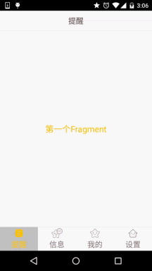
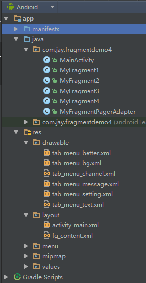

# 5.2.4 Fragment实例精讲——底部导航栏+ViewPager滑动切换页面

> 来源: https://www.runoob.com/w3cnote/android-tutorial-fragment-demo4.html

> 前三节我们分别用不同的方式实现了普通底部导航栏的效果，而本节我们将会在第二个实例的基础上
> 加上ViewPager来实现滑动切换页面的效果！大部分朋友都知道这个ViewPager是什么东西吧，如果
> 不知道没关系，下面我们简单的来介绍一个这个控件！

## 1.ViewPager简单介绍

### 1）是怎么样的一个控件？

> 答：一个页面切换的组件，我们可以往里面填充多个View，然后我们可以通过触摸屏幕左右滑动
> 切换不同的View，和前面学习的ListView一样，我们需要一个Adapter(适配器)，将要显示的View和
> 我们的ViewPager进行绑定，而ViewPager有他自己特定的Adapter——PagerAdapter！另外，Google
> 官方是建议我们使用Fragment来填充ViewPager的,这样可以更加方便的生成每个Page以及管理
> 每个Page的生命周期!当然它给我们提供了两个不同的Adapter，他们分别是：
> **FragmentPageAdapter**和**FragmentStatePagerAdapter**！
> 而我们本节用到的则是前者：FragmentPageAdapter！
> 另外要说一点的是**ViewPager的缓存机制**：
> ViewPager会缓存当前页，前一页，以及后一页，比如有1，2，3，4这四个页面：
> 当我们处于第一页：缓存1，2
> ——> 处于第二页：缓存 1，2，3
> ——> 处于第三页：缓存2，3，4
> ——> 处于第四页缓存3，4这样！

### 2）使用PagerAdapter要重写相关方法：

> - **getCount( )**:获得viewpager中有多少个view

> - **destroyItem( )**:移除一个给定位置的页面。适配器有责任从容器中删除这个视图。这是为了确保
> 在finishUpdate(viewGroup)返回时视图能够被移除。

> - **instantiateItem( )**:①将给定位置的view添加到ViewGroup(容器)中,创建并显示出来
> ②返回一个代表新增页面的Object(key),通常都是直接返回view本身就可以了,
> 当然你也可以自定义自己的key,但是key和每个view要一一对应的关系

> - **isViewFromObject**( ):判断instantiateItem(ViewGroup, int)函数所返回来的Key与一个页面视图是否是
> 代表的同一个视图(即它俩是否是对应的，对应的表示同一个View),通常我们直接写
> return view == object；就可以了,至于为什么要这样讲起来比较复杂,后面有机会进行了解吧
> 貌似是ViewPager中有个存储view状态信息的ArrayList,根据View取出对应信息的吧!

**PS:**不一定要重写所有方法~

## 2.实现效果图以及工程目录结构：

先来看下我们要实现的效果吧

接下来看下我们的项目结构：

## 3.代码实现：

### Step 1：相关资源文件的准备：

PS：我们是在实现底部导航栏方法2的基础上来写的，所以资源文件照搬即可！
这里就不贴多次了~！

### Step 2：编写activity_main.xml的布局文件：

PS：只是把前面的FrameLayout替换成了：android.support.v4.view.ViewPager而已：

**activity_mian.xml**：

### Step 3：编写Fragment的布局以及代码：

PS：这里为了顺便演示ViewPager的机制，特意写成了四个Fragment！在onCreateView中打印创建Log！

**fg_content.xml:
**

**MyFragment1.java**:

其他三个照葫芦画瓢，换点东西就好！

### Step 4：自定义FragmentPagerAdapter类：

代码很简单，只需传递一个FragmentManager过来，其他都在这里完成！

### Step 5：MainActivity的编写：

逻辑很简单，自己看~

**MainActivity.java:**

PS：嘿嘿，上面我把导包部分的代码也贴出来了，就是害怕你们导错包，然后出现一些莫名其妙的错误！
因为ViewPager是v4包下面的，所以Fragment，FragmentManager，FragmentTransaction都是需要使用
V4包下的哦！另外获取FragmentManager的方法不是直接用getFragmentManager()而是使用
getSupportFragmentManager(）哦！

注意：如果 ViewPager 放在 RadioButton 后，RadioButton 的点击事件会失效。

## 4.代码下载：

**FragmentDemo4**：[下载FragmentDemo4.zip](/try/download/FragmentDemo4.zip)

## 本节小结：

> 好的，上面就是底部导航栏 + ViewPager实现简单滑动切换Fragment的实现过程了！
> 就说这么多，谢谢~

### 图片清单

1. 图1 -> images/85621650.jpg （原图：https://www.runoob.com/wp-content/uploads/2015/08/85621650.jpg）
2. 图2 -> images/383165.jpg （原图：https://www.runoob.com/wp-content/uploads/2015/08/383165.jpg）
