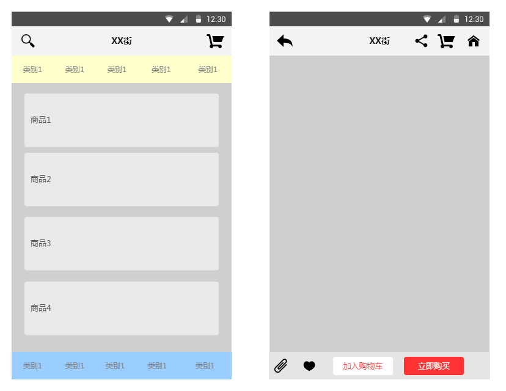
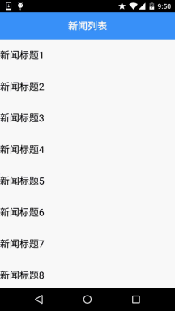

# 5.2.5 Fragment实例精讲——新闻(购物)类App列表Fragment的简单实现

> 来源: https://www.runoob.com/w3cnote/android-tutorial-fragment-demo5.html

## 本节引言：

> 相信大家对点击列表，然后进入详情这种App并不陌生吧，在购物类App和新闻类App中最为常见：
> 下面我们简单来讲一下流程逻辑！

## 1.逻辑流程讲解：

刚好公司测试妹子的测试机上装了楚楚街9块9的APP，呵呵，直接就照这个来研究吧：

嘿嘿，市面上很多APP都是这种样子的，而这个可以用我们学到的Fragment来实现：
可能gif动画看不清，笔者用界面原型工具画个大概吧：

大概就这样，中间区域是一个布局容器，一般是FrameLayout，然后我们将一个Fragment replace
到这个容器中或者add也行，而这个Fragment中有一个listview，当我们点击这个ListView中的一项，
中间容器中的Fragment就会被replace成对应详细信息的Fragment所替代，如果我们只是replace的话，
就不会保存第一个Fragment的状态，用户又得从头开始浏览，这肯定是很不方便的，这里我们可以
通过Fragment栈的addtobackStack和popbackstack来解决这个问题！当replace的同时，我们将被替换
的Fragment添加到stack中，当用户点击回退按钮时，调用popbackstack弹出栈，具体实现见下述代码
示例！

## 2.代码示例：简单新闻类APP列表和内容切换的实现

**运行效果图**：

**实现代码**：

**Step 1**:先把两个Fragment以及Activity的布局实现了

**fg_newlist.xml**:

**fg_context.xml**:

**activity_main.xml**:

---

**Step 2**:实现我们的业务Bean类和自定义BaseAdapter类：

**Data.java:**

**MyAdapter.java**:

**Step 3**:MainActivity的实现

**MainActivity.java**:

**Step 4**:列表Fragment的实现：

**NewListFragment.java**：

---

**Step 5**:内容Fragment的实现：

**NewContentFragment.java**:

代码很简单，就不慢慢解释了~

## 3.代码下载

**FragmentDemo5.zip**：[下载 FragmentDemo5.zip](/try/download/FragmentDemo5.zip)

## 本节小结：

> 因为时间的关系，并没有详细的去做过多的讲解，示例代码也很简单，方便各位初学者理解！
> 如果要用到实际项目中还需要对此进行一番修改~！好的，本节就到这里，谢谢~

### 图片清单

1. 图1 -> images/45752366.jpg （原图：https://www.runoob.com/wp-content/uploads/2015/09/45752366.jpg）
2. 图2 -> images/30802705.jpg （原图：https://www.runoob.com/wp-content/uploads/2015/09/30802705.jpg）
3. 图3 -> images/12913566.jpg （原图：https://www.runoob.com/wp-content/uploads/2015/09/12913566.jpg）
