# 6.1 数据存储与访问之——文件存储读写

> 来源: https://www.runoob.com/w3cnote/android-tutorial-file.html

## 本节引言：

> 嘿嘿，看到这个题目，相信部分读者会问，你前面的Fragment写完了吗？嗯，没写完，因为想例子，需要
> 一点时间，为了提高效率，所以决定像多线程一样，并发的来写教程，这样可能可以加快写教程的进度，
> 到现在为止，刚好写了60篇，离完成入门教程还很远呢，而前面也说过，想在一个半到两个月之内完成
> 这套教程，今天已经9.1号了，要加吧劲~好的，废话就这么多，本节给大家介绍的是Android数据存储与
> 访问方式中的一个——文件存储与读写，当然除了这种方式外，我们可以存到SharedPreference，数据库，
> 或者Application中，当然这些后面都会讲，嗯，开始本节内容~

## 1.Android文件的操作模式

> 学过Java的同学都知道，我们新建文件，然后就可以写入数据了，但是Android却不一样，因为Android是
> 基于Linux的，我们在读写文件的时候，还需加上文件的操作模式，Android中的操作模式如下：

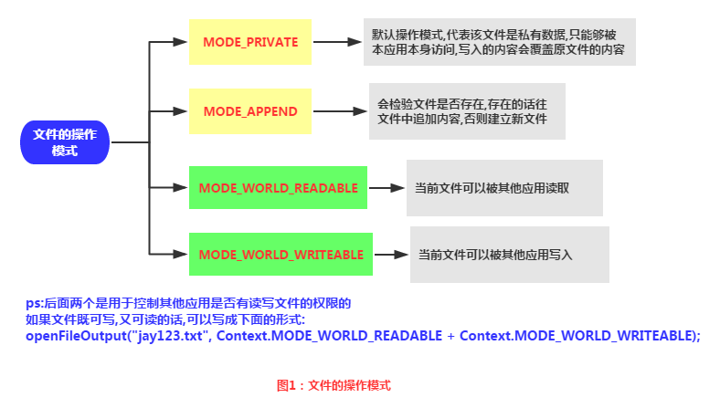

## 2.文件的相关操作方法

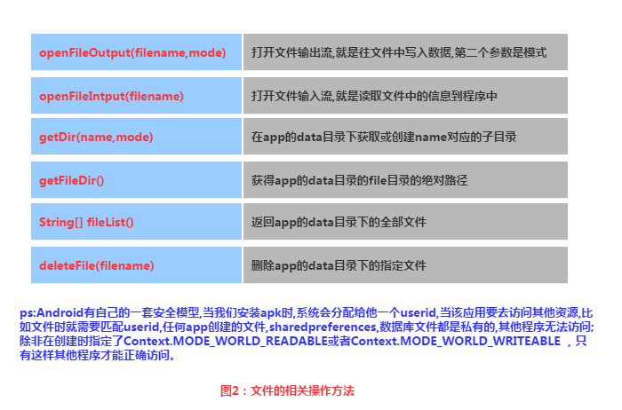

## 3.文件读写的实现

> Android中的文件读写和Java中的文件I/O相同，流程也很简单，下面我们来写个简单的示例：

**实现效果图：**

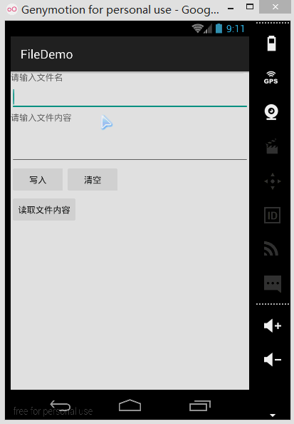

**PS:**这里用的是模拟器，因为笔者的N5并没有root，看不到文件的存储目录，下面我们打开DDMS
的File Exploer可以看到，在data/data/<包名>/file中有我们写入的文件：

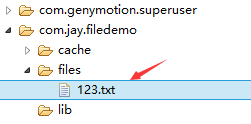

我们可以点击右上角的响应图标将文件导入到电脑中，并且打开验证写入的内容：

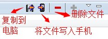 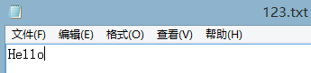

**代码实现：**

首先是布局文件:**main_activity.xml**

然后我们来写一个文件协助类：**FileHelper.java**

最后是**MainActivity.java**，我们在这里完成相关操作：

## 4.读取SD卡上的文件

**读取流程图**：

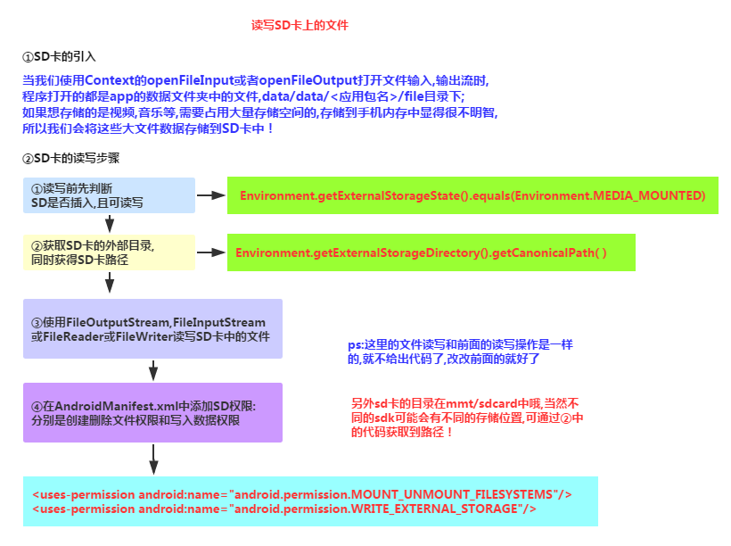

**代码示例**：

**运行效果图**：

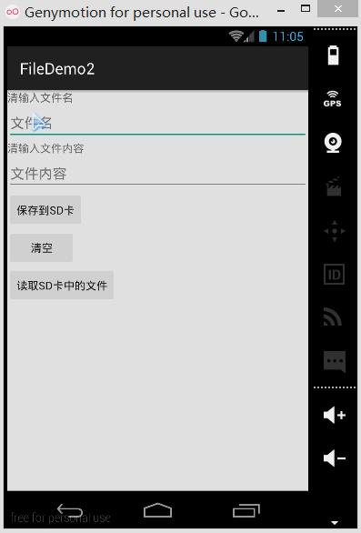

同样打开DDMS的File Explorer，在旧版本的系统上我们可以直接在mmt\sdcard上找到，但是新版本
的就可能需要我们自己找找了，首先我们来到这个路径下：

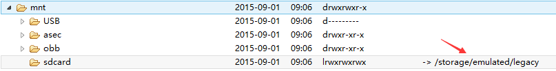

点开sdcard，但是没东西，我们继续找唠叨后面这个/storage/emulated/legacy下找：

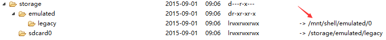

好吧，他又跳到别的地方去了，我们继续找/storage/shell/emilated/0

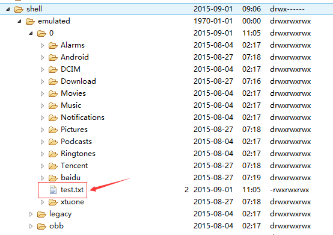

果然找到了，我们在SD卡里生成的test.txt！导出到电脑看下里面的内容：

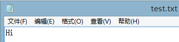

嘿嘿，果然读写SD卡成功~接下来我们来看下代码是怎么写的：

**代码实现：**

**main_activity.xml**:

接着我们来写一个SD操作类：
**
SDFileHelper.java**

接着**MainActivity.java**实现相关逻辑：

最后别忘记在**AndroidManifest.xml**写上读写SD卡的权限哦！

## 5.关于原生模拟器SD卡的问题

> 如果是真机调试的话通常都是可以的,对于原生虚拟机的话就问题多多了,再我们前面使用
> Environment.getExternalStorageState().equals(Environment.MEDIA_MOUNTED)可能
> 一直返回的是false，就是SD卡不存在，这个是主要的问题，现在新版本的SDK都会在
> 创建AVD的时候会同时申请一块SD卡的存储区域的

> 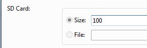

> 对于旧版本的sdk或者其他原因可能需要手动关联下sd卡,设置如下:
> ①找到创建好的avd的镜像的路径:
> 点击打开avd界面,点击detail,查看avd镜像的目录下

> 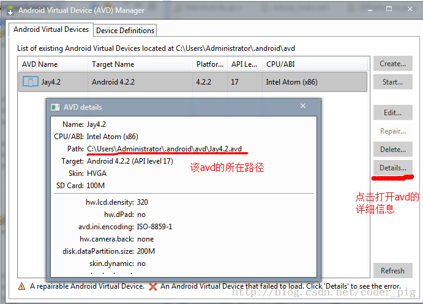

> ②来到avd镜像所在的路径下,复制sdcard.img的路径:
> 比如我的:-sdcard C:\Users\Administrator.android\avd\Jay4.2.avd\sdcard.img

> ③接着点击 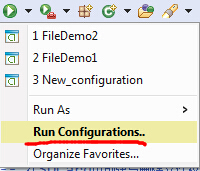来到以下界面:

> 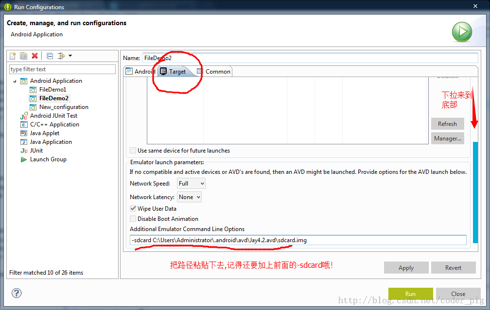

> 最后apply以下,然后Run就可以了!

## 6.读取raw和assets文件夹下的文件

> 相信大家对两个文件夹并不陌生，如果我们不想自己的文件被编译成二进制文件的话，
> 我们可以把文件放到这两个目录下，而两者的区别如下：

> - **res/raw**：文件会被映射到R.java文件中，访问的时候直接通过资源ID即可访问，而且
> 他不能有目录结构，就是不能再创建文件夹

> - **assets**：不会映射到R.java文件中，通过AssetManager来访问，能有目录结构，即，
> 可以自行创建文件夹

**读取文件资源：**

**res/raw**：

**assets**：

## 代码下载：

- **FileDemo.zip：[下载 FileDemo.zip**](/try/download/FileDemo.zip)

- **FileDemo2.zip：[下载 FileDemo2.zip**](/try/download/FileDemo2.zip)

## 本节小结：

> 好的，关于Android的数据存储与访问的第一节——文件读写就到这里，如果在学习本文中
> 遇到什么问题，或者觉得有些纰漏的地方，欢迎提出，万分感激，谢谢~

### 图片清单

1. 图1 -> images/17587054.jpg （原图：https://www.runoob.com/wp-content/uploads/2015/09/17587054.jpg）
2. 图2 -> images/95941036.jpg （原图：https://www.runoob.com/wp-content/uploads/2015/09/95941036.jpg）
3. 图3 -> images/4082095.jpg （原图：https://www.runoob.com/wp-content/uploads/2015/09/4082095.jpg）
4. 图4 -> images/40001362.jpg （原图：https://www.runoob.com/wp-content/uploads/2015/09/40001362.jpg）
5. 图5 -> images/16759834.jpg （原图：https://www.runoob.com/wp-content/uploads/2015/09/16759834.jpg）
6. 图6 -> images/16726891.jpg （原图：https://www.runoob.com/wp-content/uploads/2015/09/16726891.jpg）
7. 图7 -> images/61882958.jpg （原图：https://www.runoob.com/wp-content/uploads/2015/09/61882958.jpg）
8. 图8 -> images/37370373.jpg （原图：https://www.runoob.com/wp-content/uploads/2015/09/37370373.jpg）
9. 图9 -> images/86777176.jpg （原图：https://www.runoob.com/wp-content/uploads/2015/09/86777176.jpg）
10. 图10 -> images/5837462.jpg （原图：https://www.runoob.com/wp-content/uploads/2015/09/5837462.jpg）
11. 图11 -> images/93353911.jpg （原图：https://www.runoob.com/wp-content/uploads/2015/09/93353911.jpg）
12. 图12 -> images/11569692.jpg （原图：https://www.runoob.com/wp-content/uploads/2015/09/11569692.jpg）
13. 图13 -> images/81668082.jpg （原图：https://www.runoob.com/wp-content/uploads/2015/09/81668082.jpg）
14. 图14 -> images/10371041.jpg （原图：https://www.runoob.com/wp-content/uploads/2015/09/10371041.jpg）
15. 图15 -> images/10334659.jpg （原图：https://www.runoob.com/wp-content/uploads/2015/09/10334659.jpg）
16. 图16 -> images/93554732.jpg （原图：https://www.runoob.com/wp-content/uploads/2015/09/93554732.jpg）
