# 6.2 数据存储与访问之——SharedPreferences保存用户偏好参数

> 来源: https://www.runoob.com/w3cnote/android-tutorial-sharedpreferences.html

## 本节引言：

> 本节给大家介绍的是第二种存储用户数据的方式，使用SharedPreferences(保存用户偏好参数)保存数据，
> 当我们的应用想要保存用户的一些偏好参数，比如是否自动登陆，是否记住账号密码,是否在Wifi下才能
> 联网等相关信息,如果使用数据库的话,显得有点大材小用了！我们把上面这些配置信息称为用户的偏好
> 设置，就是用户偏好的设置，而这些配置信息通常是保存在特定的文件中！比如windows使用ini文件，
> 而J2SE中使用properties属性文件与xml文件来保存软件的配置信息;而在Android中我们通常使用
> 一个轻量级的存储类——SharedPreferences来保存用户偏好的参数！SharedPreferences也是使用xml文件,
> 然后类似于Map集合,使用键-值的形式来存储数据;我们只需要调用SharedPreferences的getXxx(name),
> 就可以根据键获得对应的值！使用起来很方便！

## 1.SharedPreferences使用示例：

**使用流程图**：

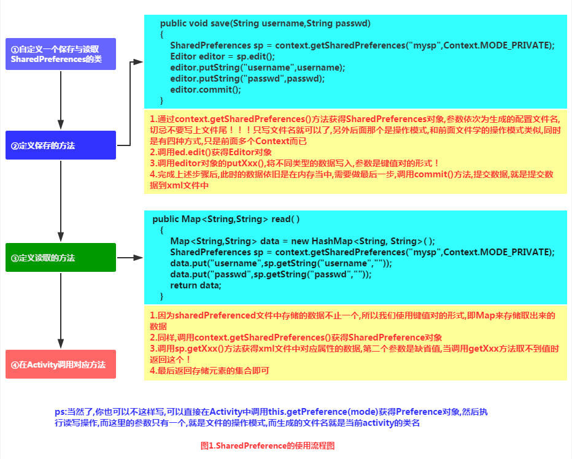

**实现代码示例**：

**运行效果图**：

流程是输入账号密码后点击登录,将信息保存到SharedPreference文件中,
然后重启app,看到数据已经显示在文本框中了

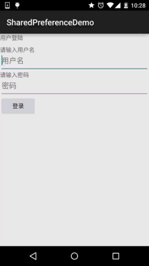

另外保存后，我们可以在File Expoler打开data/data/<包名>可以看到在shared_prefs目录下
生成了一个xml文件(因为N5没root，这里找了以前的效果图)：

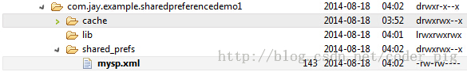

点击导出到桌面可以看到里面的内容:

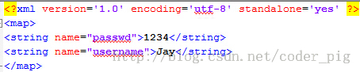

**代码实现**：

布局文件**activity_main.xml**的编写：

编写简单的SP工具类：**SharedHelper.java**：

最后是**MainActivity.java**实现相关逻辑：

## 2.读取其他应用的SharedPreferences

> **核心**：
> 获得其他app的Context,而这个Context代表访问该app的全局信息的接口,而决定应用的唯一标识
> 是应用的包名,所以我们可以通过应用包名获得对应app的Context
> 另外有一点要注意的是：其他应用的SP文件是否能被读写的前提就是SP文件是否指定了可读或者
> 可写的权限，我们上面创建的是MODE_PRIVATE的就不可以了~所以说你像读别人的SP里的数据，
> 很难，另外，一些关键的信息，比如密码保存到SP里，一般都是会做加密的，所以只能自己写自己玩~
> 等下会讲下常用的MD5加密方法！

**实现流程图**：

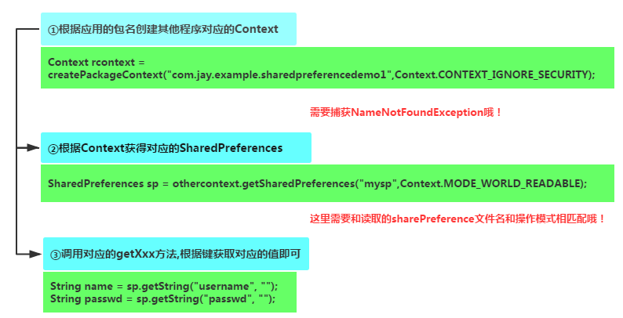

**代码示例：**

**运行效果图**：

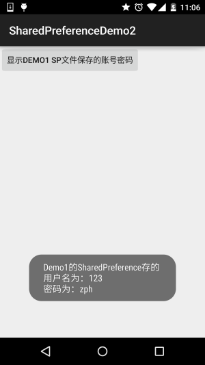

**代码实现**：

我们读取SP的操作放在MainActivity.java中完成，点击按钮后读取SP，并通过Toast显示出来：

## 3.使用MD5对SharedPreference的重要数据进行加密

> 嘿嘿，上面我们这样直接把账号密码保存到sp里，如果没root的手机，别的应用倒无法访问手机，
> 如果root了，然后数据给其他应用获取到，然后造成了一些后果，这...就不怪我们了，哈哈，
> 谁叫你root了~，这锅我们不背，的确是这样！但是作为一名有责任心的APP开发人员，我们总不能
> 这样是吧，我们可以使用一些加密算法对用户密码进行加密，另外我们一般加密的都是用户密码！
> 下面我们简画个简单的图帮助大家理解下加密的处理的流程：

### 1.简单的加密处理流程

**流程图如下**：

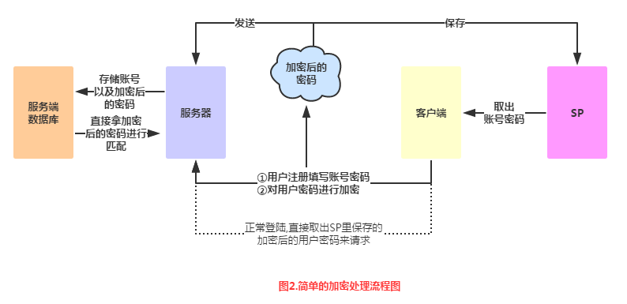

**流程图解析**：

> - **Step 1**.用户注册账号密码，账号密码校验后(账号是否重复，密码位数 > 6位等)，
> 即账号密码有效，注册成功后，我们提交给服务器的账号，以及本地加密过的密码！

> - **Step 2**.服务器端将用户提交的账号，加密过的密码保存到服务端的数据库中，也就是服务
> 端并不会保存我们的明文密码(原始)密码！

> - **Step 3**.说回客户端，如果注册成功或者登陆成功，你想保存账号密码到SP中，保存的的密码
> 也需要走一趟加密流程！即明文密码——>加密，再保存！如果不保存，每次请求的时候，明文密码
> 也要走一趟家里流程，然后拿着加密后的密码来请求服务器！

> - **Step 4**.服务器验证账号以及加密密码，成功，分配客户端一个session标识，后续客户端可以拿着
> 这个session来访问服务端提供的相关服务！

嘿嘿，理解了吧，加密的方法有很多种，小猪也不是这方面的高玩，以前使用过的加密方法是MD5
加密，本节也给大家简单介绍一下这个MD5加密，以及演示下用法~

### 2.MD5简单介绍：

**1）MD5是什么鬼？：**

> 答：Message Digest Algorithm MD5（中文名为消息摘要算法第五版）为计算机安全领域广泛
> 使用的一种散列函数，用以提供消息的完整性保护——摘自《百度百科》
> 简单点说就是一种加密算法，可以将一个字符串，或者文件，压缩包，执行MD5加密后，
> 就可以生产一个固定长度为128bit的串！这个串基本唯一！另外我们都知道:一个十六进制
> 需要用4个bit来表示，那么对应的MD5的字符串长度就为：128 / 4 = 32位了！另外可能
> 你看到一些md5是16位的，只是将32位MD5码去掉了前八位以及后八位！不信么，我们来试试
> 百度一下：md5在线解密，第一个：[http://www.cmd5.com/](http://www.cmd5.com/)

> 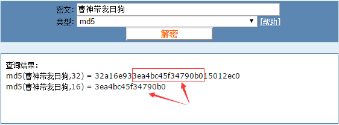

**2）MD5能破解吗？**

> 答：MD5不可逆，就是说没有对应的算法，无法从生成的md5值逆向得到原始数据！
> 当然暴力破解除外，简单的MD5加密后可以查MD5库~

**3）MD5值唯一吗？**

> 答：不唯一，一个原始数据只对应一个MD5值，但是一个MD5值可能对应多个原始数据！

### 3.MD5加密实现例子：

其实网上有很多写好的MD5的例子，百度或者谷歌一搜一大堆，这里提供下小猪用的MD5加密工具类！

**Md5Util.java**：

**MainActivity.java**直接调用getMD5这个静态方法：

我们可以看到Logcat上打印出：

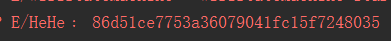

这就是加密过后的呵呵了，我们可以把这串密文拷贝到上面这个md5的在线解密网站：

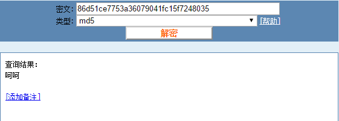

嘿嘿，果然，只是这样加密一次，就直接破解了，有点不安全的样子，那就加密100次咯，
就是将加密后的字符串再加密，重复100次，我们在原先的基础上加个加密一百次的方法：

然后调用下，发现打印这个的Log：

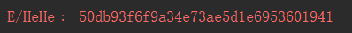

复制界面网站上：

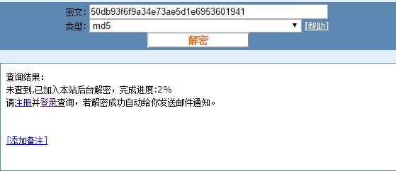

好的，装B成功~

## 4.SharedPreference工具类：

> 每次都要自行实例化SP相关的类，肯定很麻烦，这里贴个SP的工具类，大家可以贴到
> 自己的项目中，工具类来源于鸿洋大神的blog~

**SPUtils.java**

## 5.代码下载：

**SharedPreferenceDemo.zip**：[下载 SharedPreferenceDemo.zip](/try/download/SharedPreferenceDemo.zip)
**SharedPreferenceDemo2.zip**：[下载 SharedPreferenceDemo2.zip](/try/download/SharedPreferenceDemo2.zip)
**SharedPreferenceDemo3.zip**：[下载 SharedPreferenceDemo3.zip](/try/download/SharedPreferenceDemo3.zip)

## 本节小结：

> 好的，关于Android存储数据的第二种方式：SharedPreference保存用户偏好参数的内容就这么多，
> 应该可以满足你日常开发使用SP的需求，如果有什么遗漏，欢迎提出，谢谢~

### 图片清单

1. 图1 -> images/77015718.jpg （原图：https://www.runoob.com/wp-content/uploads/2015/09/77015718.jpg）
2. 图2 -> images/56032594.jpg （原图：https://www.runoob.com/wp-content/uploads/2015/09/56032594.jpg）
3. 图3 -> images/51008434.jpg （原图：https://www.runoob.com/wp-content/uploads/2015/09/51008434.jpg）
4. 图4 -> images/95851258.jpg （原图：https://www.runoob.com/wp-content/uploads/2015/09/95851258.jpg）
5. 图5 -> images/54316471.jpg （原图：https://www.runoob.com/wp-content/uploads/2015/09/54316471.jpg）
6. 图6 -> images/31896879.jpg （原图：https://www.runoob.com/wp-content/uploads/2015/09/31896879.jpg）
7. 图7 -> images/86646661.jpg （原图：https://www.runoob.com/wp-content/uploads/2015/09/86646661.jpg）
8. 图8 -> images/62809654.jpg （原图：https://www.runoob.com/wp-content/uploads/2015/09/62809654.jpg）
9. 图9 -> images/71453784.jpg （原图：https://www.runoob.com/wp-content/uploads/2015/09/71453784.jpg）
10. 图10 -> images/52984536.jpg （原图：https://www.runoob.com/wp-content/uploads/2015/09/52984536.jpg）
11. 图11 -> images/12090032.jpg （原图：https://www.runoob.com/wp-content/uploads/2015/09/12090032.jpg）
12. 图12 -> images/1147082.jpg （原图：https://www.runoob.com/wp-content/uploads/2015/09/1147082.jpg）
