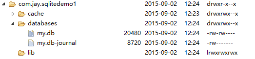
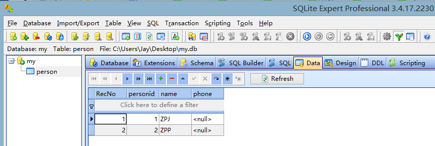
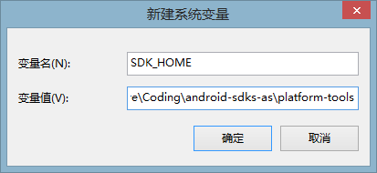
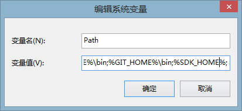
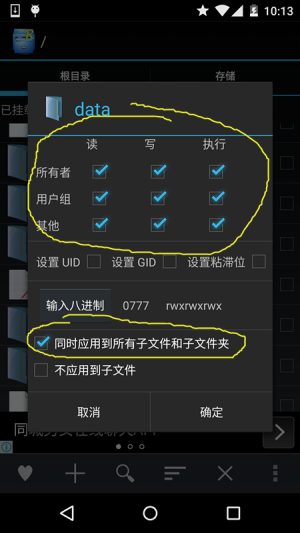
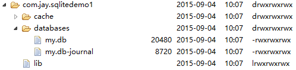
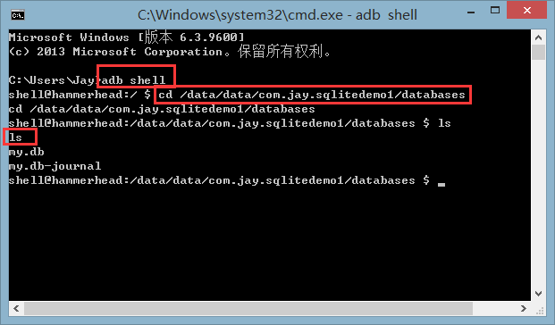
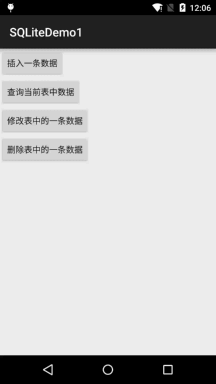

# 6.3.1 数据存储与访问之——初见SQLite数据库

> 来源: https://www.runoob.com/w3cnote/android-tutorial-sqlite-intro.html

## 本节引言：

> 本节我们继续来学习Android数据存储与访问的第三种方式：SQLite数据库，和其他的SQL数据库不同，
> 我们并不需要在手机上另外安装一个数据库软件，Android系统已经集成了这个数据库，我们无需像
> 使用其他数据库软件(Oracle，MSSQL，MySql等)又要安装，然后完成相关配置，又要改端口之类的！
> 引言就说这么多，接下来我们来学习下这个东西~

## 1.基本概念

### 1）SQLite是什么？为什么要用SQLite？SQLite有什么特点？

> 答：下面请听小猪娓娓道来：

> ①SQLite是一个轻量级的关系型数据库，运算速度快，占用资源少，很适合在移动设备上使用，
> 不仅支持标准SQL语法，还遵循ACID(数据库事务)原则，无需账号，使用起来非常方便！

> ②前面我们学习了使用文件与SharedPreference来保存数据,但是在很多情况下，
> 文件并不一定是有效的,如多线程并发访问是相关的；app要处理可能变化的复杂数据结构等等！
> 比如银行的存钱与取钱！使用前两者就会显得很无力或者繁琐，数据库的出现可以解决这种问题，
> 而Android又给我们提供了这样一个轻量级的SQLite，为何不用？

> ③SQLite支持**五种数据类型**:NULL,INTEGER,REAL(浮点数),TEXT(字符串文本)和BLOB(二进制对象)
> 虽然只有五种,但是对于varchar,char等其他数据类型都是可以保存的;因为SQLite有个最大的特点:
> **你可以各种数据类型的数据保存到任何字段中而不用关心字段声明的数据类型**是什么,比如你
> 可以在Integer类型的字段中存放字符串,当然**除了声明为主键INTEGER PRIMARY
> KEY的字段只能够存储64位整数**！ 另外， SQLite 在解析CREATE TABLE 语句时，
> 会忽略 CREATE TABLE 语句中跟在字段名后面的数据类型信息如下面语句会忽略 name字段的类型信息：
> **CREATE TABLE person (personid integer primary key autoincrement, name varchar(20))**

> **小结下特点：**

> SQlite通过**文件**来保存数据库，一个文件就是一个**数据库**，数据库中又包含多个**表格**，表格里又有
> 多条**记录**，每个记录由多个**字段**构成，每个字段有对应的**值**，每个值我们可以指定**类型**，也可以不指定
> 类型(主键除外)

**PS**：对了，Android内置的SQLite是SQLite 3版本的~

### 2）几个相关的类：

> 嘿嘿，学习一些新东西的时候，最不喜欢的莫过于遇到一些新名词，是吧，我们先来说下几个
> 我们在使用数据库时用到的三个类：

> - **SQLiteOpenHelper**：抽象类，我们通过继承该类，然后重写数据库创建以及更新的方法，
> 我们还可以通过该类的对象获得数据库实例，或者关闭数据库！

> - **SQLiteDatabase**：数据库访问类：我们可以通过该类的对象来对数据库做一些增删改查的操作

> - **Cursor**：游标，有点类似于JDBC里的resultset，结果集！可以简单理解为指向数据库中某
> 一个记录的指针！

## 2.使用SQLiteOpenHelper类创建数据库与版本管理

> 对于涉及数据库的app,我们不可能手动地去给他创建数据库文件,所以需要在第一次启用app
> 的时候就创建好数据库表;而当我们的应用进行升级需要修改数据库表的结构时,这个时候就需要
> 对数据库表进行更新了;对于这两个操作,安卓给我们提供了**SQLiteOpenHelper**的两个方法,
> **onCreate**( )**与onUpgrade**( )来实现

**方法解析**：

> - **onCreate(database)**:首次使用软件时生成数据库表

> - **onUpgrade(database,oldVersion,newVersion)**:在数据库的版本发生变化时会被调用，
> 一般在软件升级时才需改变版本号，而数据库的版本是由程序员控制的，假设数据库现在的
> 版本是1，由于业务的变更，修改了数据库表结构，这时候就需要升级软件，升级软件时希望
> 更新用户手机里的数据库表结构，为了实现这一目的，可以把原来的数据库版本设置为2
> 或者其他与旧版本号不同的数字即可！

**代码示例**：

**代码解析**：

> 上述代码第一次启动应用，我们会创建这个my.db的文件，并且会执行onCreate()里的方法，
> 创建一个Person的表，他又两个字段，主键personId和name字段；接着如我我们修改db的版本
> 号，那么下次启动就会调用onUpgrade()里的方法，往表中再插入一个字段！另外这里是插入
> 一个字段，所以数据不会丢失，如果是重建表的话，表中的数据会全部丢失，下一节我们会
> 来教大家如何解决这个问题！

**流程小结**：

> - **Step 1**：自定义一个类继承SQLiteOpenHelper类

> - **Step 2**：在该类的构造方法的super中设置好要创建的数据库名,版本号

> - **Step 3**：重写onCreate( )方法创建表结构

> - **Step 4**：重写onUpgrade( )方法定义版本号发生改变后执行的操作

## 3.如何查看我们生成的db文件

当我们调用上面的MyDBOpenhelper的对象的getWritableDatabase()就会在下述目录下创建我们的db
数据库文件：

我们发现数据库有两个，前者是我们创建的数据库，而后者则是为了能让数据库支持事务而产生的
临时的日志文件！一般的大小是0字节！
而在**File Explorer**里我们确是打不开文件的，连txt都打不开，何况是.db！
所以下面给大家两条路选：

> - 1.先导出来，然后用SQLite的图形化工具查看

> - 2.配置adb环境变量后，通过adb shell来查看(命令行，装比利器)！

嗯，接着给大家演示上述两种方法，选自己喜欢的一种就可以了~~

### 方法1：使用SQLite图形化工具查看db文件

这类软件有很多，笔者用的是SQLite Expert Professional，当然你也可以使用其他工具
又需要的可以下载：[SQLiteExpert.zip](http://pan.baidu.com/s/1eQ5pSwM)

把我们的db文件导出到电脑桌面，打开SQLiteExpert，界面如下：

别问我怎么玩，导入db后自己慢慢玩，用法很简单，不懂百度~

至于方法二，本来是想试试的，后来发现sqlite命令找不到，试了几次就算了，
后面用到在细扣，有兴趣可以找下郭霖的《第一行代码——Android》按着流程图试试！
这里只贴前面的一部分，命令部分自己看书！

### 方法2：adb shell命令行带你装逼带你飞

**1.配置SDK环境变量：**

**右键我的电脑** ——> **高级系统设置** -> **环境变量** -> **新建系统变量** -> 把SDK的platform-tools路径拷贝下：
比如笔者的：**C:\Software\Coding\android-sdks-as\platform-tools**

确定，然后再找到Path的环境变量，编辑，然后在结尾加上：**%SDK_HOME%;**

然后打开命令行，输入adb，唰唰唰一堆东西，就说明配置成功了！

**——————重点——————**：
在执行后续命令行指令之前，针对你的测试的机器可能有几种：
1.**原生模拟器**：那行，你跳过这里，继续往下
2.**Genymotion模拟器**：没戏，Genymotion Shell执行不了下述命令
3.**真机(已root)**：那么你打开**File Explorer**看看data/data/目录下有东西没？没么？
下面提供一个方法，就是先装个**RE文件管理器**，然后授予RE **Root权限**，接着来到根目录：
然后长按data目录，会弹出这样的对话框：

接着等他慢慢修改权限，修改完毕后，我们再次打开DDMS的**File Explorer**，我们可以看到：

好的，可以看到data/data里的东西了！
**——————————————————————**

**2.进入adb shell，接着键入下述指令，来到我们app的databases目录下：**

接着依次输入下述指令：

> - **sqlite3** my.db ：打开数据库文件

> - **.table** 查看数据库中有哪些表
> 接着你直接输入数据库语句就可以了，比如查询：Select * from person

> - **.schema**：查看建表语句

> - **.quit**：退出数据库的编辑

> - **.exit**：退出设备控制台

...因为system/bin/sh sqlite3: not found，这个问题，后面Sqlite命令的都用不了，
要看效果图就自行查询郭大侠的书吧~而下面我们还是先导出db文件，然后用图形化的
数据库工具来查看！

## 4.使用Android提供的API操作SQLite

> 假如你没学过数据库相关的语法，或者你懒，不想写数据库语法，就可以使用Android给我们
> 提供的操作数据库的一些API方法，下面我们写个简单的例子来掩饰下这些API的用法！

**代码示例**：

**运行效果图**：

**实现代码**：

布局过于简单，就四个Button，就不贴了，直接贴**MainActivity.java**的代码：

## 5.使用SQL语句操作数据库

> 当然，你可能已经学过SQL，会写相关的SQL语句，而且不想用Android提供的这些API，
> 你可以直接使用SQLiteDatabase给我们提供的相关方法：

> - **execSQL**(SQL,Object[]):使用带占位符的SQL语句,这个是执行修改数据库内容的sql语句用的

> - **rawQuery**(SQL,Object[]):使用带占位符的SQL查询操作
> 另外前面忘了介绍下 Cursor 这个东西以及相关属性，这里补充下：
> ——**Cursor**对象有点类似于JDBC中的ResultSet,结果集!使用差不多,提供一下方法移动查询结果的记录指针:

> - **move**(offset):指定向上或者向下移动的行数,整数表示向下移动;负数表示向上移动！

> - **moveToFirst**():指针移动到第一行,成功返回true,也说明有数据

> - **moveToLast**():指针移动到最后一样,成功返回true;

> - **moveToNext**():指针移动到下一行,成功返回true,表明还有元素！

> - **moveToPrevious**():移动到上一条记录

> - **getCount**( )获得总得数据条数

> - **isFirst**():是否为第一条记录

> - **isLast**():是否为最后一项

> - **moveToPosition**(int):移动到指定行

使用代码示例：

### 1.插入数据：

### 2.删除数据：

### 3.修改数据：

### 4.查询数据：

### 5.数据分页：

### 6.查询记录数：

**PS**：除了上面获取条数的方法外还可以使用cursor.getCount()方法获得数据的条数,
但是SQL语句要改改！比如**SELECT * FROM person;**

## 本节小结：

> 本节给大家介绍了Android内置SQLite的基本用法，还是比较简单的，下一节再来研究点稍微
> 高级一点的东西，SQLite事务，应用更新数据库里数据怎么处理，以及数据库存储大二进制文件
> 的方法！好的，本节就到这里~

### 图片清单

1. 图1 -> images/76327470.jpg （原图：https://www.runoob.com/wp-content/uploads/2015/09/76327470.jpg）
2. 图2 -> images/11857861.jpg （原图：https://www.runoob.com/wp-content/uploads/2015/09/11857861.jpg）
3. 图3 -> images/34334471.jpg （原图：https://www.runoob.com/wp-content/uploads/2015/09/34334471.jpg）
4. 图4 -> images/94082599.jpg （原图：https://www.runoob.com/wp-content/uploads/2015/09/94082599.jpg）
5. 图5 -> images/91955134.jpg （原图：https://www.runoob.com/wp-content/uploads/2015/09/91955134.jpg）
6. 图6 -> images/52138602.jpg （原图：https://www.runoob.com/wp-content/uploads/2015/09/52138602.jpg）
7. 图7 -> images/64994648.jpg （原图：https://www.runoob.com/wp-content/uploads/2015/09/64994648.jpg）
8. 图8 -> images/96538426.jpg （原图：https://www.runoob.com/wp-content/uploads/2015/09/96538426.jpg）
9. 图9 -> images/91732661.jpg （原图：https://www.runoob.com/wp-content/uploads/2015/09/91732661.jpg）
10. 图10 -> images/43499816.jpg （原图：https://www.runoob.com/wp-content/uploads/2015/09/43499816.jpg）
