# 7.2.1 Android XML数据解析

> 来源: https://www.runoob.com/w3cnote/android-tutorial-xml.html

## 本节引言：

> 前面两节我们对Android内置的Http请求方式：HttpURLConnection和HttpClient，本来以为OkHttp
> 已经集成进来了，然后想讲解下Okhttp的基本用法，后来发现还是要导第三方，算了，放到进阶部分
> 吧，而本节我们来学习下Android为我们提供的三种解析XML数据的方案！他们分别是：
> SAX,DOM,PULL三种解析方式，下面我们就来对他们进行学习！

## 1.XML数据要点介绍

首先我们来看看XML数据的一些要求以及概念：

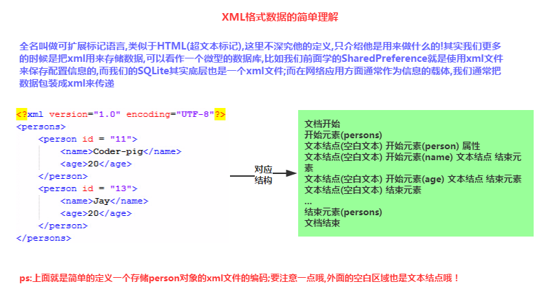

## 2.三种解析XML方法的比较

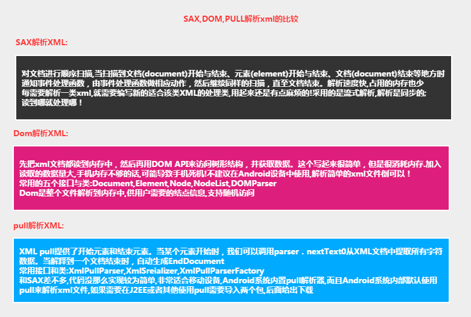

## 3.SAX解析XML数据

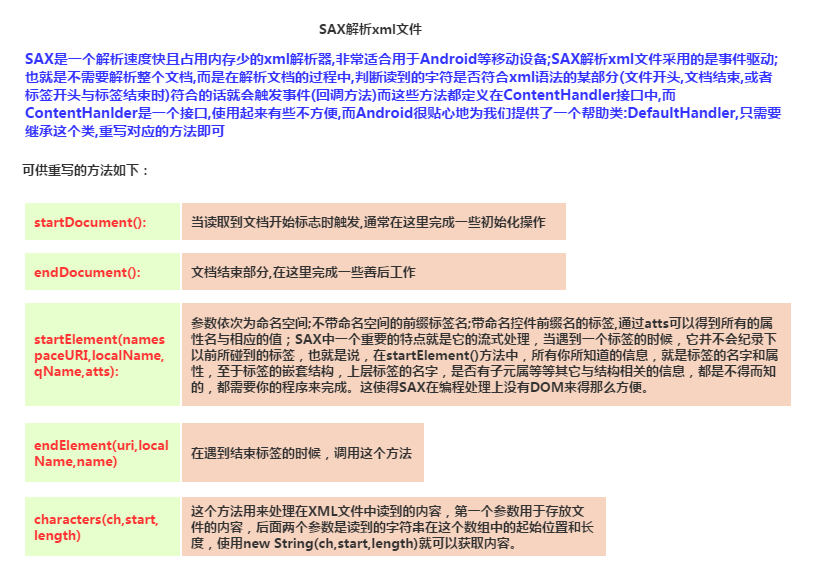

**核心代码**：

SAX解析类：**SaxHelper.java**：

然后我们在MainActivity.java中写上写上这样一个方法，然后要解析XML的时候调用下
就好了~

**一些其他的话**：

嗯，对了，忘记给大家说下我们是定义下面这样一个person1.xml文件，然后放到assets目录下的！
文件内容如下：**person1.xml**

我们是把三种解析方式都糅合到一个demo中，所以最后才贴全部的效果图，这里的话，贴下打印的Log，
相信大家会对SAX解析XML流程更加明了：

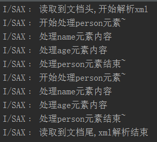

另外，外面的空白文本也是文本节点哦！解析的时候也会走这些节点！

## 4.DOM解析XML数据

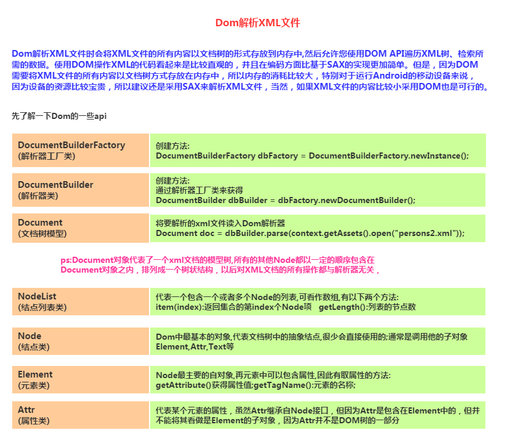

**核心代码**：

**DomHelper.java**

**代码分析**：

> 从代码我们就可以看出DOM解析XML的流程，先整个文件读入Dom解析器，然后形成一棵树，
> 然后我们可以遍历节点列表获取我们需要的数据!

## 5.PULL解析XML数据

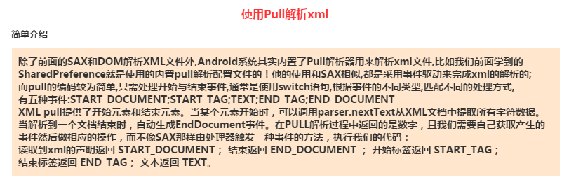

**使用PULL解析XML数据的流程**：

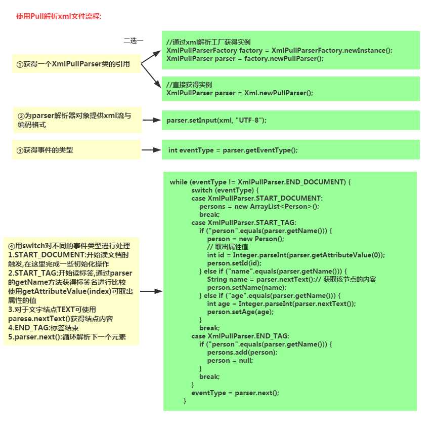

**核心代码**：

**使用Pull生成xml数据的流程**:

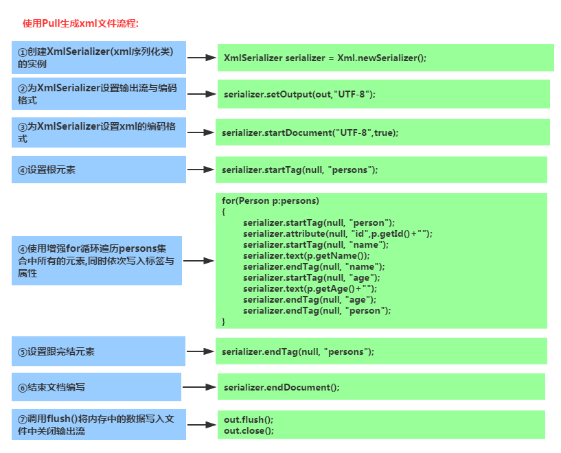

**核心代码**：

## 6.代码示例下载：

**运行效果图**：

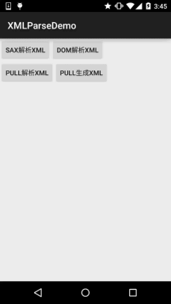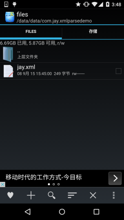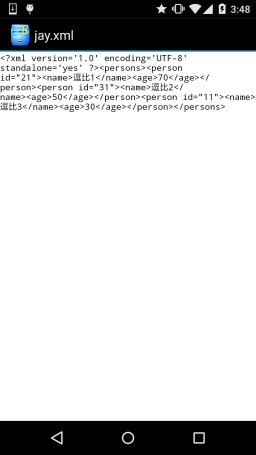

**代码下载**：
**XMLParseDemo.zip**：[下载 XMLParseDemo.zip](/try/download/XMLParseDemo.zip)

## 本节小结：

> 本节介绍了Android中三种常用的XML解析方式，DOM，SAX和PULL，移动端我们建议用后面这
> 两种，而PULL用起来更加简单，这里就不多说了，代码是最好的老师~本节就到这里，下节我们
> 来学习Android为我们提供的扣脚Json解析方式！谢谢~

### 图片清单

1. 图1 -> images/57964990.jpg （原图：https://www.runoob.com/wp-content/uploads/2015/09/57964990.jpg）
2. 图2 -> images/1274926.jpg （原图：https://www.runoob.com/wp-content/uploads/2015/09/1274926.jpg）
3. 图3 -> images/30217214.jpg （原图：https://www.runoob.com/wp-content/uploads/2015/09/30217214.jpg）
4. 图4 -> images/54323937.jpg （原图：https://www.runoob.com/wp-content/uploads/2015/09/54323937.jpg）
5. 图5 -> images/74672487.jpg （原图：https://www.runoob.com/wp-content/uploads/2015/09/74672487.jpg）
6. 图6 -> images/96185982.jpg （原图：https://www.runoob.com/wp-content/uploads/2015/09/96185982.jpg）
7. 图7 -> images/68554165.jpg （原图：https://www.runoob.com/wp-content/uploads/2015/09/68554165.jpg）
8. 图8 -> images/69350628.jpg （原图：https://www.runoob.com/wp-content/uploads/2015/09/69350628.jpg）
9. 图9 -> images/7048078.jpg （原图：https://www.runoob.com/wp-content/uploads/2015/09/7048078.jpg）
10. 图10 -> images/50598560.jpg （原图：https://www.runoob.com/wp-content/uploads/2015/09/50598560.jpg）
11. 图11 -> images/34929030.jpg （原图：https://www.runoob.com/wp-content/uploads/2015/09/34929030.jpg）
