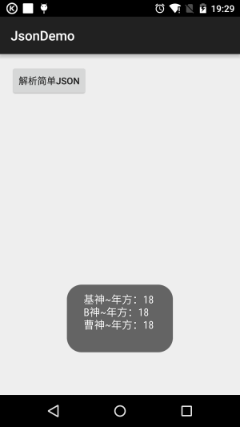
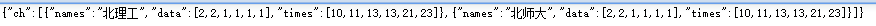
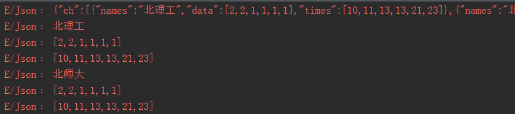

# 7.2.2 Android JSON数据解析

> 来源: https://www.runoob.com/w3cnote/android-tutorial-json.html

## 本节引言：

> 相信大家肯定对 Json 不陌生吧，我们和服务器交互一般用得较多的数据传递方式都是 Json 字符串的形式，
> 保存对象，我们也可以写成一个 Json 字符串然后存储！解析 Json 不知道你用的是 Gson，Fastjson，jackson
> 等，不过本节我们并不会去用这些第三方的解析库，而是使用 Android 自带的 Json 解析器来解析 Json！
> 好的，开始本节内容！

## 1.Json概念以及与XML的比较

**1）Json是什么？**

> 答：JavaScript Object Natation, 一种轻量级的数据交换格式, 与XML一样,
> 广泛被采用的客户端和服务端交互的解决方案！具有良好的可读和便于快速编写的特性。

**2）Json与XML的比较**：

> - JSON和XML的数据可读性基本相同;

> - JSON和XML同样拥有丰富的解析手段

> - JSON相对于XML来讲，数据的体积小

> - JSON与JavaScript的交互更加方便

> - JSON对数据的描述性比XML较差

> - JSON的速度要远远快于XML

> PS:上述来自于百度~简单点说Json的优点：体积小，节省流量，只是不如XML直观，可读性
> 稍微差一点而已！

**3）Json的格式规范**：

> 就像协议一样，肯定是有一套规范的，毕竟双方都是通过Json字符串来传递数据，语法规则如下：
> **数据在名称/值对中**；**数据由逗号分隔**；**花括号保存对象**；**方括号保存数组**；
> 而Json数据的书写格式：**名称/值对** 比如： **"person"："coder-pig"**
> 比如一个简单的Json字符串：

> 我们除了解析Json还可以自己拼接Json，当然如果你自己拼了一个Json字符串又不知道对不对，
> 可以百度随便找一个校验工具，比如：
> [http://www.runoob.com/jsontool](//www.runoob.com/jsontool)把Json字符串贴上去，校验下就好！

## 2.Android给我们提供的Json解析类

> 这些API都存在于org.json包下，而我们用到的类有下面这些：

> - **JSONObject**：
> Json对象，可以完成Json字符串与Java对象的相互转换

> - **JSONArray**：
> Json数组，可以完成Json字符串与Java集合或对象的相互转换

> - **JSONStringer**：
> Json文本构建类，这个类可以帮助快速和便捷的创建JSON text，
> 每个JSONStringer实体只能对应创建一个JSON text

> - **JSONTokener**：Json解析类

> - **JSONException**：Json异常

## 3.代码示例：解析Json字符串：

PS:这里我们就不另外写servlet或者请求网站，直接把Json写到字符串中来解析，模拟下就算了！

### 1)简单的Json字符串解析示例：

我们解析的是上面这个简单的Json，首先我们来写一个POJO类：

**Person.java**：

写一个解析上述Json字符串的方法：

**运行效果图**：

嘿嘿，很简单是吧，接下来我们找一个复杂点的！

### 2)复杂的Json字符串解析示例：

如果是这样的Json字符串呢？

呵呵，那就需要我们一步步来扣数据了：

**解析代码如下**：

**看下打印的Log**:

当然还有一层，有兴趣你就自己扣...

## 本节小结：

> 好的，使用Android给我们提供的扣脚Json解析类果然要慢慢扣，当然你也可以将解析的过程
> 反过来，自己拼接JSON，时间关系，这里就慢慢拼接了，哈哈，当然进阶部分我们
> 学习了第三方的一些Json解析库就轻松多了，~好的，本节就到这里，谢谢~

### 图片清单

1. 图1 -> images/10621891.jpg （原图：https://www.runoob.com/wp-content/uploads/2015/09/10621891.jpg）
2. 图2 -> images/12227965.jpg （原图：https://www.runoob.com/wp-content/uploads/2015/09/12227965.jpg）
3. 图3 -> images/35808866.jpg （原图：https://www.runoob.com/wp-content/uploads/2015/09/35808866.jpg）
