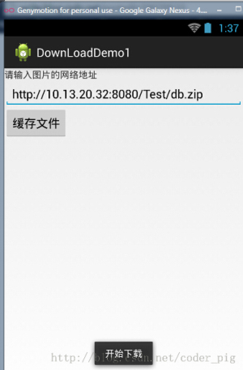
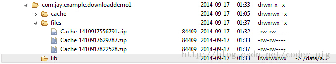
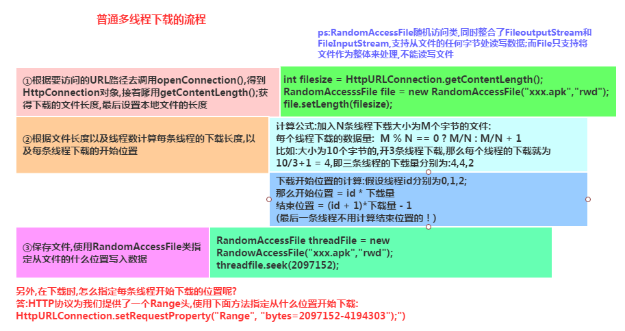
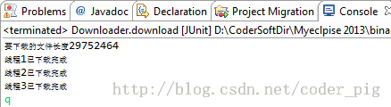
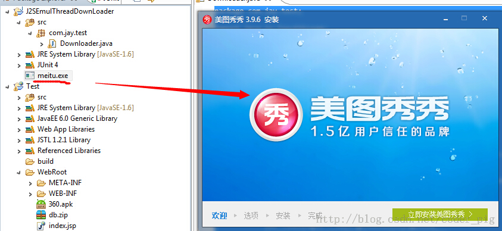

# 7.3.2 Android 文件下载（1）

> 来源: https://www.runoob.com/w3cnote/android-tutorial-download1.html

## 本节引言：

> 又是一个深坑，初学者慎入...本节将从普通的单线程下载 -> 普通多线程下载 ->
>  -> 以及一个很实用的例子：利用Android那只DownloadManager更新apk
> 并覆盖安装的实现代码！好的，这样看上去，本节还是蛮有趣的，开始本节内容！
> PS:我们把整个完整的多线程断点续传放到下一节中！

## 1.普通单线程下载文件：

> 直接使用URLConnection.openStream()打开网络输入流,然后将流写入到文件中！

**核心方法**：

**运行结果**：

## 2.普通多线程下载：

我们都知道使用多线程下载文件可以更快地完成文件的下载,但是为什么呢?

> 答：因为抢占的服务器资源多,假设服务器最多服务100个用户,服务器中的一个线程
> 对应一个用户100条线程在计算机中并发执行,由CPU划分时间片轮流执行,加入a有99条线程
> 下载文件,那么相当于占用了99个用户资源,自然就有用较快的下载速度

**PS**:当然不是线程越多就越好,开启过多线程的话,app需要维护和同步每条线程的开销,
这些开销反而会导致下载速度的降低,另外还和你的网速有关!

**多线程下载的流程**：

> - 获取网络连接

> - 本地磁盘创建相同大小的空文件

> - 计算每条线程需从文件哪个部分开始下载，结束

> - 依次创建，启动多条线程来下载网络资源的指定部分

PS:这里直接创建一个Java项目，然后在JUnit里运行指定方法即可，

**核心代码如下**：

**
运行截图：**

如图,使用多线程完成了对文件的下载!双击exe文件可运行,说明文件并没有损坏!

**注意事项：**

> - int filelength = conn.getContentLength(); //获得下载文件的长度(大小)

> - RandomAccessFile file = new RandomAccessFile(filename, "rwd"); 
> //该类运行对文件进行读写,是多线程下载的核心

> - nt threadlength = filelength % 3 == 0 ? filelength/3:filelength+1;
> //计算每个线程要下载的量

> - conn.setRequestProperty("Range", "bytes="+startposition+"-"); //指定从哪个位置开始读写,这个是URLConnection提供的方法

> - //System.out.println(conn.getResponseCode());
> //这个注释了的代码是用来查看conn的返回码的,我们前面用的都是200,
> 而针对多线程的话,通常是206,必要时我们可以通过调用该方法查看返回码！

> - int quit = System.in.read();while('q' != quit){Thread.sleep(2000);}
> //这段代码是做延时操作的,因为我们用的是本地下载,可能该方法运行完了,而我们的
> 线程还没有开启,这样会引发异常,这里的话,让用户输入一个字符,如果是'q'的话就退出

---

## 3.使用DownloadManager更新应用并覆盖安装：

下面的代码可以直接用，加入到项目后，记得为这个内部广播注册一个过滤器：

**AndroidManifest.xml**

：

## 4.参考代码下载：

普通单线程下载文件：[DownLoadDemo1.zip](//www.runoob.com/wp-content/uploads/2015/09/DownLoadDemo1.zip)
普通多线程下载文件：[J2SEMulDownLoader.zip](//www.runoob.com/wp-content/uploads/2015/09/J2SEmulThreadDownLoader.zip)

## 本节小结：

> 好的，本节给大家介绍了普通单线程以及多线程下载文件，还有利用Android自带DownManager来
> 下载更新APK，然后覆盖的实现！相信会对大家的实际开发带来便利，好的，就说这么多，谢谢~

### 图片清单

1. 图1 -> images/95790312.jpg （原图：https://www.runoob.com/wp-content/uploads/2015/09/95790312.jpg）
2. 图2 -> images/6397185.jpg （原图：https://www.runoob.com/wp-content/uploads/2015/09/6397185.jpg）
3. 图3 -> images/96132016.jpg （原图：https://www.runoob.com/wp-content/uploads/2015/09/96132016.jpg）
4. 图4 -> images/1027899.jpg （原图：https://www.runoob.com/wp-content/uploads/2015/09/1027899.jpg）
5. 图5 -> images/84936685.jpg （原图：https://www.runoob.com/wp-content/uploads/2015/09/84936685.jpg）
6. 图6 -> images/86929807.jpg （原图：https://www.runoob.com/wp-content/uploads/2015/09/86929807.jpg）
