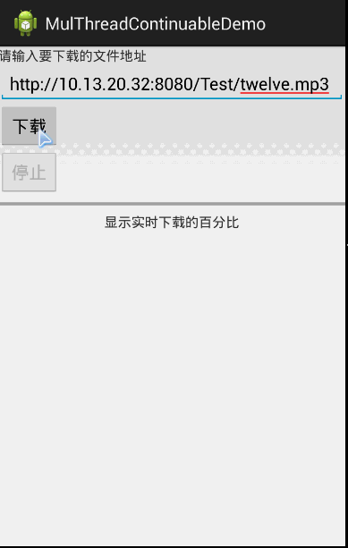

# 7.3.3 Android 文件下载（2）

> 来源: https://www.runoob.com/w3cnote/android-tutorial-download2.html

## 本节引言：

> 本节给大家带来的Android中的多线程断点续传的代码解析，呵呵，为什么叫解析呢？因为我
> 也写不出来，( ╯□╰ )！先来说说断点的意思吧！所谓的断点就是：使用数据库记录每天线程所
> 下载的进度！每次启动时根据线程id查询某线程的下载进度，在继续下载！听上去蛮简单的，
> 要你写十有八九写不出，这很正常，所以本节看懂最好，看不懂也没什么，会用和改就好！
> 好的，开始本节内容~

## Android多线程断点下载的代码流程解析：

**运行效果图**：

**实现流程全解析**：

### Step 1：创建一个用来记录线程下载信息的表

创建数据库表,于是乎我们创建一个数据库的管理器类,继承SQLiteOpenHelper类
重写onCreate()与onUpgrade()方法,我们创建的表字段如下:

**DBOpenHelper.java**：

---

### Step 2：创建一个数据库操作类

我们需要创建什么样的方法呢？

> - ①我们需要一个根据URL获得每条线程当前下载长度的方法

> - 
> ②接着,当我们的线程新开辟后,我们需要往数据库中插入与该线程相关参数的方法

> - 
> ③还要定义一个可以实时更新下载文件长度的方法

> - 
> ④我们线程下载完,还需要根据线程id,删除对应记录的方法

**FileService.java**

### Step 3：创建一个文件下载器类

好了,数据库管理器与操作类都完成了接着就该弄一个文件下载器类了,在该类中又要完成
什么操作呢？要做的事就多了：

> **①**定义一堆变量,核心是线程池threads和同步集合ConcurrentHashMap,用于缓存线程下载长度的
> **②**定义一个获取线程池中线程数的方法;
> **③**定义一个退出下载的方法,
> **④**获取当前文件大小的方法
> **⑤**累计当前已下载长度的方法,这里需要添加一个synchronized关键字,用来解决并发访问的问题
> **⑥**更新指定线程最后的下载位置,同样也需要用同步
> **⑦**在构造方法中完成文件下载,线程开辟等操作
> **⑧**获取文件名的方法:先截取提供的url最后的'/'后面的字符串,如果获取不到,再从头字段查找,还是
> 找不到的话,就使用网卡标识数字+cpu的唯一数字生成一个16个字节的二进制作为文件名
> **⑨**开始下载文件的方法
> **⑩**获取http响应头字段的方法
> **⑪**打印http头字段的方法
> **12**.打印日志信息的方法

**FileDownloadered.java**:

---

### Step 4：自定义一个下载线程类

这个自定义的线程类要做的事情如下：

> - 
> ① 首先肯定是要继承Thread类啦,然后重写Run()方法

> - 
> ② Run()方法:先判断是否下载完成,没有得话:打开URLConnection链接,接着RandomAccessFile
> 进行数据读写,完成时设置完成标记为true,发生异常的话设置长度为-1,打印异常信息

> - 
> ③打印log信息的方法

> - 
> ④判断下载是否完成的方法(根据完成标记)

> - 
> ⑤获得已下载的内容大小

**DownLoadThread.java：**

---

### Step 5：创建一个DownloadProgressListener接口监听下载进度

FileDownloader中使用了DownloadProgressListener进行进度监听,
所以这里需要创建一个接口,同时定义一个方法的空实现:

**DownloadProgressListener.java**:

### Step 6：编写我们的布局代码

另外调用android:enabled="false"设置组件是否可点击, 代码如下

**activity_main.xml**:

---

### Step 7：MainActivity的编写

最后就是我们的MainActivity了,完成组件以及相关变量的初始化;
使用handler来完成界面的更新操作,另外耗时操作不能够在主线程中进行,
所以这里需要开辟新的线程,这里用Runnable实现,详情见代码 吧

**MainActivity.java**:

### Step 8：AndroidManifest.xml文件中添加相关权限

## 参考代码下载：

多线程断点下载器demo：[MulThreadContinuableDemo.zip](//www.runoob.com/wp-content/uploads/2015/09/MulThreadContinuableDemo.zip)

多线程断点下载+在线音乐播放器：[多线程断点下载+在线音乐播放器.zip](//www.runoob.com/wp-content/uploads/2015/09/MulThreadContinuableDemo2-music.zip)

## 本节小结：

> 好的，本节关于Android多线程断点下载的代码解析就这么多，够呛的是把，不过还是
> 那句话，有别人造好的轮子，为什么还要自己造呢？况且现在的我们还能力造出来，
> 不是么，So，暂时弄懂，会用，知道怎么改就好~嗯，就说这么多，谢谢~

### 图片清单

1. 图1 -> images/8403794.jpg （原图：https://www.runoob.com/wp-content/uploads/2015/09/8403794.jpg）
2. 图2 -> images/15853670.jpg （原图：https://www.runoob.com/wp-content/uploads/2015/09/15853670.jpg）
