# 7.4 Android 调用 WebService

> 来源: https://www.runoob.com/w3cnote/android-tutorial-webservice.html

## 本节引言：

> 经过前面的学习，数据请求，数据解析，文件上传下载等，应该满足大家与服务器交互的基本
> 需求了，而本节给大家介绍的Android调用WebService，其实这玩意有点类似于一些给我们提供
> 原始数据API服务的数据平台，比如聚合数据！而WebService则用到了XML和SOAP，通过HTTP协议
> 即可完成与远程机器的交互！嗯，不多说，开始本节内容~

## 1.WebService简介

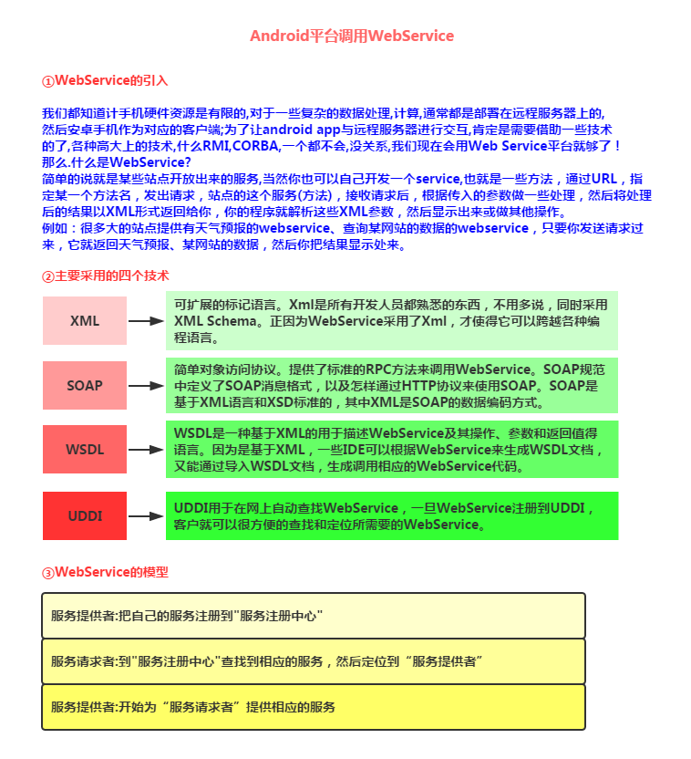

PS：如果看完上面简介还不是很清楚的话，那么就算了，之前公司就用C#搭的一个WebService！
本节我们并不讨论如何去搭建一个WebService，我们仅仅知道如何去获取WebService提供的服务，
然后解析返回的XML数据，然后把相关数据显示到我们的Android设备上就好！

## 2.去哪里获取WebService服务

网上有很多提供WebService的站点，首先找到这些站点，然后获取相应的服务即可！
这里选取WebXml和云聚36wu作为例子给大家讲解下，他们的官网：

**webXml**：[http://www.webxml.com.cn/zh_cn/index.aspx](http://www.webxml.com.cn/zh_cn/index.aspx)

> 以前是免费的，不过都商业化了，很多服务都要收费，但是可以试用~
> 改站点上提供了16个不同的Web服务，可以根据自己的需求，查询相应服务，调用不同的接口！

**webXml的相关页面**：

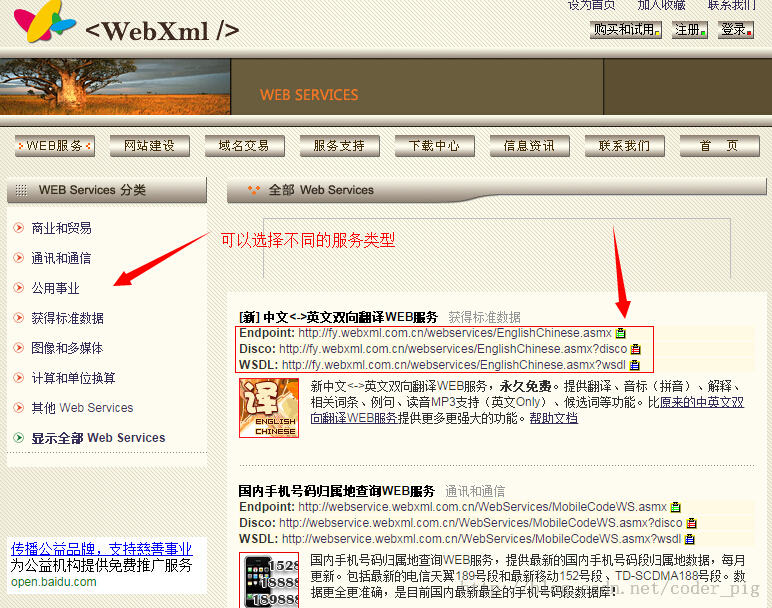

**相关使用次数说明**:

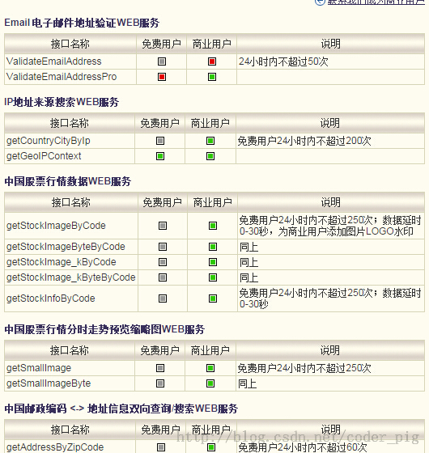

**云聚36wu**：[http://www.36wu.com/Service](http://www.36wu.com/Service)

> 同样也提供了很多的服务,很多手机的app都是用的这里的接口,比如彩虹公交,手机天气等
> 不过,这个也是要收费的=-=,可以试用,不过只能一小时内发送20次请求;
> 点击申请使用,获得key就可以了!两者随便选一个吧!

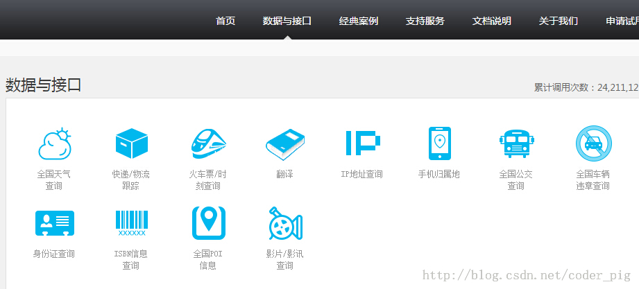

## 3.第三方jar包的准备

> 首先如果想在Android平台上调用WebService需要依赖于第三方类库:ksoap2
> 而在Android平台上,使用的是ksoap2 Android,一个高效,轻量级的SOAP开发包!

> jar包下载地址：[https://code.google.com/p/ksoap2-android/wiki/HowToUse?tm=2](https://code.google.com/p/ksoap2-android/wiki/HowToUse?tm=2)

> 天朝可能上不去，这里提供两个百度云的链接供大家下载使用：

> **2.54版本**：[ksoap2-android 2.54.jar](/try/download/ksoap2-android-assembly-2.5.4-jar-with-dependencies.jar)

> **3.30版本**：[ksoap2-android 3.30.jar](/try/download/ksoap2-android-assembly-3.3.0-jar-with-dependencies.jar)

> 如果所幸你能进入jar包的下载地址的话,那么你会看到下面的界面:

> 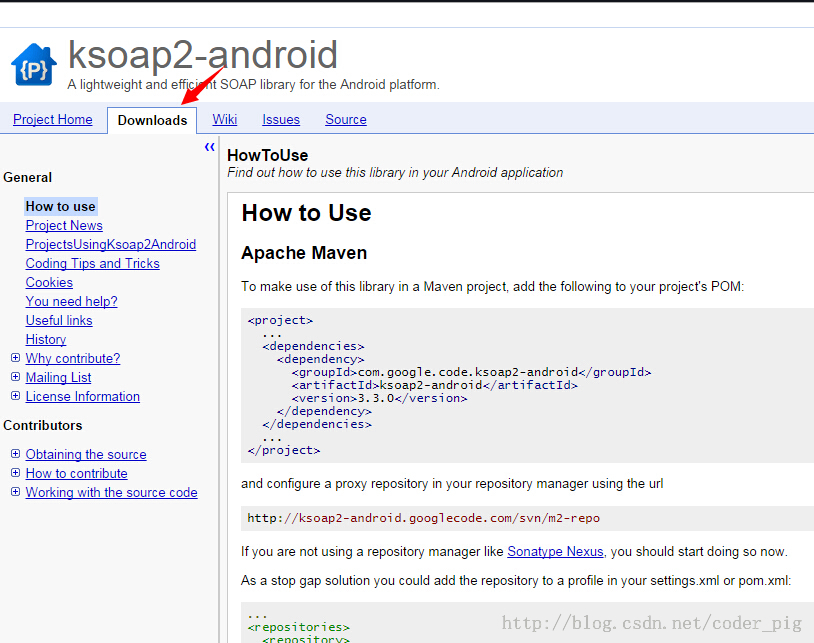

> 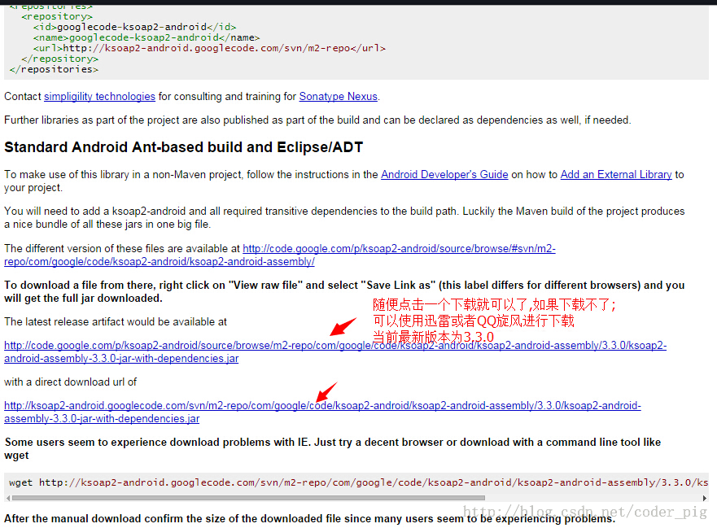

## 4.获取相关的一些参数

> 首先找到我们需要获取的服务，然后记录相关的参数：
> **NameSpace**(命名空间),**SoapAction**以及**URL**就不用说了,其他参数这样找:

> 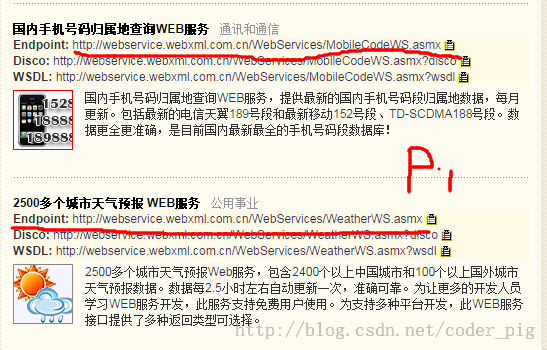

> **比如我们这里找的是天气的查询参数，点进去我们可以看到这样一个参数文档：**

> 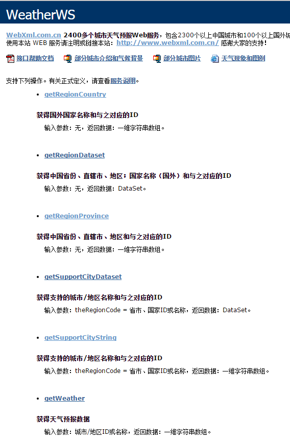

> **比如这里我们需要的是天气查询部分的功能：**

> 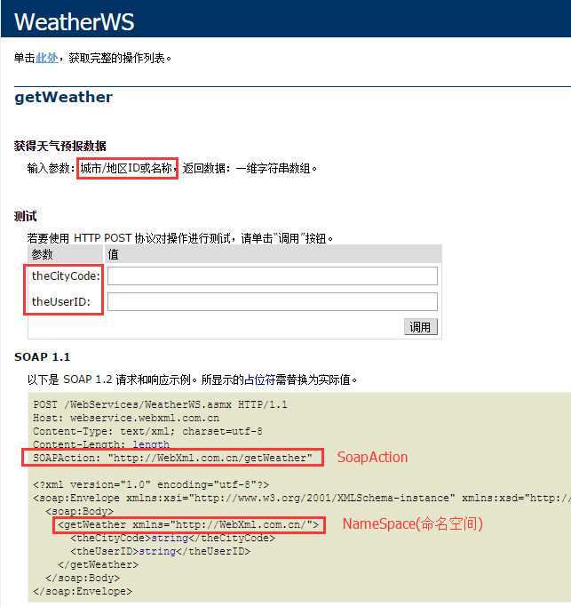

> 先把框住的SoapAction和NameSpace拷贝下来！当然我们可以在这个页面测试，另外
> 我们是免费用户，id可以不填直接跳过，输入后点击调用按钮会打开这样一个页面：

> 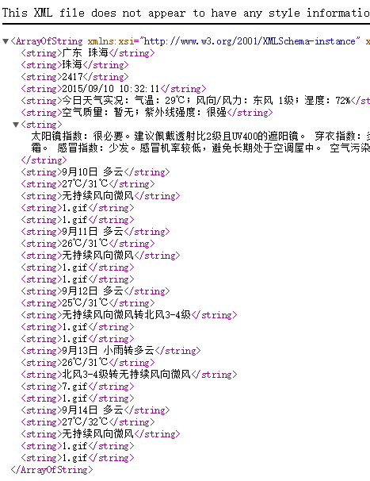

> 嘿嘿，这里就是返回的XML，而我们要做的也就是解析这样一个XML，另外这里的
> .gif代表的是天气图标！

同理，我们再把归属地查询的看下SoapAction，NameSpace以及相关参数mark下！

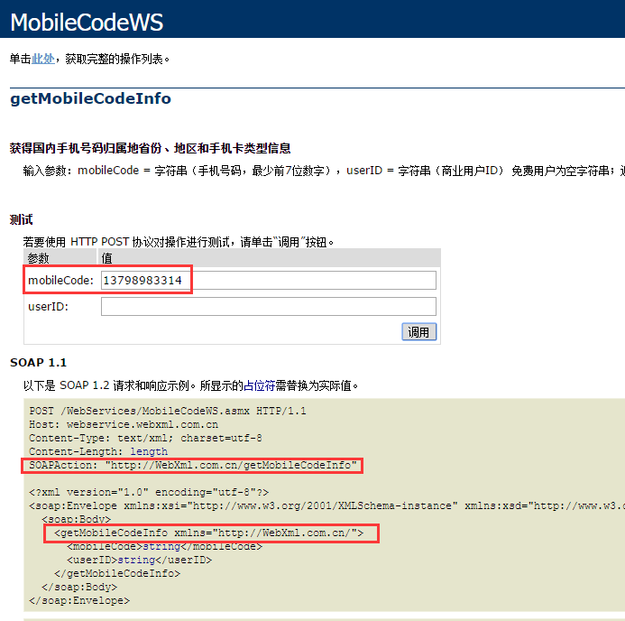

**以及返回后的XML数据**：

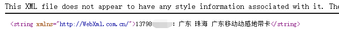

## 5.注册并启用相关WEB服务

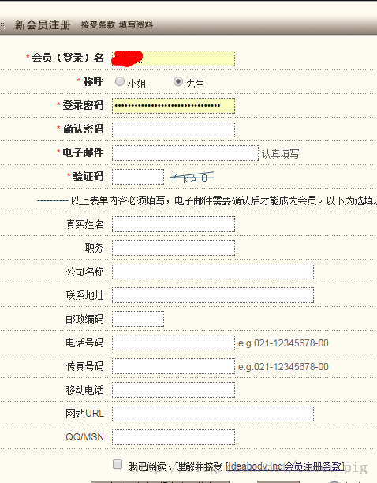

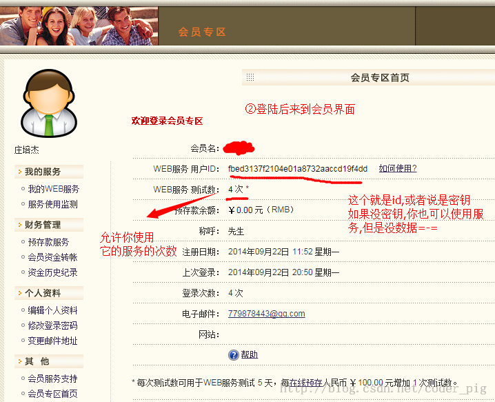

点击我的Web服务器，然后点击试用，WebXML给我们提供了五天的免费试用，
我们把需要的两个服务器开启！

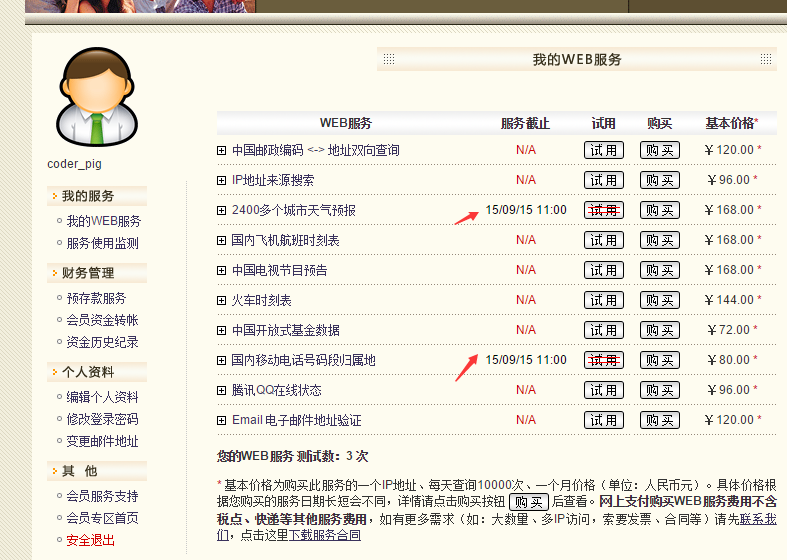

好的，记得mark下我们自己的key哦~

## 6.调用WebService的代码示例

嗯，接下来我们来写代码验证调用WebService的流程：

**运行效果图**：

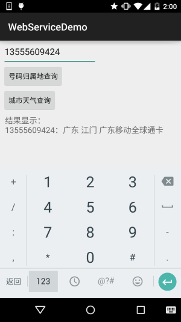

PS:这个号码是以前的号码=-=，别尝试拨打，已经换人了~
另外天气服务好像有写问题，有时并不能获取到，估计是WebXml做的一些限制，
毕竟试用...

**实现代码**：

另外，别忘了导包和Internet的权限！

## 参考代码下载：

**WebServiceDemo.zip**：[下载 WebServiceDemo.zip](/try/download/WebServiceDemo.zip)

## 本节小结：

> 好的，本节关于Android端如何去使用这个WebService就讲解到这里，下一节我们来学习一个
> 类似于浏览器的Android控件——WebView，敬请期待~谢谢~！

### 图片清单

1. 图1 -> images/29885464.jpg （原图：https://www.runoob.com/wp-content/uploads/2015/09/29885464.jpg）
2. 图2 -> images/14506413.jpg （原图：https://www.runoob.com/wp-content/uploads/2015/09/14506413.jpg）
3. 图3 -> images/24990554.jpg （原图：https://www.runoob.com/wp-content/uploads/2015/09/24990554.jpg）
4. 图4 -> images/2918446.jpg （原图：https://www.runoob.com/wp-content/uploads/2015/09/2918446.jpg）
5. 图5 -> images/67390549.jpg （原图：https://www.runoob.com/wp-content/uploads/2015/09/67390549.jpg）
6. 图6 -> images/14715990.jpg （原图：https://www.runoob.com/wp-content/uploads/2015/09/14715990.jpg）
7. 图7 -> images/77830142.jpg （原图：https://www.runoob.com/wp-content/uploads/2015/09/77830142.jpg）
8. 图8 -> images/4860400.jpg （原图：https://www.runoob.com/wp-content/uploads/2015/09/4860400.jpg）
9. 图9 -> images/96394953.jpg （原图：https://www.runoob.com/wp-content/uploads/2015/09/96394953.jpg）
10. 图10 -> images/49499402.jpg （原图：https://www.runoob.com/wp-content/uploads/2015/09/49499402.jpg）
11. 图11 -> images/96494147.jpg （原图：https://www.runoob.com/wp-content/uploads/2015/09/96494147.jpg）
12. 图12 -> images/30595401.jpg （原图：https://www.runoob.com/wp-content/uploads/2015/09/30595401.jpg）
13. 图13 -> images/93886000.jpg （原图：https://www.runoob.com/wp-content/uploads/2015/09/93886000.jpg）
14. 图14 -> images/81129909.jpg （原图：https://www.runoob.com/wp-content/uploads/2015/09/81129909.jpg）
15. 图15 -> images/61530107.jpg （原图：https://www.runoob.com/wp-content/uploads/2015/09/61530107.jpg）
16. 图16 -> images/67585998.jpg （原图：https://www.runoob.com/wp-content/uploads/2015/09/67585998.jpg）
