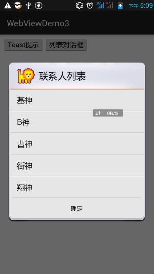
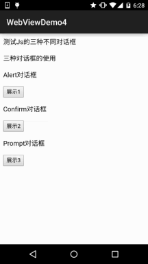
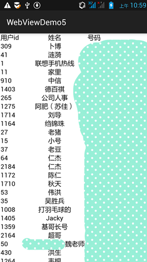
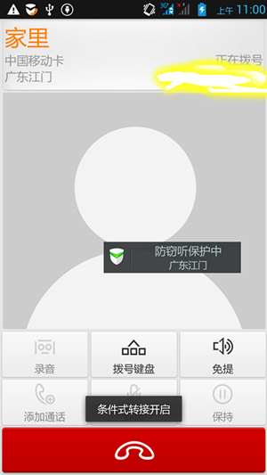

# 7.5.2 WebView和JavaScrip交互基础

> 来源: https://www.runoob.com/w3cnote/android-tutorial-webview-javascrip.html

## 本节引言：

> 在上一节中我们对Android的WebView(网页视图)进行了学习，相信已经了解了WebView的基本用法；

> 而本节我们要学习的就是通过：**HTML** -> **JS** ->**Java**来完成HTML5端与Android手机间的
> 互访！好的，话不多说，有吗有真相，让我们通过编写代码来体验这种微妙的联系吧~

> PS：为了方便，本节用到的HTML都是以文件的形式放到assets目录下，只需通过
> loadUrl("file:///android_asset/~")即可加载对应的HTML~

## 1.核心步骤讲解：

**首先**，我们定义一个类，用于将数据暴露出来，JS通过该类暴露的方法(**Public**)来调用Android！

**接着**，我们在WebView所在页面Activity，使用下述代码:
**webview.getSettings().setJavaScriptEnabled(true);**
**webview.addJavascriptInterface(object,"name");**

然后js或者html中调用name.xxx调用对象里的暴露的方法：
比如： < input type="button" value="Toast提示" onclick="name.showToast('呵呵');"/>
另外，setJavaScriptEnabled是**在Android 4.4以前**的系统才有效！！！下一节我们会来讲解Android 4.4后
WebKit的变化以及要注意的地方！

## 2.使用示例讲解：

### 1）HTML通过JS显示Toast与普通列表的对话框

**运行效果图**：

**代码实现**：

先准备我们的HTML文件，创建好后放到assets目录下：

**demo1.html**:

自定义一个Object对象，js通过该类暴露的方法来调用Android

**MyObject.java**:

最后是**MainActivity.java**，启用JavaScript支持，然后通过addJavascriptInterface暴露对象~

### 2）HTML通过JS调用三种不同的对话框

**运行效果图**：

**实现代码**：

先往assets目录下塞一个html文件：
**demo2.html**：

PS：主布局和prompt布局这里就不贴了！
直接上**MainActivity.java**:

### 3.HTML通过JS读取Android联系人并显示

> 该代码实现的是通过js读取Android手机中联系列表,然后显示到HTML中
> 当我们点击某个电话号码时,会直接跳转到拨号页面
> 实现关键：
> 利用onload()在网页加载的时候加载相应的js脚本,而js脚本中定义的一个函数是
> 取出传递过来的对象,获取里面的数据,通过for循环以单元行的形式打印出来！

**运行效果图**：

实现代码：

往assets文件夹下编写要给**demo3.html**文件，内容如下：

再写一个业务类**Contact.java：**

再写一个业务类**Contact.java**：

好的，就是那么简单，但是，当你看到效果示意图，我祭出的是我大联想而非N5，就说明了，上述代码
在N5中执行不了，因为在4.4以后addJavascriptInterface()就不可以用了~至于为什么，我们会在下节课
中对WebView在4.4后的注意事项跟大家说下~

## 代码下载：

WebViewDemo4：[下载 WebViewDemo4.zip](/try/download/WebViewDemo4.zip)

WebViewDemo5：[下载 WebViewDemo5.zip](/try/download/WebViewDemo5.zip)

## 本节小结：

> 好的，本节我们对WebView和JavaScrip交互进行了简单的学习，有点意思是吧~，如果你会
> HTML + CSS + JS，那么你可以尝试着自己创建一个HTML5端的移动APP试试~本节就说这么多，
> 谢谢~

### 图片清单

1. 图1 -> images/95799440.jpg （原图：https://www.runoob.com/wp-content/uploads/2015/09/95799440.jpg）
2. 图2 -> images/14220406.jpg （原图：https://www.runoob.com/wp-content/uploads/2015/09/14220406.jpg）
3. 图3 -> images/79140005.jpg （原图：https://www.runoob.com/wp-content/uploads/2015/09/79140005.jpg）
4. 图4 -> images/66051621.jpg （原图：https://www.runoob.com/wp-content/uploads/2015/09//66051621.jpg）
5. 图5 -> images/77471599.jpg （原图：https://www.runoob.com/wp-content/uploads/2015/09//77471599.jpg）
