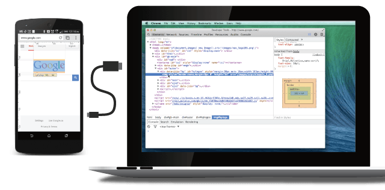
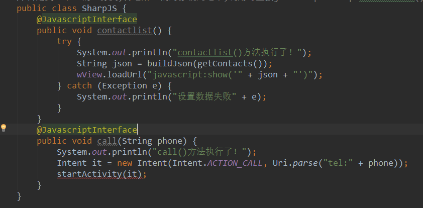
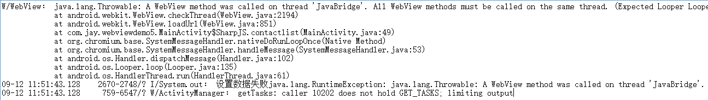
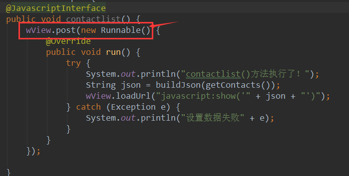
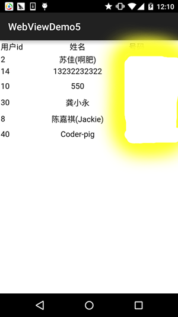

# 7.5.3 Android 4.4后WebView的一些注意事项

> 来源: https://www.runoob.com/w3cnote/android-tutorial-webview-attention.html

## 本节引言：

> 本节参考原文：[Android 4.4 中 WebView 使用注意事项.md](https://github.com/cundong/blog/blob/master/Android%204.4%20%E4%B8%AD%20WebView%20%E4%BD%BF%E7%94%A8%E6%B3%A8%E6%84%8F%E4%BA%8B%E9%A1%B9.md)

> 从Android 4.4开始，Android中的WebView不再是基于WebKit的，而是开始基于Chromium，这个改变
> 使得WebView的性能大幅提升，并且对HTML5，CSS，JavaScript有了更好的支持！

> 虽然chromium完全取代了以前的WebKit for Android，但Android WebView的API接口并没有变，
> 与老的版本完全兼容。这样带来的好处是基于WebView构建的APP，无需做任何修改，
> 就能享受chromium内核的高效与强大。

> 对于4.4后的WebView，我们需要注意下下面这些问题：

## 1.多线程

> 如果你在子线程中调用WebView的相关方法，而不在UI线程，则可能会出现无法预料的错误。
> 所以，当你的程序中需要用到多线程时候，也请使用runOnUiThread()方法来保证你关于
> WebView的操作是在UI线程中进行的：

## 2.线程阻塞

> 永远不要阻塞UI线程，这是开发Android程序的一个真理。虽然是真理，我们却往往不自觉的
> 犯一些错误违背它，一个开发中常犯的错误就是：在UI线程中去等待JavaScript 的回调。
> 例如：

千万不要这样做，Android 4.4中，提供了新的Api来做这件事情。
evaluateJavascript() 就是专门来异步执行JavaScript代码的。

## 3.evaluateJavascript() 方法

> 专门用于异步调用JavaScript方法，并且能够得到一个回调结果。

**示例**：

## 4.处理WebView中url的跳转

> 新版WebView对于自定义scheme的url跳转，新增了更为严格的限制条件。 当你实现了 shouldOverrideUrlLoading() 或 shouldInterceptRequest() 回调，WebView 也只会在跳转url是合法Url时才会跳转。
> 例如，如果你使用这样一个url ：

shouldOverrideUrlLoading() 将不会被调用。

正确的使用方式是：

对应的检测Url跳转的方式：

当然，也可以这样使用：

## 5.UserAgent变化

> 如果你的App对应的服务端程序，会根据客户端传来的UserAgent来做不同的事情，那么你需要注意
> 的是，新版本的WebView中，UserAgent有了些微妙的改变：

使用**getDefaultUserAgent()**方法可以获取默认的UserAgent，也可以通过：

来设置和获取自定义的UserAgent。

## 6.使用addJavascriptInterface()的注意事项

> 从Android4.2开始。 只有添加 @JavascriptInterface 声明的Java方法才可以被JavaScript调用，
> 例如：

## 7.Remote Debugging

> 新版的WebView还提供了一个很厉害的功能：使用Chrome来调试你运行在WebView中的程序
> 具体可以看：[remote-debugging](https://developers.google.com/chrome-developer-tools/docs/remote-debugging)
> PS：需要梯子~你也可以直接百度remote-debugging了解相关信息，以及如何使用！
> 

## 上一节中N5读取联系人的问题解决：

> 嘿嘿，看完上面的，我们知道在Android4.2后，只有添加 @JavascriptInterface
> 声明的Java方法才可以被JavaScript调用，于是乎我们为之前的两个方法加上@JavascriptInterface

但是，加完以后，并没有和我们的预想一样，出现我们想要的联系人列表，这是为什么呢？
我们通过查看Log发现下面这样一段信息：

大概的意思就是：所有的WebView方法都应该在同一个线程程中调用，而这里的contactlist方法却在
JavaBridge线程中被调用了！所以我们要要把contactlist里的东东写到同一个线程中，比如一种解决
方法，就是下面这种：

嘿嘿，接下来运行下程序，神奇的发现，我们N5的手机联系人可以读取到了~

同理，之前第一个示例也可以这样解决~

## 本节小结：

> 本节跟大家走了一趟Android 4.4后WebView要注意的事项，以及一些对上一节中N5问题
> 的解决~相信会给大家在实际开发中使用WebView带来便利~谢谢

### 图片清单

1. 图1 -> images/69982214.jpg （原图：https://www.runoob.com/wp-content/uploads/2015/09/69982214.jpg）
2. 图2 -> images/15501988.jpg （原图：https://www.runoob.com/wp-content/uploads/2015/09/15501988.jpg）
3. 图3 -> images/53511153.jpg （原图：https://www.runoob.com/wp-content/uploads/2015/09/53511153.jpg）
4. 图4 -> images/81470524.jpg （原图：https://www.runoob.com/wp-content/uploads/2015/09/81470524.jpg）
5. 图5 -> images/3820375.jpg （原图：https://www.runoob.com/wp-content/uploads/2015/09/3820375.jpg）
