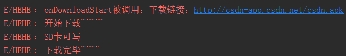
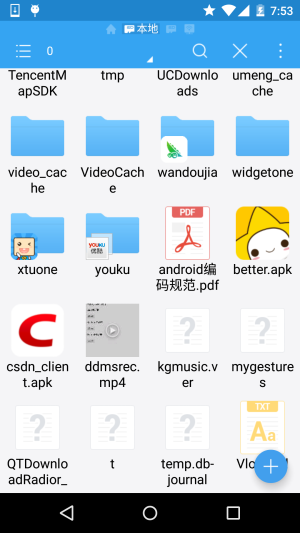

# 7.5.4 WebView文件下载

> 来源: https://www.runoob.com/w3cnote/android-tutorial-webview-download-file.html

## 本节引言

> 本节给大家介绍的是WebView下载文件的知识点，当我们在使用普通浏览器的时候，比如UC，
> 当我们点击到一个可供下载链接的时候，就会进行下载，WebView作为一个浏览器般的组件，
> 当然也是支持下载，我们可以自己来写下载的流程，设置下载后的文件放哪，以什么文件名
> 保存，当然也可以调用其它内置的浏览器来进行下载，比如Chrome，UC等等！
> 下面给大家演示下用法！

## 1.调用其它浏览器下载文件：

> 这个很简单，我们只需为WebView设置setDownloadListener，然后重写DownloadListener的
> onDownloadStart，然后在里面写个Intent，然后startActivity对应的Activity即可！

**关键代码如下**：

如果你手机内存在多个浏览器的话，会打开一个对话框供你选择其中一个浏览器进行下载~

## 2.自己写线程下载文件

> 当然，你可能不想把下载文件放到默认路径下，或者想自己定义文件名等等，你都可以自己来写
> 一个线程来下载文件，实现示例代码如下：

**核心代码**：

我们自己另外写一个下载的线程类：

**DownLoadThread.java**

然后**MainActivity.java**中创建并启动该线程：

**运行结果**：

我们打开SD卡可以看到，下载好的文件已经安安静静地躺在SD卡里了：

**注意事项**：

好的，另外，别忘了写SD卡的读写权限以及Internet访问网络的权限：

还有，**in = conn.getInputStream()**;要写在conn设置完所有东西的后面！！切记，不然什么都读不了！

## 本节小结：

> 本节非常简单，代码就不贴出了，其实就是setDownloadListener这个玩意，自己重写下
> onDownloadStart方法来处理下载过程而已~，本节就到这里，谢谢~

### 图片清单

1. 图1 -> images/9992949.jpg （原图：https://www.runoob.com/wp-content/uploads/2015/09/9992949.jpg）
2. 图2 -> images/3865809.jpg （原图：https://www.runoob.com/wp-content/uploads/2015/09/3865809.jpg）
