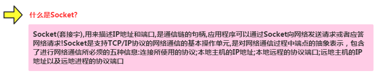
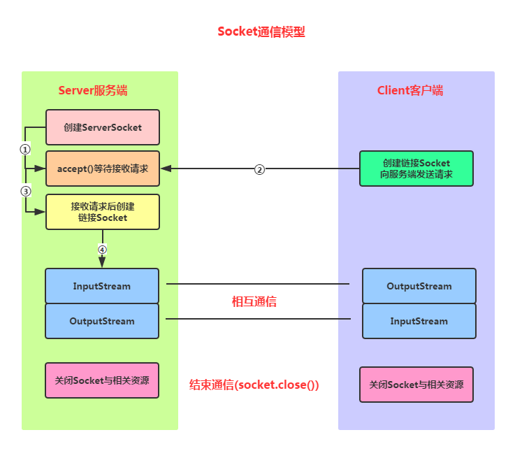
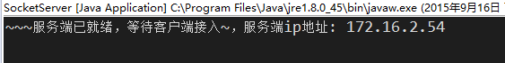
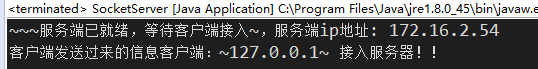
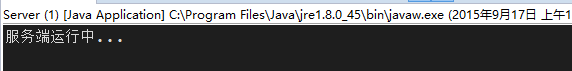
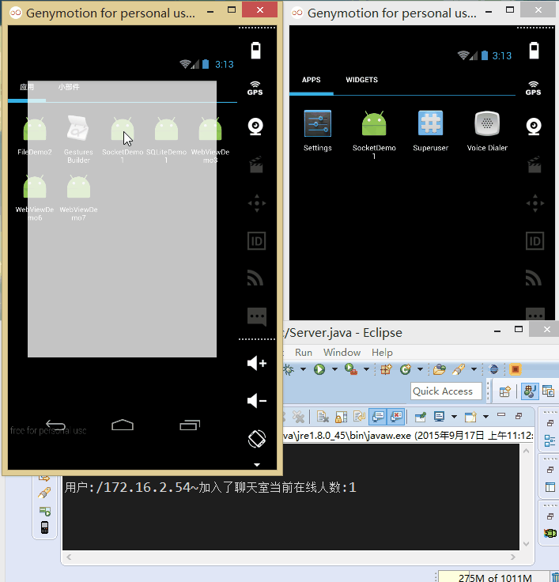

# 7.6.2 基于TCP协议的Socket通信(1)

> 来源: https://www.runoob.com/w3cnote/android-tutorial-socket1.html

## 本节引言：

> 上一节的概念课枯燥无味是吧，不过总有点收获是吧，本节开始我们来研究基于TCP协议的Socket
> 通信，先来了解下Socket的概念，以及Socket通信的模型，实现Socket的步骤，以及作为Socket服务
> 端与客户端的两位各做要做什么事情！好的，我们由浅入深来扣这个Socket吧！

## 1.什么是Socket？

## 2.Socket通信模型：

**Socket通信实现步骤解析**：

> **Step 1**：创建ServerSocket和Socket

> **Step 2**：打开连接到的Socket的输入/输出流

> **Step 3**：按照协议对Socket进行读/写操作

> **Step 4**：关闭输入输出流，以及Socket

好的，我们接下来写一个简单的例子，开启服务端后，客户端点击按钮然后链接服务端，
并向服务端发送一串字符串，表示通过Socket链接上服务器~

## 3.Socket服务端的编写：

**服务端要做的事有这些**：

> **Step 1**：创建ServerSocket对象，绑定监听的端口

> **Step 2**：调用accept()方法监听客户端的请求

> **Step 3**：连接建立后，通过输入流读取客户端发送的请求信息

> **Step 4**：通过输出流向客户端发送响应信息

> **Step 5**：关闭相关资源

**代码实现**：

直接在Eclipse下创建一个Java项目，然后把Java代码贴进去即可！

然后我们把代码run起来，控制台会打印：

好的，接下来到Android客户端了！

## 4.Socket客户端的编写：

**客户端要做的事有这些**：

> **Step 1**：创建Socket对象，指明需要链接的服务器的地址和端号

> **Step 2**：链接建立后，通过输出流向服务器发送请求信息

> **Step 3**：通过输出流获取服务器响应的信息

> **Step 4**：关闭相关资源

**代码实现**：

**MainActivity.java**：

因为Android不允许在主线程(UI线程)中做网络操作，所以这里需要我们自己
另开一个线程来连接Socket！

**运行结果：**

点击按钮后，服务端控制台打印：

---

## 5.增强版案例：小猪简易聊天室

> 只是点击个按钮，然后服务器返回一串信息，肯定是很无趣的是吧，接下来我们来
> 搭建一个超简单的聊天室，我们需要用到线程池，存储Socket链接的集合，我们还需要
> 字节写一个线程，具体的我们在代码中来体会！

**实现的效果图：**

先把我们的服务端跑起来：

接着把我们的程序分别跑到两台模拟器上：

接下来我们来写代码：

首先是服务端，就是将读写socket的操作放到自定义线程当中，创建ServerSocket后，循环
调用accept方法，当有新客户端接入，将socket加入集合当中，同时在线程池新建一个线程！

另外，在读取信息的方法中，对输入字符串进行判断，如果为bye字符串，将socket从集合中
移除，然后close掉！

**Server.java：**

接着到客户端，客户端的难点在于要另外开辟线程的问题，因为Android不允许直接在
主线程中做网络操作，而且不允许在主线程外的线程操作UI，这里的做法是自己新建
一个线程，以及通过Hanlder来更新UI，实际开发不建议直接这样做！！！

布局文件:**activity_main.xml**：

**MainActivity.java：**

## 本节小结：

> 好的，本节给大家讲解了基于TCP的Socket通信，文中介绍了Socket通信的模型，实现了
> 一个简单的Socket通信例子，以及写了一个增强版的实例：小猪聊天室，相信会对刚涉及
> Socket编程的你带来便利~，谢谢~

### 图片清单

1. 图1 -> images/7998721.jpg （原图：https://www.runoob.com/wp-content/uploads/2015/09/7998721.jpg）
2. 图2 -> images/37360672.jpg （原图：https://www.runoob.com/wp-content/uploads/2015/09/37360672.jpg）
3. 图3 -> images/61199545.jpg （原图：https://www.runoob.com/wp-content/uploads/2015/09/61199545.jpg）
4. 图4 -> images/6331744.jpg （原图：https://www.runoob.com/wp-content/uploads/2015/09/6331744.jpg）
5. 图5 -> images/58853753.jpg （原图：https://www.runoob.com/wp-content/uploads/2015/09/58853753.jpg）
6. 图6 -> images/41184595.jpg （原图：https://www.runoob.com/wp-content/uploads/2015/09/41184595.jpg）
