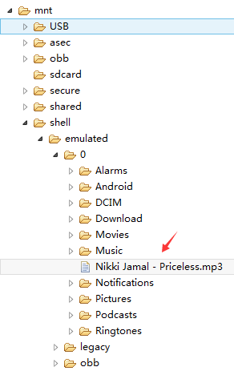
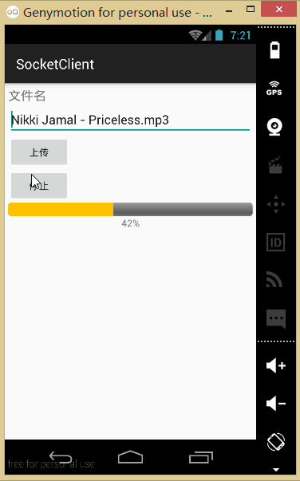
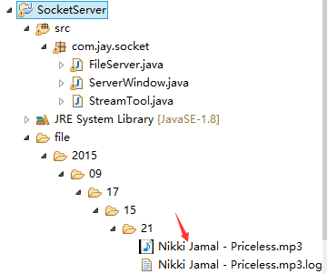
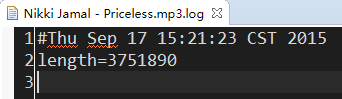
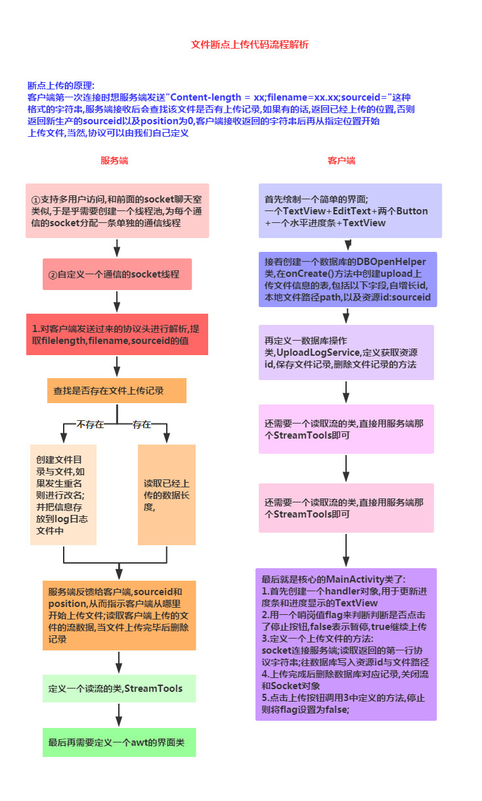

# 7.6.3 基于TCP协议的Socket通信(2)

> 来源: https://www.runoob.com/w3cnote/android-tutorial-socket2.html

## 本节引言：

> 上节中我们给大家接触了Socket的一些基本概念以及使用方法，然后写了一个小猪简易聊天室的
> Demo，相信大家对Socket有了初步的掌握，本节我们来学习下使用Socket来实现大文件的断点续传！
> 这里讲解的是别人写好的一个Socket上传大文件的例子，不要求我们自己可以写出来，需要的时候会用
> 就好！

## 1.运行效果图：

1.先把我们编写好的Socket服务端运行起来：

2.将一个音频文件放到SD卡根目录下：

3.运行我们的客户端：

4.上传成功后可以看到我们的服务端的项目下生成一个file的文件夹，我们可以在这里找到上传的文件：
.log那个是我们的日志文件

## 2.实现流程图：

## 3.代码示例：

先编写一个服务端和客户端都会用到的流解析类：

**StreamTool.java**：

### 1）服务端的实现：

socket管理与多线程管理类：

**FileServer.java**：

服务端界面类:**ServerWindow.java**：

### 2）客户端(Android端)

首先是布局文件：**activity_main.xml**：

因为断点续传，我们需要保存上传的进度，我们需要用到数据库，这里我们定义一个数据库
管理类：**DBOpenHelper.java：**：

然后是数据库操作类：**UploadHelper.java**：

对了，别忘了客户端也要贴上那个流解析类哦，最后就是我们的**MainActivity.java**了：

最后，还有，记得往**AndroidManifest.xml**中写入这些权限哦！

## 4.代码下载：

[Socket上传大文件demo](/try/download/SocketUploadBigFile.zip)

## 5.本节小结：

> 本节给大家介绍了基于TCP协议的Socket的另一个实例：使用Socket完成大文件的续传，
> 相信大家对Socket的了解更进一步，嗯，下一节再写一个例子吧，两个处于同一Wifi
> 下的手机相互传递数据的实例吧！就说这么多，谢谢~

### 图片清单

1. 图1 -> images/37010390.jpg （原图：https://www.runoob.com/wp-content/uploads/2015/09/37010390.jpg）
2. 图2 -> images/24615233.jpg （原图：https://www.runoob.com/wp-content/uploads/2015/09/24615233.jpg）
3. 图3 -> images/2161477.jpg （原图：https://www.runoob.com/wp-content/uploads/2015/09/2161477.jpg）
4. 图4 -> images/77735016.jpg （原图：https://www.runoob.com/wp-content/uploads/2015/09/77735016.jpg）
5. 图5 -> images/75061502.jpg （原图：https://www.runoob.com/wp-content/uploads/2015/09/75061502.jpg）
6. 图6 -> images/28511586.jpg （原图：https://www.runoob.com/wp-content/uploads/2015/09/28511586.jpg）
