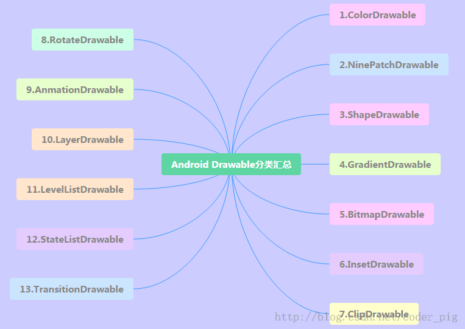
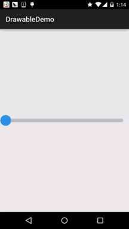
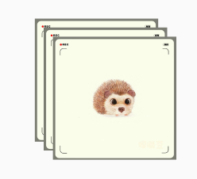
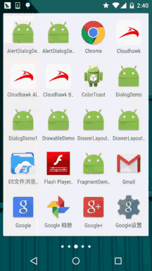
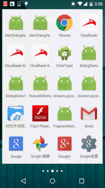
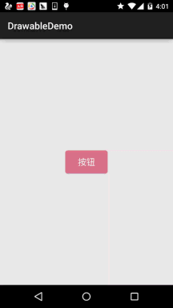

# 8.1.3 Android中的13种Drawable小结 Part 3

> 来源: https://www.runoob.com/w3cnote/android-tutorial-drawable3.html

## 本节引言：

> 本节我们来把剩下的四种Drawable也学完，他们分别是：
> **LayerDrawable**,**TransitionDrawable**,**LevelListDrawable和StateListDrawable**,
> 依旧贴下13种Drawable的导图：

> 

## 1.LayerDrawable

> 层图形对象，包含一个Drawable数组，然后按照数组对应的顺序来绘制他们，索引
> 值最大的Drawable会被绘制在最上层！虽然这些Drawable会有交叉或者重叠的区域，但
> 他们位于不同的层，所以并不会相互影响，以<**layer-list**>作为根节点！

**相关属性如下**：

> - **drawable**:引用的位图资源,如果为空徐璈有一个Drawable类型的子节点

> - **left**:层相对于容器的左边距

> - **right**:层相对于容器的右边距

> - **top**:层相对于容器的上边距

> - **bottom**:层相对于容器的下边距

> - **id**:层的id

**使用示例**：

**运行效果图**：

**代码实现**：

非常简单，结合前面学习的shapeDrawable和ClipDrawable：

**layerList_one.xml**

然后在布局文件中添加一个Seekbar，内容如下：

卧槽，没了？对的，就是这么点东西~说了是层图形对象，我们还可以弄个**层叠图片**的效果：

**运行效果图**：

**实现代码**：

**层叠图片的layerlist_two.xml**:

然后在activity_main.xml里加个ImageView，内容如下：

 简单好用，还等什么，快快应用到你的项目中吧~

## 2.TransitionDrawable

> LayerDrawable的一个子类，TransitionDrawable只管理两层的Drawable！两层！两层！
> 并且提供了透明度变化的动画，可以控制一层Drawable过度到另一层Drawable的动画效果。
> 根节点为<**transition**>，记住只有两个Item，多了也没用，属性和LayerDrawable差不多，
> 我们需要调用**startTransition**方法才能启动两层间的切换动画；
> 也可以调用**reverseTransition()**方法反过来播放：

**使用示例**：

**运行效果图**：

**实现代码**：

在res/drawable创建一个TransitionDrawable的xml文件

然后布局文件里加个ImageView，然后把src设置成上面的这个drawable
然后MainActivity.java内容如下：

另外，如果你想实现：多张图片循环的淡入淡出的效果
可参考：[Android Drawable Resource学习（七）、TransitionDrawable](http://blog.csdn.net/lonelyroamer/article/details/8243606)中的示例
很简单，核心原理就是：handler定时修改Transition中两个图片！

## 3.LevelListDrawable

> 用来管理一组Drawable的,我们可以为里面的drawable设置不同的level，
> 当他们绘制的时候，会根据level属性值获取对应的drawable绘制到画布上，根节点
> 为:<**level-list**>他并没有可以设置的属性，我们能做的只是设置每个<**item**>
> 的属性！

**item可供设置的属性如下**：

> - **drawable**:引用的位图资源,如果为空徐璈有一个Drawable类型的子节点

> - **minlevel:level**对应的最小值

> - **maxlevel:level**对应的最大值

**使用示例**：

**运行效果图**：

**代码实现**：

通过shapeDrawable画圆，一式五份，改下宽高即可：

**shape_cir1.xml**：

接着到LevelListDrawable，这里我们设置五层：

**level_cir.xml**：

最后MainActivity写如下代码：

也很简单，一个Timer定时器,handler修改level值~

## 4.StateListDrawable

> 好了终于迎来了最后一个drawable：StateListDrawable，这个名字看上去模式，其实我们
> 以前就用到了，还记得为按钮设置不同状态的drawable的<**selctor**>吗？没错，用到的
> 就是这个StateListDrawable！

**可供设置的属性如下**：

> - **drawable**:引用的Drawable位图,我们可以把他放到最前面,就表示组件的正常状态~

> - **state_focused**:是否获得焦点

> - **state_window_focused**:是否获得窗口焦点

> - **state_enabled**:控件是否可用

> - **state_checkable**:控件可否被勾选,eg:checkbox

> - **state_checked**:控件是否被勾选

> - **state_selected**:控件是否被选择,针对有滚轮的情况

> - **state_pressed**:控件是否被按下

> - **state_active**:控件是否处于活动状态,eg:slidingTab

> - **state_single**:控件包含多个子控件时,确定是否只显示一个子控件

> - **state_first**:控件包含多个子控件时,确定第一个子控件是否处于显示状态

> - **state_middle**:控件包含多个子控件时,确定中间一个子控件是否处于显示状态

> - **state_last**:控件包含多个子控件时,确定最后一个子控件是否处于显示状态

**使用示例**：

那就来写个简单的圆角按钮吧！

**运行效果图**：

**代码实现**：

那就先通过shapeDrawable来画两个圆角矩形，只是颜色不一样而已：

**shape_btn_normal.xml**：

接着我们来写个selctor：**selctor_btn.xml**：

然后按钮设置android:background="@drawable/selctor_btn"就可以了~
你可以根据自己需求改成矩形或者椭圆，圆形等！

## 本节小结：

> 好的，关于Android中的13种不同类型的Drawable已经讲解完毕了，当然，这只是基础，实际
> 开发中肯定还有各种高逼格的用法，这就要靠大家去扩展了，这里只是给大家一个引导！

> 嗯，时间关系，上述的例子都是一个个试的，所以最后的demo乱七八糟哈，可能
> 你对这些素材又需要，还是贴下，有需要的自行下载：[DrawableDemo.zip](http://static.runoob.com/download/DrawableDemo.zip)
> 嗯，谢谢~祝周末愉快

### 图片清单

1. 图1 -> images/59216860.jpg （原图：https://www.runoob.com/wp-content/uploads/2015/10/59216860.jpg）
2. 图2 -> images/33659494.jpg （原图：https://www.runoob.com/wp-content/uploads/2015/10/33659494.jpg）
3. 图3 -> images/80416467.jpg （原图：https://www.runoob.com/wp-content/uploads/2015/10/80416467.jpg）
4. 图4 -> images/84078589.jpg （原图：https://www.runoob.com/wp-content/uploads/2015/10/84078589.jpg）
5. 图5 -> images/85899256.jpg （原图：https://www.runoob.com/wp-content/uploads/2015/10/85899256.jpg）
6. 图6 -> images/65455566.jpg （原图：https://www.runoob.com/wp-content/uploads/2015/10/65455566.jpg）
7. 图7 -> images/32015507.jpg （原图：https://www.runoob.com/wp-content/uploads/2015/10/32015507.jpg）
