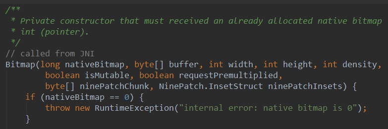
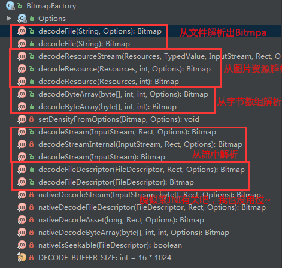
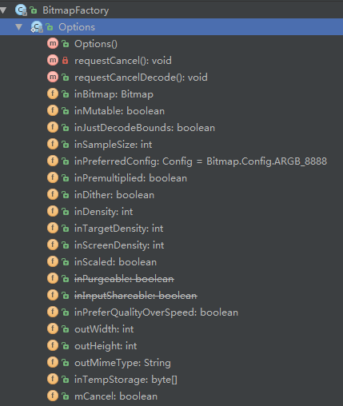
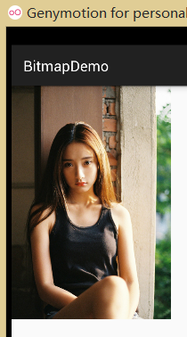
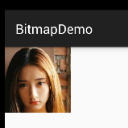
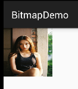

# 8.2.1 Bitmap(位图)全解析 Part 1

> 来源: https://www.runoob.com/w3cnote/android-tutorial-bitmap1.html

## 本节引言：

> 在上一节中我们对Android中的13种类型的Drawable的类型进行了讲解，有没有应用到自己的
> 项目当中呢？而本节我们来探讨的是Bitmap(位图)的一些使用，而在开始本节的内容之前我们
> 先来区分几个名词的概念：

> - **Drawable**：通用的图形对象，用于装载常用格式的图像，既可以是PNG，JPG这样的图像，
> 也是前面学的那13种Drawable类型的可视化对象！我们可以理解成一个用来放画的——**画框**！

> - **Bitmap(位图)**：我们可以把他看作一个**画架**，我们先把画放到上面，然后我们可以
> 进行一些处理，比如获取图像文件信息，做旋转切割，放大缩小等操作！

> - **Canvas(画布)**：如其名，**画布**，我们可以在上面作画(绘制)，你既可以用**Paint(画笔)**，
> 来画各种形状或者写字，又可以用**Path(路径)**来绘制多个点，然后连接成各种图形！

> - **Matrix(矩阵)**：用于图形特效处理的，颜色矩阵(ColorMatrix)，还有使用Matrix进行图像的
> 平移，缩放，旋转，倾斜等！

> 而上述的这些都是Android中的底层图形类：**android.graphics**给我们提供的接口！
> 嗯，话不多说开始本节内容！
> PS：官方文档：[Bitmap](http://androiddoc.qiniudn.com/reference/android/graphics/Bitmap.html)

## 1.了解Bitmap，BitmapFactory，BitmapFacotry.Options

> 如题，本来可以直接说着三个东东的关系的，但是我就是要**傲娇**，就要看代码！
> 如果你打开Bitmap类的源码，你会看到Bitmap的构造方法上有这样一段东东：

> 

> 大概想说的就是：Bitmap的构造方法是私有的，外面不能实例化，只能通过JNI实例化！
> 当然，肯定也会给我们提供一个接口给我们来创建Bitmap的，而这个接口类就是：**BitmapFactory**！
> 来来来，打开BitmapFactory类，我们点下左边的Structure可以看到BitmapFactory给我们
> 提供了这些方法，大部分都是decodeXxx，通过各种形式来创建Bitmap的！

> 

> 接着我们又发现了，每一种方法，都会有一个Options类型的参数，点进去看看：
> 于是乎我们发现了这货是一个静态内部类:**BitmapFacotry.Options**!
> 而他是用来设置decode时的选项的！

> 

> 我们对这里的某些参数的值进行设置，比如inJustDecodeBounds设置为true避免OOM(内存溢出)，
> 什么，不知道OOM，没事，等下一点点跟你说清楚！最后回到我们的Bitmap！嗯，Bitmap中的
> 方法比较多，就不一一进行讲解了，我们从中挑几个用得较多的来讲解！
> 中文文档：[Android中文API（136） —— Bitmap](http://www.cnblogs.com/over140/archive/2011/11/21/2256727.html)

## 2.Bitmap常用方法

> **普通方法**

> - public boolean **compress** (Bitmap.CompressFormat format, int quality, OutputStream stream)
> 将位图的压缩到指定的OutputStream，可以理解成将Bitmap保存到文件中！
> **format**：格式，PNG，JPG等；
> **quality**：压缩质量，0-100，0表示最低画质压缩，100最大质量(PNG无损，会忽略品质设定)
> **stream**：输出流
> 返回值代表是否成功压缩到指定流！

> - void **recycle**()：回收位图占用的内存空间，把位图标记为Dead

> - boolean **isRecycled**()：判断位图内存是否已释放

> - int **getWidth**()：获取位图的宽度

> - int **getHeight**()：获取位图的高度

> - boolean **isMutable**()：图片是否可修改

> - int **getScaledWidth**(Canvas canvas)：获取指定密度转换后的图像的宽度

> - int **getScaledHeight**(Canvas canvas)：获取指定密度转换后的图像的高度

> **静态方法**：

> - Bitmap **createBitmap**(Bitmap src)：以src为原图生成不可变得新图像

> - Bitmap **createScaledBitmap**(Bitmap src, int dstWidth,int dstHeight, boolean filter)：以src为原图，创建新的图像，指定新图像的高宽以及是否变。

> - Bitmap **createBitmap**(int width, int height, Config config)：创建指定格式、大小的位图

> - Bitmap **createBitmap**(Bitmap source, int x, int y, int width, int
> height)以source为原图，创建新的图片，指定起始坐标以及新图像的高宽。

> - public static Bitmap **createBitmap**(Bitmap source, int x, int y, int width, int height,
> Matrix m, boolean filter)

**BitmapFactory.Option**可设置参数：

> - boolean **inJustDecodeBounds**——如果设置为true，不获取图片，不分配内存，但会返回图片的高宽度信息。

> - int **inSampleSize**——图片缩放的倍数。如果设为4，则宽和高都为原来的1/4，则图是原来的1/16。

> - int **outWidth**——获取图片的宽度值

> - int **outHeight**——获取图片的高度值

> - int **inDensity**——用于位图的像素压缩比

> - int **inTargetDensity**——用于目标位图的像素压缩比（要生成的位图）

> - boolean **inScaled**——设置为true时进行图片压缩，从inDensity到inTargetDensity。

好吧，就贴这么多吧，要用自己查文档~

## 3.获取Bitmap位图

> 从资源中获取位图的方式有两种：通过BitmapDrawable或者BitmapFactory，下面演示下：
> 我们首先得获得这个

**BitmapDrawable方法**：

你可以创建一个构造一个BitmapDrawable对象，比如通过流构建BitmapDrawable：

**BitmapFactory方法**：

都是静态方法，直接调，可以通过资源ID、路径、文件、数据流等方式来获取位图！

---

## 4.获取Bitmap的相关信息：

这个，只要我们获取了Bitmap对象，就可以调用相关方法来获取对应的参数了，getByteCount获得大小，
getHeight和getWidth这些~这里就不写了，自己查文档！

---

## 5.抠图片上的某一角下来

有时，可能你想把图片上的某一角扣下来，直接通过Bitmap的createBitmap()扣下来即可
参数依次为：处理的bitmap对象，起始x,y坐标，以及截取的宽高

**运行效果图**：

原图：

切下来的一角：

## 6.对Bitmap进行缩放

我们这里不用Matrix来对Bitmap，而是直接使用Bitmap给我们提供的**createScaledBitmap**来实现，
参数依次是：处理的bitmap对象，缩放后的宽高，

## 7.使用Bitmap进行截屏

**运行效果图**：

**实现代码**：

**代码分析**：

> 代码非常简单，final View contentView = getWindow().getDecorView();这句代码是获取当前XML
> 根节点的View！然后设置截屏的大小，调用下contentView.draw(new Canvas(bitmap));好了，然后
> bitmap转换成流，接着写入SD卡，没了~当然从结果我们也可以看出，截图截取的是改APP的内容而已！
> 如果要截全屏，自行谷歌~!

## 本节小结：

> 本节给大家讲解下Bitmap，BitmapFactory和他的静态内部类Options，以及BitmapDrawable的
> 基本使用，其实Bitmap我们知道怎么创建就好了，他的扩展一般是通过Matrix和Canvas来实现的，
> Bitmap，我们更多的时候关注的是OOM问题，下一节我们就来学习下如何避免Bitmap的OOM问题！
> 谢谢~

### 图片清单

1. 图1 -> images/76982237.jpg （原图：https://www.runoob.com/wp-content/uploads/2015/10/76982237.jpg）
2. 图2 -> images/38708742.jpg （原图：https://www.runoob.com/wp-content/uploads/2015/10/38708742.jpg）
3. 图3 -> images/47964812.jpg （原图：https://www.runoob.com/wp-content/uploads/2015/10/47964812.jpg）
4. 图4 -> images/85259228.jpg （原图：https://www.runoob.com/wp-content/uploads/2015/10/85259228.jpg）
5. 图5 -> images/54694376.jpg （原图：https://www.runoob.com/wp-content/uploads/2015/10/54694376.jpg）
6. 图6 -> images/52687906.jpg （原图：https://www.runoob.com/wp-content/uploads/2015/10/52687906.jpg）
7. 图7 -> images/2135673.jpg （原图：https://www.runoob.com/wp-content/uploads/2015/10/2135673.jpg）
8. 图8 -> images/46565610.jpg （原图：https://www.runoob.com/wp-content/uploads/2015/10/46565610.jpg）
9. 图9 -> images/95335358.jpg （原图：https://www.runoob.com/wp-content/uploads/2015/10/95335358.jpg）
