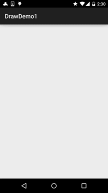
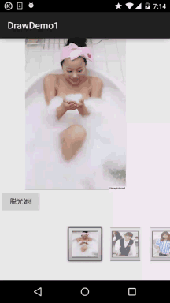

# 8.3.2 绘图类实战示例

> 来源: https://www.runoob.com/w3cnote/android-tutorial-bitmap-demo.html

## 本节引言：

> 前两节我们学了Bitmap和一些基本的绘图API的属性以及常用的方法，但心里总觉得有点
> 不踏实，总得写点什么加深下映像是吧，嗯，本节我们就来写两个简单的例子：

> - 
> 1.简单画图板的实现

> - 
> 2.帮美女擦衣服的简单实现

> 嘿嘿，第二个例子是小猪刚学安卓写的一个小Demo~嘿嘿~
> 开始本节内容~

## 1.实战示例1：简单画图板的实现：

> 这个相信大家都不陌生，很多手机都会自带一个给用户涂鸦的画图板，这里我们就来写个简单的
> 例子，首先我们分析下，实现这个东东的一些逻辑：

> **Q1：这个画板放在哪里？**

> 答：View里，我们自定义一个View，在onDraw()里完成绘制，另外View还有个onTouchEvent的方法，
> 我们可以在获取用户的手势操作！

> **Q2.需要准备些什么？**

> 答：一只画笔(Paint)，一块画布(Canvas)，一个路径(Path)记录用户绘制路线；
> 另外划线的时候，每次都是从上次拖动时间的发生点到本次拖动时间的发生点！那么之前绘制的
> 就会丢失，为了保存之前绘制的内容，我们可以引入所谓的"**双缓冲**"技术：
> 其实就是每次不是直接绘制到Canvas上，而是先绘制到Bitmap上，等Bitmap上的绘制完了，
> 再一次性地绘制到View上而已！

> **Q3.具体的实现流程？**

> 答：初始化画笔，设置颜色等等一些参数；在View的onMeasure()方法中创建一个View大小的Bitmap，
> 同时创建一个Canvas；onTouchEvent中获得X,Y坐标，做绘制连线，最后invalidate()重绘，即调用
> onDraw方法将bitmap的东东画到Canvas上！

好了，逻辑知道了，下面就上代码了：

**MyView.java**：

**运行效果图**：

你可以根据自己的需求进行扩展，比如加上修改画笔大小，修改画笔颜色，保存自己画的图等！
发散思维，自己动手~

## 2.实战示例2：擦掉美女衣服的实现

> 核心思路是：
> 利用帧布局，前后两个ImageView，前面的显示未擦掉衣服的情况，后面的显示擦掉衣服后的情况！

> 为两个ImageView设置美女图片后，接着为前面的ImageView设置OnTouchListener！在这里对手指
> 触碰点附近的20*20个像素点，设置为透明！

**运行效果图**：

**代码实现**：

**Step 1**：第一个选妹子的Activity相关的编写，首先是界面，一个ImageView，Button和Gallery！

**activity_main.xml**：

接着是我们Gallery的Adapter类，这里我们重写下BaseAdapter，而里面就显示一个图片比较简单，
就不另外写一个布局了！

**MeiziAdapter.java**:

最后到我们的Activity，也很简单，无非是为gallery设置onSelected事件，点击按钮后把，当前选中的
Position传递给下一个页面！

**MainActivity.java**：

接着是我们擦掉妹子衣服的页面了，布局比较简单，FrameLayout + 前后两个ImageView：

**activity_caclothes.xml**：

接着到就到Java部分的代码了：

**CaClothes.java**：

代码也不算苦涩难懂，还是比较简单的哈，嗯，效果图看看就好，别做那么多右手螺旋定则哈....

## 3.代码示例下载：

[DrawDemo1.zip](http://static.runoob.com/download/DrawDemo1.zip) 项目比较大，20多M，图片资源比较多，你懂的~

## 本节小结：

> 好的，本节写了关于绘图的两个小例子，还是蛮有趣的，相信你发下了，擦美女衣服那里，
> 消除的时候是方块的，不那么完美是吧，没事，下节我们学多个PorterDuff这个东西，我们
> 再来写多个例子，相比起这个代码就简单很多了，另外，时间关系，代码并没有去优化
> 或者整理，可以根据自己需求进行修改~好的，就说这么多，祝大家周末愉快~

### 图片清单

1. 图1 -> images/55635114.jpg （原图：https://www.runoob.com/wp-content/uploads/2015/10/55635114.jpg）
2. 图2 -> images/2.gif （原图：https://www.runoob.com/wp-content/uploads/2015/10/2.gif）
3. 图3 -> images/30359706.jpg （原图：https://www.runoob.com/wp-content/uploads/2015/10/30359706.jpg）
4. 图4 -> images/88695912.jpg （原图：https://www.runoob.com/wp-content/uploads/2015/10/88695912.jpg）
