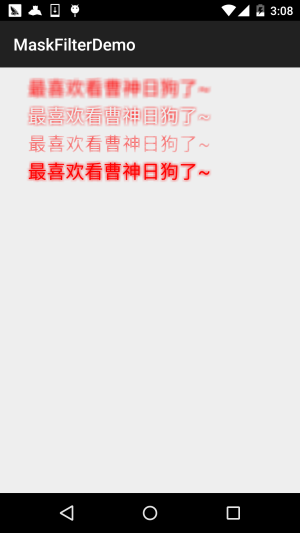
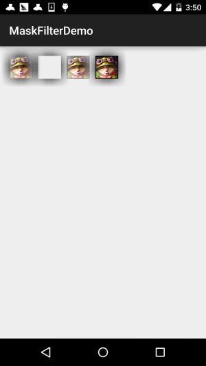
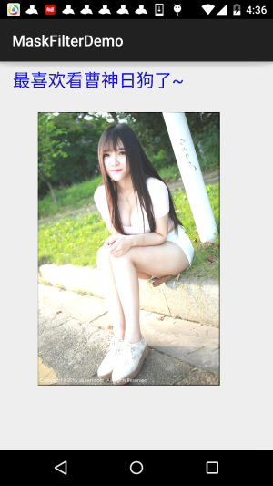
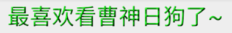

# 8.3.3 Paint API之—— MaskFilter(面具)

> 来源: https://www.runoob.com/w3cnote/android-tutorial-maskfilter.html

## 本节引言：

> 在[Android基础入门教程——8.3.1 三个绘图工具类详解](/w3cnote/android-tutorial-drawable-tool.html)的Paint方法中有这样一个方法：

> **setMaskFilter(MaskFilter maskfilter)**：
> 设置MaskFilter，可以用不同的MaskFilter实现滤镜的效果，如滤化，立体等！
> 而我们一般不会直接去用这个MaskFilter，而是使用它的两个子类：

> **BlurMaskFilter**：指定了一个模糊的样式和半径来处理Paint的边缘。

> **EmbossMaskFilter**：指定了光源的方向和环境光强度来添加浮雕效果。
> 下面我们来写个例子来试验一下~！

> 官方API文档：
> [BlurMaskFilter](http://androiddoc.qiniudn.com/reference/android/graphics/BlurMaskFilter.html)；
> [EmbossMaskFilter](http://androiddoc.qiniudn.com/reference/android/graphics/EmbossMaskFilter.html)；

## 1.BlurMaskFilter(模糊效果)

> 说什么滤镜立体，谁知道怎么样，示例见真知：

**代码示例**：

**运行效果图**：

**实现代码**：

> 这里我们创建一个自定义View，在里面完成绘制！

**BlurMaskFilterView.java**：

> 好的，从上面的代码示例，我们可以发现，我们使用这个BlurMaskFilter，无非是，
> 在构造方法中实例化：

> **BlurMaskFilter(10f,BlurMaskFilter.Blur.NORMAL);**

> 我们可以控制的就是这两个参数：

> **第一个参数**：指定模糊边缘的半径；

> **第二个参数**：指定模糊的风格，可选值有：

> - 
> BlurMaskFilter.Blur.**NORMAL**：内外模糊

> - 
> BlurMaskFilter.Blur.**OUTER**：外部模糊

> - 
> BlurMaskFilter.Blur.**INNER**：内部模糊

> - 
> BlurMaskFilter.Blur.**SOLID**：内部加粗，外部模糊

可能还是有点不清晰，我们找个图片来试试：

这里我们把模糊半径修改成了50，就更加明显了~

## 2.EmbossMaskFilter(浮雕效果)

> 如题，通过指定环境光源的方向和环境光强度来添加浮雕效果，同样，我们写个示例来看看效果：

**代码示例**：

**运行效果图**：

**实现代码**：

> 从效果图我们就可以看出一些EmbossMaskFilter的效果，修改光线，形成浮雕效果~妹子图不明显，
> 文字就很清晰显示出纹路了！和BlurMaskFilter一样，相关的设置都是在构造方法中进行！

> **EmbossMaskFilter(float[] direction, float ambient, float specular, float blurRadius)**
> 参数依次是：

> **direction**：浮点型数组，用于控制x,y,z轴的光源方向

> **ambient**：设置环境光亮度，0到1之间

> **specular**：镜面反射系数

> **blurRadius**：模糊半径

> 你可以修改这些值，试试不同的效果，比如我修改下上述的，又会是另一种效果：

> //这里为了明显点，换成了绿色

> 

## 3.注意事项

> 在使用MaskFilter的时候要注意，当我们的targetSdkVersion >= 14的时候，MaskFilter
> 就不会起效果了，这是因为Android在API 14以上版本都是默认开启硬件加速的，这样充分
> 利用GPU的特性，使得绘画更加平滑，但是会多消耗一些内存！好吧，我们把硬件加速关了
> 就好，可以在不同级别下打开或者关闭硬件加速，一般是关闭~

> - **Application**：在配置文件的application节点添加：
> android:hardwareAccelerated="true"

> - **Activity**：在配置文件的activity节点添加
> android:hardwareAccelerated="false"

> - **View**：可以获得View对象后调用，或者直接在View的onDraw()方法里设置：
> view.setLayerType(View.LAYER_TYPE_HARDWARE, null);

## 示例代码下载：

[MaskFilterDemo.zip](http://static.runoob.com/download/MaskFilterDemo.zip)

## 本节小结：

> 本节给大家演示了Paint的一个API，**setMaskFilter(MaskFilter maskfilter)**，学习了
> MaskFilter两个子类的基本用法：BlurMaskFilter(模糊效果)与EmbossMaskFilter(浮雕效果)，
> 比较简单，多学一点，对我们进阶部分的自定义控件也是没有坏处的~好的，就说这么多，
> 谢谢~

> 对了，忘了说，其实在SDK中的example中有个类，就演示了这两种用法：

> **samples\android-xx\legacy\ApiDemos\src\com\example\android\apis\graphics**
> 目录下的：**FingerPaint.java**文件~

### 图片清单

1. 图1 -> images/14201002.jpg （原图：https://www.runoob.com/wp-content/uploads/2015/10/14201002.jpg）
2. 图2 -> images/18321619.jpg （原图：https://www.runoob.com/wp-content/uploads/2015/10/18321619.jpg）
3. 图3 -> images/79392450.jpg （原图：https://www.runoob.com/wp-content/uploads/2015/10/79392450.jpg）
4. 图4 -> images/4535741.jpg （原图：https://www.runoob.com/wp-content/uploads/2015/10/4535741.jpg）
5. 图5 -> images/68330378.jpg （原图：https://www.runoob.com/wp-content/uploads/2015/10/68330378.jpg）
