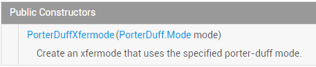

# 8.3.5 Paint API之—— Xfermode与PorterDuff详解(二)

> 来源: https://www.runoob.com/w3cnote/android-tutorial-xfermode-porterduff2.html

## 本节引言：

> 上一节，我们学习了Xfermode两个已经过世(过时)的儿子：**AvoidXfermode**， **PixelXorXfermode**，
> 虽然说有点用，但是终归是被淘汰的了，本节我们来学习Xfermode还健在的三儿子：**PorterDuffXfermode**；

> 先祭上官方API文档：[PorterDuffXfermode](http://androiddoc.qiniudn.com/reference/android/graphics/PorterDuffXfermode.html)！文档内容很少，我们可以看到他的构造方法：

> 

> 参数只有一个：**PorterDuff.Mode** mode，而Android给我们提供了16种图片混排模式，简单点可以
> 理解为两个图层按照不同模式，可以组合成不同的结果显示出来！16种混排模式的结果图如下：

> 

> 这里两个图层：先绘制的图是**目标图(DST)**，后绘制的图是**源图(SRC)**！

> 当然，在文档中我们发现可供使用的模式并不是16种，而是18种，新增了**ADD**和**OVERLAY**两种模式!

> 嗯，说多也白说，代码最实际，本节我们写下代码来验证下这18种模式吧！

> PS:这个PorterDuff的命名其实是两个人名的组合：Tomas Proter和 Tom Duff组成的，他们是最早在
> 最早在SIGGRAPH上提出图形混合概念的大神级人物，有兴趣的自行百度~

## 写个例子来验证上面的这个图：

> 好的，我们来写个例子验证下上面这个图，通过修改不同的模式，来对结果进行对比分析！

**代码实现**：

**Step 1**：我们先写个获取屏幕宽高的工具类吧！**ScreenUtil.java**：

Step 2：编写我们的自定义View类，在这里做试验！**XfermodeView.java**：

代码看起来好复杂是吧，其实不然，无非就是获取了屏幕宽高，然后画了一个矩形一个圆形，
计算了一下他们的位置，然后设置下图层(固定写法)，接着设下下画笔setXfermode，接着
绘制到canvas上而已，你看不懂的可能是绘制位置的计算吧，其实不然，位置你喜欢怎么定
都可以！那么接下来我们来一个个看下解果咯，你只需修改**PD_MODE**的值设置为不同模式即可！

**运行效果图**：

### 1）PorterDuff.Mode.ADD：

 饱和度叠加

### 2）PorterDuff.Mode.CLEAR：

 所绘制不会提交到画布上，嗯结果...不知道是为什么了，正常是没东西的..

### 3）PorterDuff.Mode.DARKEN：

 取两图层全部区域，交集部分颜色加深

### 4）PorterDuff.Mode.DST：

 只保留目标图的alpha和color，所以绘制出来只有目标图

### 5）PorterDuff.Mode.DST_ATOP：

 源图和目标图相交处绘制目标图，不相交的地方绘制源图

### 6）PorterDuff.Mode.DST_IN：

 两者相交的地方绘制目标图，绘制的效果会受到原图处的透明度影响

### 7）PorterDuff.Mode.DST_OUT：

 在不相交的地方绘制目标图

### 8）PorterDuff.Mode.DST_OVER：

 目标图绘制在上方

### 9）PorterDuff.Mode.LIGHTEN：

 取两图层全部区域，点亮交集部分颜色

### 10）PorterDuff.Mode.MULTIPLY：

 取两图层交集部分叠加后颜色

### 11）PorterDuff.Mode.OVERLAY：

 叠加

### 12）PorterDuff.Mode.SCREEN：

 取两图层全部区域，交集部分变为透明色

### 13）PorterDuff.Mode.SRC：

 只保留源图像的alpha和color，所以绘制出来只有源图

### 14）PorterDuff.Mode.SRC_ATOP：

 源图和目标图相交处绘制源图，不相交的地方绘制目标图

### 15）PorterDuff.Mode.SRC_IN：

 两者相交的地方绘制源图

### 16）PorterDuff.Mode.SRC_OUT：

 不相交的地方绘制源图

### 17）PorterDuff.Mode.SRC_OVER：

 把源图绘制在上方

### 18）PorterDuff.Mode.XOR：

 不相交的地方按原样绘制源图和目标图

## 本节示例代码下载：

[PorterDuffXfermodeDemo.zip](http://static.runoob.com/download/PorterDuffXfermodeDemo.zip)

## 本节小结：

> 嗯，本节就写了一个简单的View来验证这18种不同PorterDuff.Mode下的不同效果，
> 嘿嘿，蛮耗时间的，不过，读者看起来肯定清晰多了是吧~当然，这只是一些初步的见解！

> **PorterDuffXfermode**的**PorterDuff.Mode**对于我们自定义控件是非常重要的！
> 本节我们初步了解，下节我们挑几个例子来练练手！

> 如果你想看关于PorterDuff.Mode更加详细的介绍可见：
> [Android Paint之 setXfermode PorterDuffXfermode 讲解](http://blog.csdn.net/tianjian4592/article/details/44783283)，别人写的不错的一篇文章！
> 嗯，就到这里，明早体检，今天就写这么多~

### 图片清单

1. 图1 -> images/69068891.jpg （原图：https://www.runoob.com/wp-content/uploads/2015/10/69068891.jpg）
2. 图2 -> images/31597067.jpg （原图：https://www.runoob.com/wp-content/uploads/2015/10/31597067.jpg）
3. 图3 -> images/14286018.jpg （原图：https://www.runoob.com/wp-content/uploads/2015/10/14286018.jpg）
4. 图4 -> images/75793644.jpg （原图：https://www.runoob.com/wp-content/uploads/2015/10/75793644.jpg）
5. 图5 -> images/95509811.jpg （原图：https://www.runoob.com/wp-content/uploads/2015/10/95509811.jpg）
6. 图6 -> images/45132148.jpg （原图：https://www.runoob.com/wp-content/uploads/2015/10/45132148.jpg）
7. 图7 -> images/8021927.jpg （原图：https://www.runoob.com/wp-content/uploads/2015/10/8021927.jpg）
8. 图8 -> images/5366249.jpg （原图：https://www.runoob.com/wp-content/uploads/2015/10/5366249.jpg）
9. 图9 -> images/79208765.jpg （原图：https://www.runoob.com/wp-content/uploads/2015/10/79208765.jpg）
10. 图10 -> images/21369612.jpg （原图：https://www.runoob.com/wp-content/uploads/2015/10/21369612.jpg）
11. 图11 -> images/30561339.jpg （原图：https://www.runoob.com/wp-content/uploads/2015/10/30561339.jpg）
12. 图12 -> images/54185887.jpg （原图：https://www.runoob.com/wp-content/uploads/2015/10/54185887.jpg）
13. 图13 -> images/20793772.jpg （原图：https://www.runoob.com/wp-content/uploads/2015/10/20793772.jpg）
14. 图14 -> images/63325846.jpg （原图：https://www.runoob.com/wp-content/uploads/2015/10/63325846.jpg）
15. 图15 -> images/57107428.jpg （原图：https://www.runoob.com/wp-content/uploads/2015/10/57107428.jpg）
16. 图16 -> images/17842157.jpg （原图：https://www.runoob.com/wp-content/uploads/2015/10/17842157.jpg）
17. 图17 -> images/6807626.jpg （原图：https://www.runoob.com/wp-content/uploads/2015/10/6807626.jpg）
18. 图18 -> images/12982127.jpg （原图：https://www.runoob.com/wp-content/uploads/2015/10/12982127.jpg）
19. 图19 -> images/35265700.jpg （原图：https://www.runoob.com/wp-content/uploads/2015/10/35265700.jpg）
20. 图20 -> images/93526997.jpg （原图：https://www.runoob.com/wp-content/uploads/2015/10/93526997.jpg）
21. 图21 -> images/55225083.jpg （原图：https://www.runoob.com/wp-content/uploads/2015/10/55225083.jpg）
22. 图22 -> images/5393163.jpg （原图：https://www.runoob.com/wp-content/uploads/2015/10/5393163.jpg）
