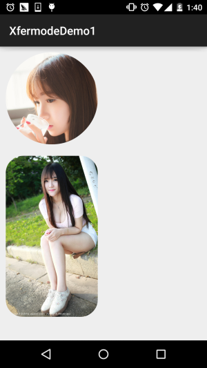

# 8.3.6 Paint API之—— Xfermode与PorterDuff详解(三)

> 来源: https://www.runoob.com/w3cnote/android-tutorial-xfermode-porterduff3.html

## 本节引言：

> 上一节，我们学习了Xfermode中的三儿子：PorterDuffXfermode构造方法中的为一个参数：
> **PorterDuff.Mode**，我们在观看了16种图片混排模式后，又自己写代码来验证了一下文档中
> 18种不同的混排模式，18种是新增了ADD和OVERLAY两种模式！当然，仅仅验证知道是不够的，
> 本节我们来写个例子，帮助我们熟悉下实际当中我们如何去使用PorterDuff.Mode为我们提供的
> 这些混排模式！本节带来的例子是：圆形&圆角图形的实现！

> 在[2.3.4 ImageView(图像视图)](https://www.runoob.com/w3cnote/android-tutorial-imageview.html)我们最后就讲解了一个最简单
> 绘制圆形ImageView的实现，原理是在图片上调用clipPath切出一个圆形！

> 而这节则是利用**PorterDuff.Mode**中的**DST_IN**模式来实现,话不多说，开始本节内容！
> PS：本节例子采自弘洋大神的——[Android Xfermode 实战 实现圆形、圆角图片](http://blog.csdn.net/lmj623565791/article/details/42094215)
> 另外，还是要贴下PorterDuff.Mode的效果图：

> 

## 1.要实现的效果图以及实现流程分析：

**运行后的效果图**：

嗯，上述就是我们要实现的一个效果，通过这个**PorterDuff.Mode.DST_IN**模式来实现！
我们来分析分析实现流程：

> - **Step 1**：
> Xfermode无非是两层图构成，先绘制的叫DST图(目标图)，后绘制的叫SRC图(原图)，我们要实现
> 圆形或者圆角，我们可以先把要显示的图片绘制出来(DST)，这里我们通过src的属性进行了设置；
> 接着再绘制出圆形和圆角(SRC)，我们想显示的部分是他们相交的地方，而且是图片部分的内容，
> 所以选择：**DST_IN**模式！

> - **Step 2**：
> 嗯，知道了原理，接下来我们要考虑自定义ImageView相关的问题了：

> - 我们是想绘制的View是圆角或者圆形，那就需要加个属性来判断，而圆角也需要一个圆角半径的
> 参数，于是乎我们可以通过自定义属性(attrs.xml)的方式，然后再自定义View的构造方法中，将
> 这些参数取出来！

> - 接着到图片大小的计算了：
> **首先**假如我们设置的是圆形的话，则需要让宽高一致，以最小值为准，我们可以在onMesure()方法
> 调用getMeasuredXxx()获得宽高，看谁小一点，调用setMeasuredDimension(x, x)；设置宽高！
> **然后**，我们在onDraw()方法中获取图片宽高，接着按照图片宽高，以及View宽高，计算缩放比例，
> 假如图片宽高与View的宽高不匹配，所犯后的图片宽高一定要大于View的宽高，so，取大值！

> - **再接着**就到图片的绘制了，定义一个绘制图形的方法，接着初始化画笔后，设置setXfermode为
> PorterDuff.Mode.DST_IN，先绘制图片，再绘制图形

> - **最后**是图片缓存的一些东西，这里用了WeakReference来缓存图片，避免每次onDraw都分配内存
> 与重绘，最后在invalidate中清楚缓存！

大体的实现流程如上述，知道流程再看代码就简单很多了！

## 2.代码实现：

自定义控件属性：**res/attrs.xml**：

接着是自定义ImageView：**CircleImageView.java**：

最后在布局文件那里调用下:**activity_main.xml**：

好的，代码一次看不懂，看多两次就懂的了~

## 3.本节代码示例下载：

[XfermodeDemo1.zip](http://static.runoob.com/download/XfermodeDemo1.zip)

## 本节小结：

> 本节我们讲解了Xfermode与PorterDuff的第一个应用例子，设置DST_IN模式来实现
> 圆形和圆角图片ImageView的定制，相信大家对PorterDuff的简单应用已经有些眉目了，
> 打铁趁热，下一节我们同一会写个例子练练手~好的，就说这么多，谢谢~

### 图片清单

1. 图1 -> images/31597067.jpg （原图：https://www.runoob.com/wp-content/uploads/2015/10/31597067.jpg）
2. 图2 -> images/57870575.jpg （原图：https://www.runoob.com/wp-content/uploads/2015/10/57870575.jpg）
