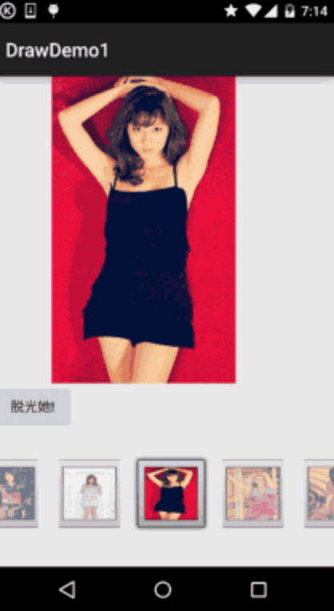

# 8.3.7 Paint API之—— Xfermode与PorterDuff详解(四)

> 来源: https://www.runoob.com/w3cnote/android-tutorial-xfermode-porterduff4.html

## 本节引言：

> 上节我们写了关于Xfermode与PorterDuff使用的第一个例子：圆角&圆形图片ImageView的实现，
> 我们体会到了PorterDuff.Mode.DST_IN给我们带来的好处，本节我们继续来写例子练练手，
> 还记得[8.3.2 绘图类实战示例](https://www.runoob.com/w3cnote/android-tutorial-bitmap-demo.html)给大家带来的拔掉美女衣服的实现吗？

> 

> 当时我们的实现方案是，将手指触碰区域附近的20*20个像素点设置为透明，效果图是这样的：

> 

> 不知道你有没有发现一个问题，我们擦美女衣服的时候，擦拭的时候都是方块的，但是我们画图板
> 画图的时候，划线都是很平滑的，有没有办法将两者结合起来，我们擦衣服时也是圆滑的呢？
> 答案肯定是有的，就是使用Xfermode咯！本节我们使用另一个模式，**DST_OUT**模式！
> 在不相交的地方绘制目标图

> 

> 如果你忘记了某个模式或者连18种模式都没见过的话，那么请移步：
> [Android基础入门教程——8.3.5 Paint API之—— Xfermode与PorterDuff详解(二)](/w3cnote/android-tutorial-xfermode-porterduff2.html)
> 另外，还是要贴下PorterDuff.Mode的效果图：

> 

> 嗯，话不多说，开始本节内容~

## 1.要实现的效果图以及实现流程分析：

**要实现的效果图**：

> 嗯，不知道你看了那个Gif图多少次了呢？不知道图中是否适合大家的口味，小猪
> 是从别人的APP上扒下来的，别问我番号或者留邮箱什么的，我什么都不知道~找番什么的，
> 问群里的老司机——基神吧，好的，我们来分析下实现流程吧~

> - 我们来说说原理，其实就是两个Bitmap，一前一后，前面的是穿着衣服的，后面的是没穿衣服的，
> 然后通过一个Path来记录用户绘制出来的图形，然后为我们的画笔设置DST_OUT的模式，那么
> 与Path重叠部分的DST(目标图)，就是穿着衣服的图，会变成透明！好哒，很简单！
> 我们再慢慢细化！

> - 首先我们需要两个Bitmap，用来存储前后两张图片，这里我们让两个Bitmap都全屏！

> - 接着设置下画笔，圆角，笔宽，抗锯齿等！

> - 再接着定义一个画Path，即用户绘制区域的方法，设置Xfermode后画区域而已！

> - 然后重写onTouchEvent方法，这部分和之前的自定义画图板是一样的！

> - 最后重写onDraw()方法，先绘制背景图片，调用用户绘制区域的方法，再绘制前景图片！

可能看上去有点复杂，其实不然，代码超简单的说~

## 2.代码实现：

直接就一个自定义View——**StripMeiZi.java**

布局代码**activity_main.xml**：

## 3.代码示例下载：

[XfermodeDemo2.zip](http://static.runoob.com/download/XfermodeDemo2.zip)

## 本节小结：

> 好的，本节我们写了Xfermode与PorterDuff的另一个实战例子——手撕美女衣服的Demo，相比起我们之前
> 那种撕美女衣服(让触摸点附近20*20的像素点变成透明)的方式斯文多了~代码也简单很多是吧，有没有
> 体会到Android图像混排Xfermode给我们带来的好处，或者对于自定义控件的重要性！嗯，还等什么，
> 打开你的IDE，把代码撸一遍，尝尝手撕美女衣服的快感吧~

### 图片清单

1. 图1 -> images/8093543.jpg （原图：https://www.runoob.com/wp-content/uploads/2015/10/8093543.jpg）
2. 图2 -> images/xxxx-113.png （原图：https://www.runoob.com/wp-content/uploads/2015/10/xxxx-113.png）
3. 图3 -> images/21369612.jpg （原图：https://www.runoob.com/wp-content/uploads/2015/10/21369612.jpg）
4. 图4 -> images/aHR0cHM6Ly93d3cuc.png （原图：https://www.runoob.com/wp-content/uploads/2015/10/aHR0cHM6Ly93d3cuc.png）
5. 图5 -> images/xxx-222.png （原图：https://www.runoob.com/wp-content/uploads/2015/10/xxx-222.png）
6. 图6 -> images/31236777.jpg （原图：https://www.runoob.com/wp-content/uploads/2015/10/31236777.jpg）
7. 图7 -> images/71331840.jpg （原图：https://www.runoob.com/wp-content/uploads/2015/10/71331840.jpg）
