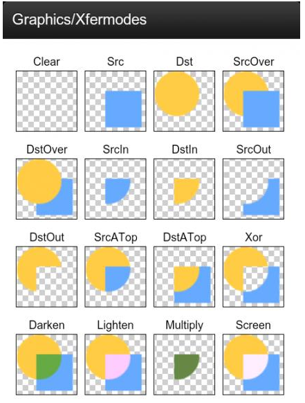
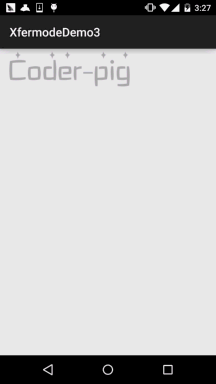

# 8.3.8 Paint API之—— Xfermode与PorterDuff详解(五)

> 来源: https://www.runoob.com/w3cnote/android-tutorial-xfermode-porterduff5.html

## 本节引言：

> 好的，上一节中，我们又写了一个关于Xfermode图片混排的例子——擦美女衣服的Demo，加上前面的
> 利用Xfermode来实现圆角或圆形ImageView，相信大家对Xfermode已经不再像以前那么陌生了，或者
> 说有点熟悉了，嗯，本节我们来写Xfermode的最后一个例子，通过Xfermode的ProterDuff.**SRC_IN**
> 模式来实现文字加载的效果！还是得贴下ProterDuff的模式图：

> 

> 本节例子参考自：[Android Paint之 setXfermode PorterDuffXfermode 讲解](http://blog.csdn.net/tianjian4592/article/details/44783283)
> 嗯，话不多说，开始本节内容~

## 1.要实现的效果图以及实现流程分析：

**要实现的效果图**：

**实现流程分析**：

> **Step 1**.首先，一个文字图片(透明背景)

> **Step 2**.初始化画笔，背景图片(DST)，矩形Rect(SRC)

> **Step 3**.先保存图层，接着先绘制背景图，设置混排模式，然后绘制Rect，清除混排模式
> 接着回复保存的图层，最后修改下Rect区域高度，调用invalidate()让View重绘！

如果流程分析有点不懂，直接看代码，超简单~

## 2.代码实现：

首先是屏幕工具类，ScreenUtil.java，这里就不贴了，之前的几节中有贴过！
然后是我们的自定义View类：**LoadTextView.java**：

嗯，没有了，就上面这么点代码，就实现了如图所示的效果，是不是很简单咧~

要coder-pig字体的图片么，贴下~

## 3.本节代码示例下载：

[XfermodeDemo3.zip](http://static.runoob.com/download/XfermodeDemo3.zip)

## 本节小结：

> 好的，本节我们又用PorterDuff的**SRC_IN**模式来写一个文字加载的效果，加上前面的：
> **DST_IN**模式实现圆形和圆角ImageView，以及**DST_OUT**模式来实现擦掉美女衣服，相信
> 大家对Xfermode的使用已经有眉目了，当然这些例子都是没有太大意义的，实际开发根本不会
> 用到，不过很便于大家理解~就好像练功夫，师傅领进门，修行靠自身！基础教程只是一个引导
> 而已，要真正掌握并学以致用还需靠你们自己，多阅读别人的优秀的代码，以及多动手！
> 好的，就说这么多，谢谢~

### 图片清单

1. 图1 -> images/31597067.jpg （原图：https://www.runoob.com/wp-content/uploads/2015/10/31597067.jpg）
2. 图2 -> images/89548864.jpg （原图：https://www.runoob.com/wp-content/uploads/2015/10/89548864.jpg）
3. 图3 -> images/43047875.jpg （原图：https://www.runoob.com/wp-content/uploads/2015/10/43047875.jpg）
