# 8.3.9 Paint API之—— ColorFilter(颜色过滤器)(1/3)

> 来源: https://www.runoob.com/w3cnote/android-tutorial-colorfilter1.html

## 本节引言：

> 上节我们学习了MaskFilter(面具)，用它的两个子类BlurMaskFilter弄了下模糊效果，EmbossMaskFilter
> 弄了下浮雕效果，而本节我们来学习的是另一个API——**ColorFilter**(颜色过滤器)，和MaskFilter一样，
> 我们并不直接使用该类，而是使用该类的三个子类：

> **颜色矩阵颜色过滤器**：[ColorMatrixColorFilter](http://androiddoc.qiniudn.com/reference/android/graphics/ColorMatrixColorFilter.html)

> **光照色彩过滤器**：[LightingColorFilter](http://androiddoc.qiniudn.com/reference/android/graphics/LightingColorFilter.html)

> **混排颜色过滤器滤器**[PorterDuffColorFilter](http://androiddoc.qiniudn.com/reference/android/graphics/PorterDuffColorFilter.html)

> 本节我们就来学习下第一个ColorMatrixColorFilter的使用吧，打开ColorMatrixColorFilter的文档，

> 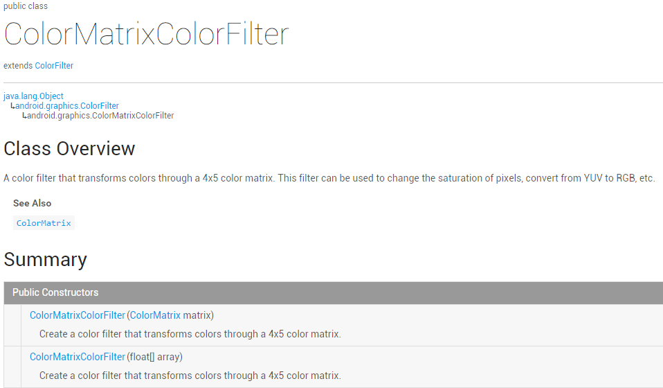

> 大概说的是：通过一个4 x 5的颜色矩阵来变换颜色，可以修改像素的饱和度，将YUV转换成RGB等！
> 而构造方法中的ColorMatrix就是颜色矩阵，也是我们学习的核心，下面听我一一道来！

> PS：[ColorMatrix的API文档](http://androiddoc.qiniudn.com/reference/android/graphics/ColorMatrix.html)

## 1.相关常识的普及：

### RGBA模型：

> RGBA不知道你听过没，黄绿蓝知道了吧，光的三基色，而RAGB则是在此的基础上多了一个透明度！
> **R(Red红色)**，**G(Green绿色)**，**B(Blue蓝色)**，**A(Alpha透明度)**；另外要和颜料的三
> 原色区分开来哦，最明显的区别就是颜料的三原色中用黄色替换了光三基色中的绿色！知道下就好，
> 有兴趣的可自行百度~

### 一些名词：

- **色调/色相**——物体传递的颜色

- **饱和度**——颜色的纯度，从0(灰)到100%(饱和)来进行描述
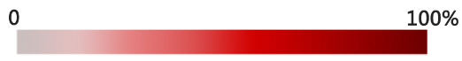

- **亮度/明度**——颜色的相对明暗程度

## 2.ColorMatrix的解读

> 如题，颜色矩阵(4 * 5)，我们可以修改矩阵中的值，来实现黑白照，泛黄老照片，高对比度等效果！
> 手撕颜色矩阵解释图如下：

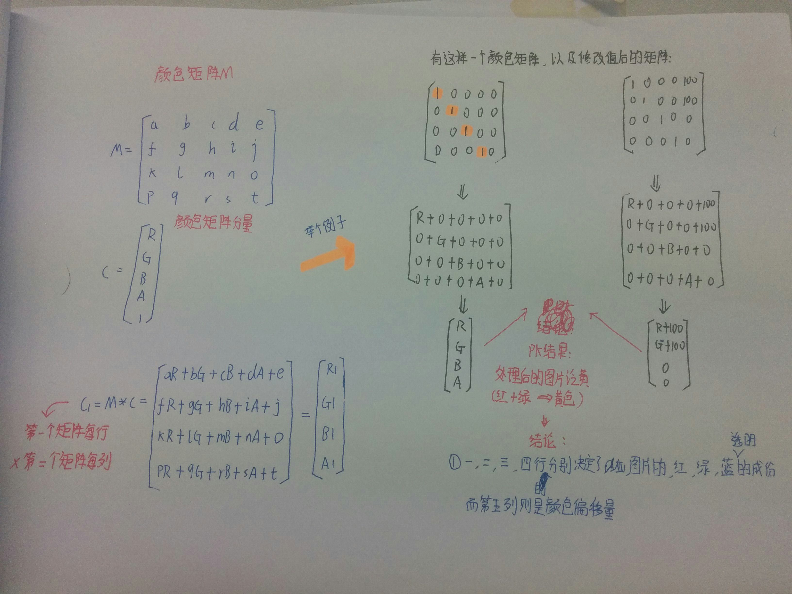

不知道你看懂上图没，如果你学过高数的话，肯定对此很熟悉，无非是矩阵的叉乘而已，没学过也没关系
计算方法就是右下角那个，**拿颜色矩阵的每一行来 * 颜色矩阵分量的每一列**！

很典型的一个例子，处理前后的结果比较，我们还可以让某**个颜色值 * 一个常数**，比如让第三行(蓝)
乘以2，效果就变成泛蓝色了，当然，我们肯定要写代码来验证验证上面的结果！

## 3.写代码来验证ColorMatrix所起的作用

> 这里来写烂大街的例子，一个ImageView，4 * 5个EditText，一个重置按钮和一个生成按钮，
> 我们来看下效果图：

依次是原图，泛黄，泛绿，泛红，高对比度，色相变换，以及黄色复古

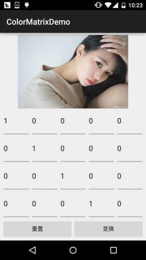 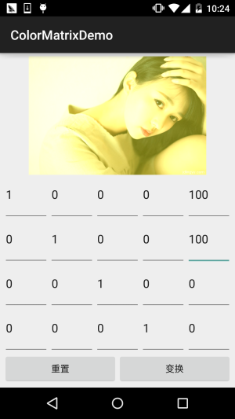

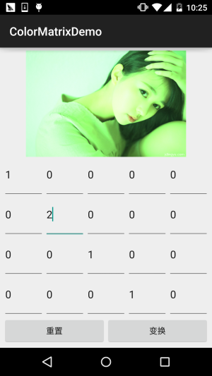 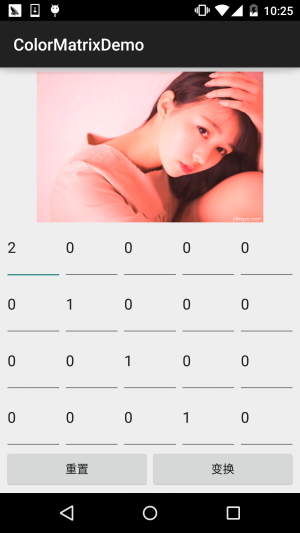

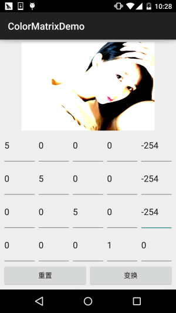 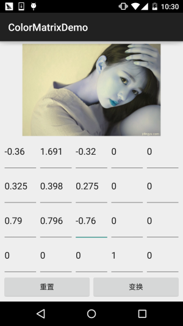

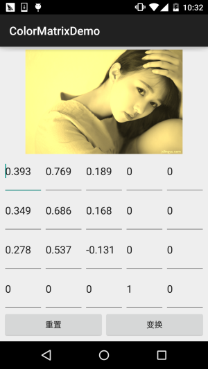

接下来我们来写代码，完成上述的效果：
**代码实现**：

首先是布局文件**activity_main.xml**：

接着是**MainActivity.java**：

代码非常的简单，就加载布局，然后往GridLayout里面塞 5 * 4 个EditText，这里用
post()方法是为了保证GridLayout加载完毕后才去获取长宽，不然在获取GridLayout长
宽的时候可是获取不到值的！接着定义了三个方法，初始矩阵，获取矩阵值，以及根据
矩阵值来处理图片~是不是很简单咧~

不过到这里你可能有一点**疑问**：

> " 难道处理图像我们只能这样修改颜色矩阵么？次次都这样肯定很麻烦，谁会去记矩阵
> 里的应该填的值？有没有简单一点处理图片的方法？ "

> 答：肯定是有的，我们可以看回文档，我们可以发现几个很常用的方法：
> **setRotate**(int axis, float degrees)：设置色调

> **setSaturation**(float sat)：设置饱和度

> **setScale**(float rScale, float gScale, float bScale, float aScale)：设置亮度

> 下面我们写个例子来试下这个三个方法！

## 4.使用ColorMatrix的三个方法处理图像

**运行效果图**：

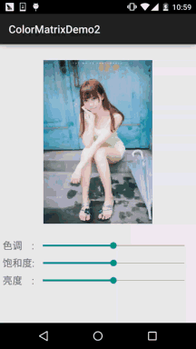

**代码实现**：

首先我们来编写一个图片处理的工具类，我们传入Bitmap，色相，饱和度以及亮度，处理后，返回
处理后的图片：**ImageHelper.java**：

接下来我们把布局也撸出来，**activity_main.xml**：

最后是我们的**MainActivity.java**：

代码同样很简单，这里就不讲解了~

## 5.本节代码示例下载：

[ColorMatrixDemo.zip](http://static.runoob.com/download/ColorMatrixDemo.zip)

[ColorMatrixDemo2.zip](http://static.runoob.com/download/ColorMatrixDemo2.zip)

## 本节小结：

> 好的，本节跟大家介绍了**ColorFilter**中的第一个**ColorMatrixColorFilter**，颜色矩阵过滤器
> 其实核心还是ColorMatrix，我们通过该类处理图片可以自己设置4*5矩阵的值，又或者直接调用
> ColorMatrix给我们提供的设置色调，饱和度，亮度的方法！图像处理无非就这样，还有一种是修改
> 像素点形式的，后面也会讲，本节内容参考自——医生(徐宜生)的慕客网视频：
> [Android图像处理-打造美图秀秀从它开始](http://www.imooc.com/learn/302)，不想看文字的可以看视频，讲得还是蛮赞的~

### 图片清单

1. 图1 -> images/39876874.jpg （原图：https://www.runoob.com/wp-content/uploads/2015/10/39876874.jpg）
2. 图2 -> images/87787621.jpg （原图：https://www.runoob.com/wp-content/uploads/2015/10/87787621.jpg）
3. 图3 -> images/37148254.jpg （原图：https://www.runoob.com/wp-content/uploads/2015/10/37148254.jpg）
4. 图4 -> images/9407252.jpg （原图：https://www.runoob.com/wp-content/uploads/2015/10/9407252.jpg）
5. 图5 -> images/92928364.jpg （原图：https://www.runoob.com/wp-content/uploads/2015/10/92928364.jpg）
6. 图6 -> images/53679704.jpg （原图：https://www.runoob.com/wp-content/uploads/2015/10/53679704.jpg）
7. 图7 -> images/36562322.jpg （原图：https://www.runoob.com/wp-content/uploads/2015/10/36562322.jpg）
8. 图8 -> images/93111170.jpg （原图：https://www.runoob.com/wp-content/uploads/2015/10/93111170.jpg）
9. 图9 -> images/55826138.jpg （原图：https://www.runoob.com/wp-content/uploads/2015/10/55826138.jpg）
10. 图10 -> images/22469866.jpg （原图：https://www.runoob.com/wp-content/uploads/2015/10/22469866.jpg）
11. 图11 -> images/71970690.jpg （原图：https://www.runoob.com/wp-content/uploads/2015/10/71970690.jpg）
12. 图12 -> images/41645227.jpg （原图：https://www.runoob.com/wp-content/uploads/2015/10/41645227.jpg）
13. 图13 -> images/48170375.jpg （原图：https://www.runoob.com/wp-content/uploads/2015/10/48170375.jpg）
