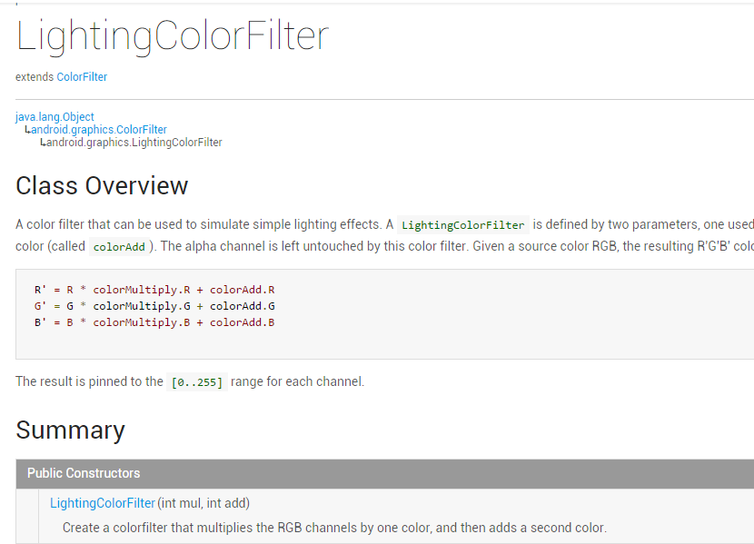
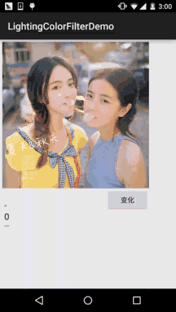

# 8.3.10 Paint API之—— ColorFilter(颜色过滤器)(2-3)

> 来源: https://www.runoob.com/w3cnote/android-tutorial-colorfilterl2.html

## 本节引言：

> 上一节中我们讲解了Android中Paint **API**中的**ColorFilter**(颜色过滤器)的第一个子类：
> **ColorMatrixColorFilter**(颜色矩阵颜色过滤器)，相信又开阔了大家的Android图像处理视野，
> 而本节我们来研究它的第二个子类：**LightingColorFilter**(光照色彩颜色过滤器)，先上一发
> 官方API文档：[LightingColorFilter](http://androiddoc.qiniudn.com/reference/android/graphics/LightingColorFilter.html)，文档里的东西也不多，关键的在这里：

> 

> 大概意思就是：一个颜色过滤器，可以用来模拟简单的灯光效果，构造方法的参数有两个，一个
> 用来乘以原图的RPG值，一个添加到前面得出的结果上！其实计算方法无非：
> **(RGB值 * mul + Add) % 255**，从而得到新的RPG值，这里的%是求余，另外，整个过程中Alpha不
> 参与改变！下面我们写个示例来验证验证！

## 1.代码示例：

**运行效果图**：

**实现代码**：

先是一个简单的布局：**activity_main.xml**：

接着是我们的**MainActiivty.java**，同样很简单：

好了，LightingColorFilter的使用演示完毕~

## 3.本节代码下载

[LightingColorFilterDemo.zip](http://static.runoob.com/download/LightingColorFilterDemo.zip)

## 本节小结：

> 嗯，本节演示了一下LightingColorFilter的一个基本用法，用来模拟简单的灯光效果，
> 实现简单的图片处理效果，好的，本节就到这里，谢谢~

### 图片清单

1. 图1 -> images/80384098.jpg （原图：https://www.runoob.com/wp-content/uploads/2015/10/80384098.jpg）
2. 图2 -> images/75555519.jpg （原图：https://www.runoob.com/wp-content/uploads/2015/10/75555519.jpg）
