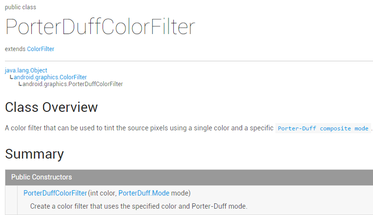
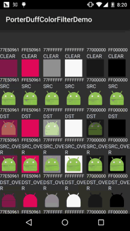
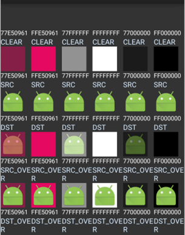
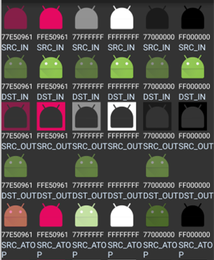
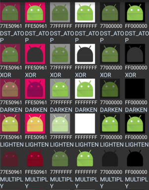
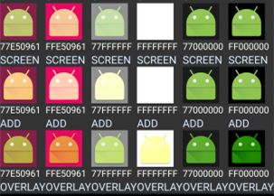

# 8.3.11 Paint API之—— ColorFilter(颜色过滤器)(3-3)

> 来源: https://www.runoob.com/w3cnote/android-tutorial-colorfilter3.html

## 本节引言：

> 嗯，本来说好今天不写的，还是写吧，毕竟难得空闲哈~，本节给大家带来的是
> ColorFilter的第三个子类：**PorterDuffColorFilter**，看到**PorterDuff**大家一定不会
> 陌生吧，假如你看过前面的
> [Android基础入门教程——8.3.5 Paint API之—— Xfermode与PorterDuff详解(二)](http://blog.csdn.net/coder_pig/article/details/49366747)
> 其实效果都是一样的，只是这里用的是颜色，而且直接设置就好，下面我们来写个简单的
> 例子，我们取6种不同的颜色，对18种模式进行测试！
> 官方API文档：[PorterDuffColorFilter](http://androiddoc.qiniudn.com/reference/android/graphics/PorterDuffColorFilter.html)
> 我们可以看到关键也是在于他的构造方法：

> 

> 前面是颜色，后面是模式~，来来来，写例子：

## 1.测试代码示例：

**运行效果图**：

**代码实现**：

这里的话我们用一个GridView来装他们，我们先来写下每个item的布局：**view_item.xml**：

接着我们编写一个POJO业务类：**Data.java**：

至于Adapter类的话我们用回以前写的可复用的自定义BaseAdapter类，这里就不贴了，不过要加
多个方法：

接着是我们的主布局文件:**activity_main.xml**：

最后是我们的**MainActivity.java**类，填充数据，设置Adapter，非常简单：

上面的动图可能太快，有时读者相查下，这里分开图截，因为没找到好用的截全屏工具，
所以这里只能分段截...

## 2.本节示例代码下载：

[PorterDuffColorFilterDemo2.zip](http://static.runoob.com/download/PorterDuffColorFilterDemo2.zip)

## 本节小结：

> 本节非常简短，API文档里就那么个用法，这里也把18种情况也列举出来了，相信
> 会对大家学习图像混排带来帮助~谢谢，今天请了一天假，会学校又感受了下学生的
> 感觉，去了一趟图书馆，看了一大波的美女，然后心情就nice了，决定还是暂时先
> 在这个公司好好滴做一个实习生，换了环境不一定能改变什么，先从改变自己开始吧~

> PS：例子摘自Github：[ColorFilterTest](https://github.com/gaeeyo/ColorFilterTest)
> 

### 图片清单

1. 图1 -> images/98182444.jpg （原图：https://www.runoob.com/wp-content/uploads/2015/10/98182444.jpg）
2. 图2 -> images/screen.gif （原图：https://www.runoob.com/wp-content/uploads/2015/10/screen.gif）
3. 图3 -> images/11437926.jpg （原图：https://www.runoob.com/wp-content/uploads/2015/10/11437926.jpg）
4. 图4 -> images/58287214.jpg （原图：https://www.runoob.com/wp-content/uploads/2015/10/58287214.jpg）
5. 图5 -> images/93006246.jpg （原图：https://www.runoob.com/wp-content/uploads/2015/10/93006246.jpg）
6. 图6 -> images/65157006.jpg （原图：https://www.runoob.com/wp-content/uploads/2015/10/65157006.jpg）
7. 图7 -> images/97043181.jpg （原图：https://www.runoob.com/wp-content/uploads/2015/10/97043181.jpg）
