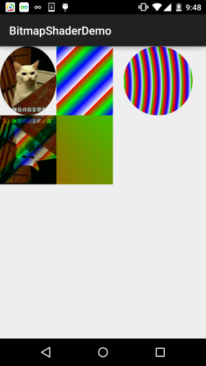

# 8.3.13 Paint API之—— Shader(图像渲染)

> 来源: https://www.runoob.com/w3cnote/android-tutorial-shader.html

## 1.构造方法详解

### 1)BitmapShader(图像渲染)

**BitmapShader(Bitmap bitmap, Shader.TileMode tileX, Shader.TileMode tileY)**

> 使用一张位图作为纹理来对某一区域进行填充，参数依次：

> - 
> **bitmap**：用来作为填充的位图；

> - 
> **tileX**：X轴方向上位图的衔接形式；

> - 
> **tileY**：Y轴方向上位图的衔接形式；

> 而这个Shader.TileMode有三种：

> - 
> **CLAMP**就是如果渲染器超出原始边界范围，则会复制边缘颜色对超出范围的区域进行着色

> - 
> **REPEAT**则是平铺形式重复渲染

> - **MIRROR**则是在横向和纵向上以镜像的方式重复渲染位图。

### 2)ComposeShader(混合渲染)

**ComposeShader(Shader shaderA, Shader shaderB, PorterDuff.Mode mode)**

> 渲染效果的叠加，看到PorterDuff就知道什么了吧？比如将BitmapShader与LinearGradient的混合渲染
> 效果等。参数依次：

> - 
> **shaderA**：第一种渲染效果

> - 
> **shaderB**：第二种渲染效果

> - 
> **mode**：两种渲染效果的叠加模式

### 3)LinearGradient(线性渲染)

**LinearGradient(float x0, float y0, float x1, float y1, int[] colors, float[] positions, Shader.TileMode tile);**

> 实现某一区域内颜色的线性渐变效果，参数依次是：

> - 
> **x0**：渐变的起始点x坐标

> - 
> **y0**：渐变的起始点y坐标

> - 
> **x1**：渐变的终点x坐标

> - 
> **y1**：渐变的终点y坐标

> - 
> **colors**：渐变的颜色数组

> - 
> **positions**：颜色数组的相对位置

> - 
> **tile**：平铺方式

### 4)RadialGradient(环形渲染)

**public RadialGradient (float x, float y, float radius, int[] colors, float[] positions, Shader.TileMode tile);**

> 实现某一区域内颜色的环形渐变效果，参数依次是：

> - 
> **x**：环形的圆心x坐标

> - 
> **y**：环形的圆心y坐标

> - 
> **radius**：环形的半径

> - 
> **colors**：环形渐变的颜色数组

> - 
> **positions**：指定颜色数组的相对位置

> - 
> **tile**：平铺方式

### 5)SweepGradient(梯度渲染)

**public SweepGradient (float cx, float cy, int[] colors, float[] positions)**

> 扫描渲染，就是以某个点位中心旋转一周所形成的效果！参数依次是：

> - 
> **cx**：扫描的中心x坐标

> - 
> **cy**：扫描的中心y坐标

> - 
> **colors**：梯度渐变的颜色数组

> - 
> **positions**：指定颜色数组的相对位置

可能从文字上我们可以简单的知道下他们对应的一个大概作用，但是我们还是写个代码来
验证下他们所起的作用，毕竟有码(图)有真相吗~

## 2.使用代码示例：

**运行效果图**：

**实现代码**：

**BitmapShaderView.java**：

就那么一百来行代码，就不用解释了吧，如果觉得有疑惑的，动手试试~

## 3.本节代码下载：

[BitmapShaderDemo.zip](http://static.runoob.com/download/BitmapShaderDemo.zip)

## 本节小结：

> 本节给大家介绍了Paint的另一个API：Shader(图像渲染)，又让我们的画笔增添了一种选择~
> 如果你看到代码有疑惑，不懂把代码粘下，改改参数，就懂了~
> 好的，本节就到这里，谢谢~

### 图片清单

1. 图1 -> images/52026720.jpg （原图：https://www.runoob.com/wp-content/uploads/2015/11/52026720.jpg）
