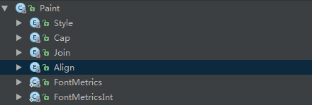
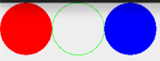
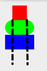
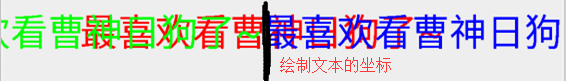
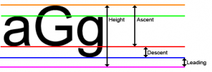
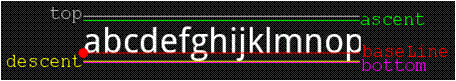
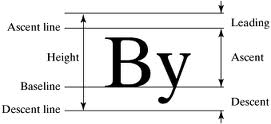
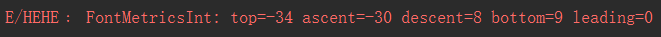
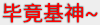

# 8.3.14 Paint几个枚举/常量值以及ShadowLayer阴影效果

> 来源: https://www.runoob.com/w3cnote/android-tutorial-shadowlayer.html

## 本节引言：

> 在[Android基础入门教程——8.3.1 三个绘图工具类详解](//www.runoob.com/w3cnote/android-tutorial-drawable-tool.html)Paint的方法参数那里我们就接触到
> 了这样几个东西：Paint.Style，Paint.Cap，Paint.Join等，这些都是Paint中的一些枚举值，相关
> 方法我们可以通过设置这些枚举值来设置特定效果比如：Style：画笔样式，Join图形结合方式等，
> 本节我们走进Paint的源码，我们来一一介绍这些枚举值，另外我们也顺道讲下这个ShadowLayer
> 设置带阴影效果的Paint！打开Paint类的源码，我们可以看到下述这些枚举值：

> 

> 好了，不BB，开始本节内容！

## 1.get枚举用法：

不知大家对枚举陌生还是熟悉，这里把贴下Paint.Style相关的调用代码(带有参构造方法的枚举)
，让大家体会体会：

下面我们一一来解释这些枚举值的作用！

## 1.Paint.Style

> 作用：画笔的样式
> 可选值：

> - **FILL**：填充内部(默认)

> - **STROKE**：只描边

> - **FILL_AND_STROKE**：填充内部与描边

> 方法调用：**setStyle(Paint.Style style)**
> 对应效果：

> 

## 2.Paint.Cap

> 作用：笔触风格，设置画笔始末端的图形(画笔开始画的第一点与最后一点)
> 可选值：

> - **BUTT**：笔触是长方形且不超过路径(默认)

> - **ROUND**：笔触是圆形

> - **SQUARE**：笔触是正方形

> 方法调用：**setStrokeCap(Paint.Cap cap)**

> 对应效果：平时我们直接画的是第一个，其他两个会比普通的多一点而外的区域，第二个
> 是圆角，第三个是矩形！

> 

## 3.Paint.Join

> 作用：设置接合处的状态，比如你的线是由多条小线拼接而成，拼接处的形状
> 可选值：

> - **MITER**：接合处为锐角(默认)

> - **ROUND**：接合处为圆弧

> - **BEVEL**：接合处为直线

> 方法调用：**setStrokeJoin(Paint.Join join)**

> 一般圆弧用得多，可参见之前的[擦掉美女衣服Demo的显示](//www.runoob.com/w3cnote/android-tutorial-xfermode-porterduff4.html)

> 另外还有个**setStrokeMiter(float miter)**是设置笔画的倾斜度，miter > = 0；
> 如：小时候用的铅笔，削的时候斜与垂直削出来的笔尖效果是不一样的。
> 主要是用来设置笔触的连接处的样式。可以和setStrokeJoin()来比较比较。

## 4.Paint.Align

> 作用：设置绘制文本的对其方式，就是相对于绘制文字的[x,y]起始坐标
> 可选值：

> - **LEFT**：在起始坐标的左边绘制文本

> - **RIGHT**：在起始坐标的右边绘制文本

> - **CENTER**：以其实坐标为中心绘制文本

> 方法调用：**setTextAlign(Paint.Align align)**

> 对应效果：另外可调用setTextSize()设置绘制文本的大小~

> 

## 5.Paint.FontMetrics和Paint.FontMetricsInt

> 字体属性及测量，另外这两个方法是一样的，只是后者取到的值是一个整形，
> 这里我们选FontMetricsInt来给大家讲解下，有下面这五个常量值，这里参考的基准点是：
> 下划线的位置(**Baseline**)

> - **top**：最高字符到baseline的距离，即ascent的最大值

> - **ascent**：字符最高处的距离到baseline的值

> - **descent**：下划线到字符最低处的距离

> - **bottom**：下划线到最低字符的距离，即descent的最大值

> - **leading**：上一行字符的descent到下一行的ascent之间的距离

> 我们看几个图帮助理解下：

> 

> 

> 

> 然后我们随意画一串字母，把这些值打印出来：
> **canvas.drawText("abcdefghijklnmopqrstuvwxyz", 400, 400, mPaint1);**
> **Log.e("HEHE", mPaint1.getFontMetricsInt().toString());**
> 运行下，我们可以看到，打印出来的Log如下：

> 

> 看完思考思考，画一画，应该不难理解！这里我们知道下就好，如果你想更
> 深入研究，可以参考下这篇：[Android字符串进阶之三：字体属性及测量（FontMetrics）](http://mikewang.blog.51cto.com/3826268/871765/)

## 6.ShadowLayer设置阴影效果

> 我们在TextView那一节就教过大家为TextView的文本设置阴影效果，而Paint其实也提供了设置
> 阴影效果的API：**setShadowLayer(float radius, float dx, float dy, int shadowColor)**

> 参数：radius为阴影的角度，dx和dy为阴影在x轴和y轴上的距离，shadowColor为阴影的颜色
> 我们可以写个非常简单的句子验证下：

**效果如下**：

另外我们还可以调用**clearShadowLayer()**来清除这个阴影层~

## 本节小结：

> 好的，本节给大家讲解了下Paint里面的几个枚举值以及静态常量，以及ShadowLayer为画笔
> 设置阴影效果或调用clearShadowLayer()清除阴影层~其实这些东西都可以自己去看源码以及
> 文档，有疑惑就动手写个Demo，很多东西就自然一清二楚的了，嗯，就说这么多，谢谢~

> 另外，可能你不知道在哪看到了我的QQ，但是可以的话尽量加群好么，平时也要上班，
> 一个两个还好，一堆人，有心无力，有时帮忙解决问题，结果一天什么都没做，望各位体谅，
> 有问题加请加小猪群，群管理都是非常热心的：**421858269**~

### 图片清单

1. 图1 -> images/78803613.jpg （原图：https://www.runoob.com/wp-content/uploads/2015/11/78803613.jpg）
2. 图2 -> images/49625903.jpg （原图：https://www.runoob.com/wp-content/uploads/2015/11/49625903.jpg）
3. 图3 -> images/69848625.jpg （原图：https://www.runoob.com/wp-content/uploads/2015/11/69848625.jpg）
4. 图4 -> images/52138677.jpg （原图：https://www.runoob.com/wp-content/uploads/2015/11/52138677.jpg）
5. 图5 -> images/38400901.jpg （原图：https://www.runoob.com/wp-content/uploads/2015/11/38400901.jpg）
6. 图6 -> images/77090782-2.jpg （原图：https://www.runoob.com/wp-content/uploads/2015/11/77090782.jpg）
7. 图7 -> images/82757632.jpg （原图：https://www.runoob.com/wp-content/uploads/2015/11/82757632.jpg）
8. 图8 -> images/69209696.jpg （原图：https://www.runoob.com/wp-content/uploads/2015/11/69209696.jpg）
9. 图9 -> images/12266092.jpg （原图：https://www.runoob.com/wp-content/uploads/2015/11/12266092.jpg）
10. 图10 -> images/95101606.jpg （原图：https://www.runoob.com/wp-content/uploads/2015/11/95101606.jpg）
