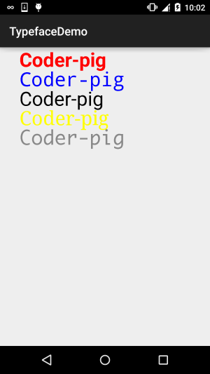

# 8.3.15 Paint API之——Typeface(字型)

> 来源: https://www.runoob.com/w3cnote/android-tutorial-typeface.html

> 本节带来Paint API系列的最后一个API，**Typeface(字型)**，由字义，我们大概可以猜到，这个
> API是用来设置字体以及字体风格的，使用起来也非常的简单！下面我们来学习下Typeface的一些相关
> 的用法！

> 官方API文档：[Typeface](http://androiddoc.qiniudn.com/reference/android/graphics/Typeface.html)~

> 

## 1.字体的可选风格

> 四个整型常量：

> - **BOLD**：加粗

> - **ITALIC**：斜体

> - **BOLD_ITALIC**：粗斜体

> - **NORMAL**：正常

## 2.可选字体对象(Typeface)

> Android系统默认支持三种字体，分别为：**sans**，**serif**，**monospace**
> 而提供的可选静态对象值有五个：

> - **DEFAULT**：默认正常字体对象

> - **DEFAULT_BOLD**：默认的字体对象，注意:这实际上不可能是粗体的,这取决于字体设置。
> 由getStyle()来确定

> - **MONOSPACE**：monospace 字体风格

> - **SANS_SERIF**：sans serif字体风格

> - **SERIF**：serif字体风格

## 3.自定义创建字型

> 可能默认的三种字体并不能满足你，可能你喜欢MAC的字体——**Monaco字体**，你想让你APP
> 里的文字可以用这种字体，首先准备好我们的TTF文件，然后丢到**assets/font/**目录下
> 然后创建对应对象，关键代码如下：

> **Typeface typeFace =Typeface.createFromAsset(getAssets(),"font/MONACO.ttf");**

## 4.使用代码示例：

**运行效果图**：

自定义的View类：**MyView.java**：

恩呢，非常简单~就不解释了，要字体的可以自己百度或者下载示例代码~

## 本节示例代码下载：

[TypefaceDemo.zip](http://static.runoob.com/download/TypefaceDemo.zip)

## 本节小结：

> 好的，一连十几节的Paint API详解就到这里了，应该已经涵盖大部分的可能会用到的API了，
> 不知道你都Get了没，这些都是为我们进阶部分的自定义控件做铺垫~嗯，就说这么多，谢谢~

### 图片清单

1. 图1 -> images/98427188.jpg （原图：https://www.runoob.com/wp-content/uploads/2015/11/98427188.jpg）
2. 图2 -> images/69781721.jpg （原图：https://www.runoob.com/wp-content/uploads/2015/11/69781721.jpg）
