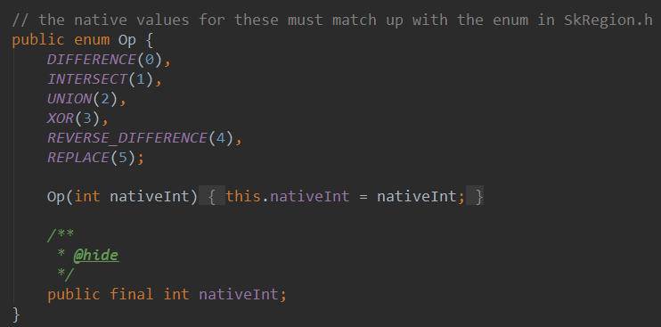
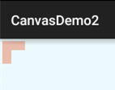
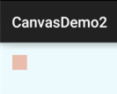
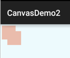
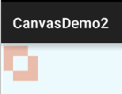
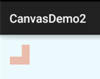
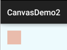
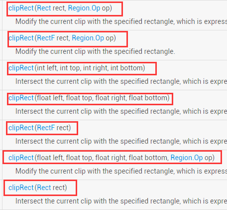
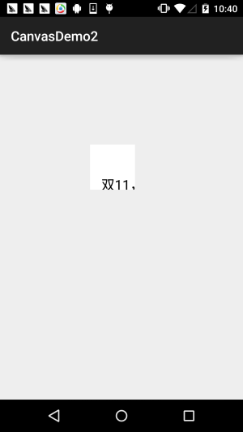
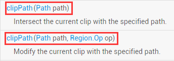

# 8.3.17 Canvas API详解(Part 2)剪切方法合集

> 来源: https://www.runoob.com/w3cnote/android-tutorial-canvas-api2.html

## 本节引言：

> 本节继续带来Android绘图系列详解之Canvas API详解(Part 2)，今天要讲解的是Canvas
> 中的ClipXxx方法族！我们可以看到文档中给我们提供的Clip方法有三种类型：
> **clipPath**( )，**clipRect**( )，**clipRegion**( )；

> 通过Path，Rect，Region的不同组合，几乎可以支持任意形状的裁剪区域！

> **Path**：可以是开放或闭合的曲线，线构成的复杂的集合图形

> **Rect**：矩形区域

> **Region**：可以理解为区域组合，比如可以将两个区域相加，相减，并，疑惑等！

> Region.Op定义了Region支持的区域间运算种类！等下我们会讲到，
> 另外要说一点，我们平时理解的剪切可能是对已经存在的图形进行Clip，但是Android中对
> Canvas进行Clip，是要在画图前进行的，如果画图后再对Canvas进行Clip的话将不会影响
> 到已经画好的图形，记住Clip是针对Canvas而非图形！
> 嗯，不BB，直接开始本节内容！

**官方API文档**：[Canvas](http://androiddoc.qiniudn.com/reference/android/graphics/Canvas.html)

## 1.Region.Op组合方式详解

> 其实难点无非这个，Region代表着区域，表示的是Canvas图层上的某一块封闭区域！
> 当然，有时间你可以自己慢慢去扣这个类，而我们一般关注的只是他的一个枚举值：**Op**

> 

> 下面我们来看看个个枚举值所起的作用：
> 我们假设两个裁剪区域A和B，那么我们调用Region.Op对应的枚举值：

> **DIFFERENCE**：A和B的**差集**范围，即A - B，只有在此范围内的绘制内容才会被显示；

> **INTERSECT**：即A和B的**交集**范围，只有在此范围内的绘制内容才会被显示

> **UNION**：即A和B的**并集**范围，即两者所包括的范围的绘制内容都会被显示；

> **XOR**：A和B的**补集**范围，此例中即A除去B以外的范围，只有在此范围内的绘制内容才会被显示；

> **REVERSE_DIFFERENCE**：B和A的**差集**范围，即B - A，只有在此范围内的绘制内容才会被显示；

> **REPLACE**：不论A和B的集合状况，B的范围将全部进行显示，如果和A有交集，则将覆盖A的交集范围；

> 如果你学过集合，那么画个Venn(韦恩图)就一清二楚了，没学过？没事，我们写个例子来试试
> 对应的结果~！写个初始化画笔以及画矩形的方法:

### **Op.DIFFERENCE**：

**结果**：

先后在(10,10)以及(50,50)为起点，裁剪了两个100*100的矩形，得出的裁剪结果是：

**A和B的差集 = A - (A和B相交的部分)**

### **Op.INTERSECT**：

**结果**：

先后在(10,10)以及(50,50)为起点，裁剪了两个100*100的矩形，得出的裁剪结果是：
**A和B的交集 = A和B相交的部分**

### **Op.UNION**：

**结果**：

先后在(10,10)以及(50,50)为起点，裁剪了两个100*100的矩形，得出的裁剪结果是：
**A和B的并集 = A的区域 + B的区域**

### **Op.XOR**：

**结果**：

先后在(10,10)以及(50,50)为起点，裁剪了两个100*100的矩形，得出的裁剪结果是：
**A和B的补集 = A和B的合集 - A和B的交集**

### **Op.REVERSE_DIFFERENCE**：

**结果**：

先后在(10,10)以及(50,50)为起点，裁剪了两个100*100的矩形，得出的裁剪结果是：
**B和A的差集 = B - A和B的交集**

### **Op.REPLACE**

**结果**：

先后在(10,10)以及(50,50)为起点，裁剪了两个100*100的矩形，得出的裁剪结果是：
**不论A和B的集合状况，B的范围将全部进行显示，如果和A有交集，则将覆盖A的交集范围；**

## 2.Region.Op使用实例：

例子参考自：[Android 2D Graphics学习（二）、Canvas篇2、Canvas裁剪和Region、RegionIterator](http://blog.csdn.net/lonelyroamer/article/details/8349601)

**运行效果图**：

**关键部分代码 MyView.java：**

**实现分析**：

> 初始化的时候获得宽高，然后循环，可以理解把图片分割成一条条的线，循环条件是：i * 每条的高度
> 不大于高度，然后线又分两种情况，调用的是Region的union，其实就是结合方式为UNINO的剪切方式
> 而已，最后是对此时图片的是否显示做下判断，隐藏和显示的情况做不同的处理，最后调用invalidate()
> 重绘！还是蛮简单的，自己理解理解吧~

另外要说一点：Canvas的变换对clipRegion没有作用

## 3.clipRect方法详解：

clipRect提供了七个重载方法：

**参数介绍如下**：

> **rect**：Rect对象，用于定义裁剪区的范围，Rect和RectF功能类似，精度和提供的方法不同而已

> **left**：矩形裁剪区的左边位置

> **top**：矩形裁剪区的上边位置

> **right**：矩形裁剪区的右边位置

> **bottom**：矩形裁剪区的下边位置

> **op**：裁剪区域的组合方式

> 上述四个值可以是浮点型或者整型

**使用示例**：

**运行结果**：

从上面的例子，不知道你发现了没？
clipRect会受Canvas变换的影响，白色区域是不花的区域，所以clipRect裁剪的是画布，
而我们的绘制是在这个裁剪后的画布上进行的！超过该区域的不显示！

## 4.clipPath方法详解：

相比起clipRect，clipPath就只有两个重载方法，使用方法非常简单，自己绘制一个Paht然后
传入即可！

**使用示例**：

这里复用我们以前在ImageView那里写的圆形ImageView的例子~

**实现代码**：

自定义ImageView：RoundImageView.java

布局代码：**activity_main.xml**:

**MainActivity.java**:

**运行效果图**：

另外使用该方法制作的圆角ImageView会有锯齿明显，即使你为Paint，Canvas设置了
抗锯齿也没用~假如你要求高的，可以使用Xfermode-PorterDuff设置图像混排来实现，
基本没锯齿，可见：[Android基础入门教程——8.3.6 Paint API之—— Xfermode与PorterDuff详解(三)](/w3cnote/android-tutorial-xfermode-porterduff3.html)

## 5.本节示例代码下载：

[CanvasDemo2.zip](http://static.runoob.com/download/CanvasDemo2.zip)

[XfermodeDemo1.zip](http://static.runoob.com/download/XfermodeDemo1.zip)

## 本节小结：

> 好的，本节给大家讲解了下Canvas中剪切有个的三个方法：clipPath( )，clipRect( )，
> clipRegion( )，难点应该是在最后一个上，六种不同的Op组合方式，其实也不难，集合
> 的概念而已，放在开头，消化了就好，而clipPath( )，clipRect( )则没什么难点~
> 对喔，今天双11，不知道你剁手了没~

### 图片清单

1. 图1 -> images/97976861.jpg （原图：https://www.runoob.com/wp-content/uploads/2015/11/97976861.jpg）
2. 图2 -> images/5388449.jpg （原图：https://www.runoob.com/wp-content/uploads/2015/11/5388449.jpg）
3. 图3 -> images/27925675.jpg （原图：https://www.runoob.com/wp-content/uploads/2015/11/27925675.jpg）
4. 图4 -> images/20979637.jpg （原图：https://www.runoob.com/wp-content/uploads/2015/11/20979637.jpg）
5. 图5 -> images/19796189.jpg （原图：https://www.runoob.com/wp-content/uploads/2015/11/19796189.jpg）
6. 图6 -> images/71471338.jpg （原图：https://www.runoob.com/wp-content/uploads/2015/11/71471338.jpg）
7. 图7 -> images/32825608.jpg （原图：https://www.runoob.com/wp-content/uploads/2015/11/32825608.jpg）
8. 图8 -> images/94503617.jpg （原图：https://www.runoob.com/wp-content/uploads/2015/11/94503617.jpg）
9. 图9 -> images/41170649.jpg （原图：https://www.runoob.com/wp-content/uploads/2015/11/41170649.jpg）
10. 图10 -> images/98791021.jpg （原图：https://www.runoob.com/wp-content/uploads/2015/11/98791021.jpg）
11. 图11 -> images/60897544.jpg （原图：https://www.runoob.com/wp-content/uploads/2015/11/60897544.jpg）
12. 图12 -> 下载失败：http://7xjqvu.com1.z0.glb.clouddn.com/15-7-18/62291148.jpg
13. 图13 -> images/82311731.jpg （原图：https://www.runoob.com/wp-content/uploads/2015/11/82311731.jpg）
