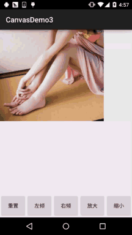
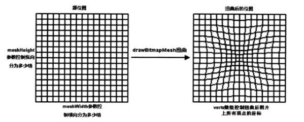
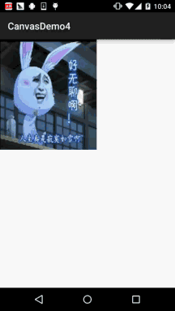

# 8.3.18 Canvas API详解(Part 3)Matrix和drawBitmapMesh

> 来源: https://www.runoob.com/w3cnote/android-tutorial-canvas-api3.html

## 本节引言：

> 在Canvas的API文档中，我们看到这样一个方法：**drawBitmap**(Bitmap bitmap, **Matrix** matrix, Paint paint)

> 这个Matrix可是有大文章的，前面我们在学Paint的API中的ColorFilter中曾讲过ColorMatrix
> 颜色矩阵，一个4 * 5 的矩阵，我们可以通过修改矩阵值来修改色调，饱和度等！
> 而今天讲的这个Matrix可以结合其他API来控制图形，组件的变换。比如Canvas就提供了上面的
> 这个drawBitmap来实现矩阵变换的效果！下面我们来慢慢研究这个东东~

> 官方API文档：[Matrix](http://androiddoc.qiniudn.com/reference/android/graphics/Matrix.html)

## 1.Matrix中的几个常用的变换方法

> - **setTranslate**(float dx, float dy)：控制Matrix进行平移

> - **setRotate**(float degrees, float px, float py)：旋转，参数依次是:旋转角度，轴心(x,y)

> - **setScale**(float sx, float sy, float px, float py):缩放，
> 参数依次是：X，Y轴上的缩放比例；缩放的轴心

> - **setSkew**(float kx, float ky)：倾斜(扭曲)，参数依次是：X，Y轴上的缩放比例

其实和Canvas变换的方法基本一致，在为Matrix设置了上面的变换后，调用Canvas的
drawBitmap()方法调用矩阵就好~

## 2.Matrix使用示例：

**运行效果图**：

**代码实现**：

**MyView.java**：

布局代码:**activity_main.xml**：

**MainActivity.java**：

用法非常简单，就不解释了~

## 3.drawBitmapMesh扭曲图像

> 在API文档中还有这样一个方法：
> **drawBitmapMesh**(Bitmap bitmap, int meshWidth, int meshHeight, float[] verts,
> int vertOffset, int[] colors, int colorOffset, Paint paint)

> 参数依次是：

> **bitmap**：需要扭曲的原位图

> **meshWidth**/**meshHeight**：在横/纵向上把原位图划分为多少格

> **verts**：长度为(meshWidth+1)*(meshHeight+2)的数组，他记录了扭曲后的位图各顶点(网格线交点)
> 位置，虽然他是一个一维数组，但是实际上它记录的数据是形如(x0,y0)，(x1,y1)..(xN,Yn)格式的数据，
> 这些数组元素控制对bitmap位图的扭曲效果

> **vertOffset**：控制verts数组从第几个数组元素开始对bitmap进行扭曲(忽略verOffset之前数据
> 的扭曲效果)

**代码示例**：

**运行效果图**：

**代码实现**：

**实现流程分析**：

> 首先你要弄清楚，这个verts数组存储的是什么？比如
> verts[0]和verts[1](http://androiddoc.qiniudn.com/reference/android/graphics/Matrix.html)，这两个相邻的元素其实表示的就是我们第一个点的x坐标和y坐标！
> 知道这一点，你就知道为什么有21 * 21个点，以及为什么数组长度等于这个值 * 2！
> 初始化部分也就懂了！

> 接着我们再来看看根据触摸事件计算verts数组元素的值的实现：
> 获得触摸点的x,y坐标，拿这个值去减对应点的x,y只，计算出触摸点和每个坐标点的距离
> 然后计算所谓的扭曲度：80000 / ((float) (dd * d))；扭曲度 >= 1的，直接让该坐标
> 点指向这个触摸点，< 1的，则让各个顶点向触摸点发生偏移，然后再调用invalidate()重绘~
> 大概就这样~多思考思考，如果还是不理解就算了~知道有这东西就好！

## 4.本节示例下载：

[CanvasDemo3.zip](http://static.runoob.com/download/CanvasDemo3.zip)

[CanvasDemo4.zip](http://static.runoob.com/download/CanvasDemo4.zip)

## 本节小结：

> 本节内容大部分摘自——李刚《Android》疯狂讲义，可能稍微容易理解一点吧~
> Matrix应该大部分的童鞋都能看懂，而drawBitmapMesh扭曲图像则可能需要一点
> 时间消化消化，看不懂也没什么哈~嗯，本节就到这里，谢谢
> 

### 图片清单

1. 图1 -> images/32127450.jpg （原图：https://www.runoob.com/wp-content/uploads/2015/11/32127450.jpg）
2. 图2 -> images/90747335.jpg （原图：https://www.runoob.com/wp-content/uploads/2015/11/90747335.jpg）
3. 图3 -> images/84992968.jpg （原图：https://www.runoob.com/wp-content/uploads/2015/11/84992968.jpg）
4. 图4 -> images/55309049.jpg （原图：https://www.runoob.com/wp-content/uploads/2015/11/55309049.jpg）
