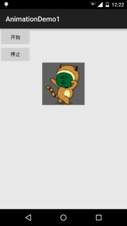
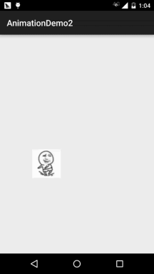

# 8.4.1 Android动画合集之帧动画

> 来源: https://www.runoob.com/w3cnote/android-tutorial-animation.html

## 本节引言：

> 从本节开始我们来探究Android中的动画，毕竟在APP中添加上一些动画，会让我们的应用变得
> 很炫，比如最简单的关开Activity，当然自定义控件动画肯定必不可少啦~而Android中的动画
> 分为三大类，**逐帧动画(Frame)**以及**补间动画(Tween)**，还有Android 3.0以后引入的**属性动画**
> **(Property)**，而本节给大家带来的是第一种动画——逐帧动画的一个基本使用~
> 

## 1.帧动画概念以及用法

> 帧动画非常容易理解，其实就是简单的由N张静态图片收集起来，然后我们通过控制依次显示
> 这些图片，因为人眼"视觉残留"的原因，会让我们造成动画的"错觉"，跟放电影的原理一样！

> 而Android中实现帧动画，一般我们会用到前面讲解到的一个Drawable：[AnimationDrawable](//www.runoob.com/w3cnote/android-tutorial-drawable2.html)
> 先编写好Drawable，然后代码中调用start()以及stop()开始或停止播放动画~

> 当然我们也可以在Java代码中创建逐帧动画，创建AnimationDrawable对象，然后调用
> addFrame(Drawable frame,int duration)向动画中添加帧，接着调用start()和stop()而已~

> 下面我们来写两个例子体会下帧动画的效果以及熟悉下用法

## 2.使用示例：

### **示例一：最简单的例子**：

**运行效果图**：

**代码实现**：

首先编写我们的动画文件，非常简单，先在res下创建一个anim目录，接着开始撸我们的
动画文件：**miao_gif.xml**：
这里的android:oneshot是设置动画是否只是播放一次，true只播放一次，false循环播放！

动画文件有了，接着到我们的布局文件：**activity_main.xml**：

最后是我们的**MainActivity.java**，这里在这里控制动画的开始以及暂停：

好的，非常的简单哈~

### 示例二：在指定地方播放帧动画

**运行效果图**：

**代码实现**：

依旧是先上我们的动画文件:**anim_zhuan.xml**：

接着我们来写一个自定义的ImageView：**FrameView.java**，这里通过反射获得当前播放的帧，
然后是否为最后一帧，是的话隐藏控件！

最后是我们的**MainActivity.java**，创建一个FrameLayout，添加View，对触摸事件中按下的
事件做处理，显示控件以及开启动画~

好的，同样很简单哈~

## 3.本节示例代码和Gif帧提取工具下载

[AnimationDemo1.zip](http://static.runoob.com/download/AnimationDemo1.zip)

[AnimationDemo2.zip](http://static.runoob.com/download/AnimationDemo2.zip)

[Gif帧提取工具](http://static.runoob.com/download/HA_AVD_Animated_GIF_producer_V5.2_FULL_Fix_ata.rar)

## 本节小结：

> 好的，本节给大家介绍了一下Android三种动画中最简单的帧动画，实际开发用的并不多
> 不过学多点东西，以后也多个思路嘛~好的，本节就到这里，谢谢~

### 图片清单

1. 图1 -> images/92102498.jpg （原图：https://www.runoob.com/wp-content/uploads/2015/11/92102498.jpg）
2. 图2 -> images/81922813.jpg （原图：https://www.runoob.com/wp-content/uploads/2015/11/81922813.jpg）
3. 图3 -> images/90866559.jpg （原图：https://www.runoob.com/wp-content/uploads/2015/11/90866559.jpg）
