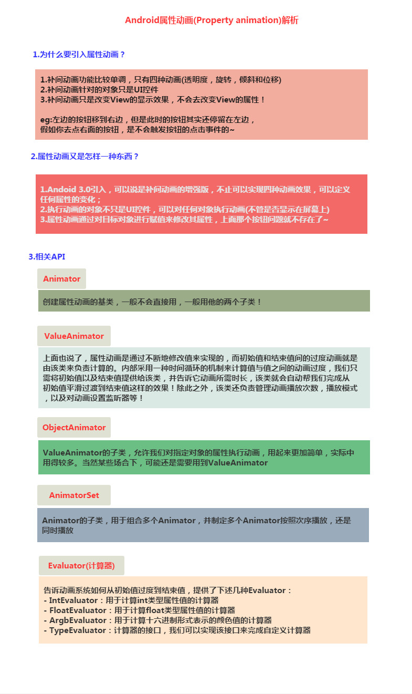
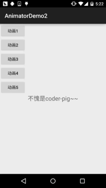
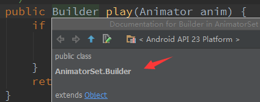

# 8.4.3 Android动画合集之属性动画-初见

> 来源: https://www.runoob.com/w3cnote/android-tutorial-valueanimator.html

## 本节引言：

本节给带来的是Android动画中的第三种动画——属性动画(Property Animation)，
记得在上一节[8.4.2 Android动画合集之补间动画](https://www.runoob.com/w3cnote/android-tutorial-alphaanimation.html)为Fragment
设置过渡动画的时候，说过，App包和V4包下的Fragment调用setCustomAnimations()对应的
动画类型是不一样的，v4包下的是**Animation**，而app包下的是**Animator**；

**Animation一般动画**就是我们前面学的**帧动画和补间动画**！**Animator**则是本节要讲的**属性动画**！

关于属性动画，大牛郭大叔已经写了三篇非常好的总结文，写得非常赞，就没必要重复造轮子了，
不过这里还是过一遍，大部分内容参考的下面三篇文章：

[Android属性动画完全解析(上)，初识属性动画的基本用法](http://blog.csdn.net/guolin_blog/article/details/43536355)

[Android属性动画完全解析(中)，ValueAnimator和ObjectAnimator的高级用法](http://blog.csdn.net/guolin_blog/article/details/43816093)

[Android属性动画完全解析(下)，Interpolator和ViewPropertyAnimator的用法](http://blog.csdn.net/guolin_blog/article/details/44171115)

写的非常好，或者说你可以直接跳过本文去看上面的三篇文章~

当然，你愿意看我叨叨逼的话，也很欢迎，好了，开始本节内容吧~

## 1.属性动画概念叨叨逼

不BB，直接上图，就是这么暴力~

## 2.ValueAnimator简单使用

**使用流程**：

- 1.调用ValueAnimator的**ofInt**()，**ofFloat**()或**ofObject**()静态方法创建ValueAnimator实例

- 2.调用实例的setXxx方法设置动画持续时间，插值方式，重复次数等

- 3.调用实例的**addUpdateListener**添加**AnimatorUpdateListener**监听器，在该监听器中
可以获得ValueAnimator计算出来的值，你可以值应用到指定对象上~

- 4.调用实例的**start()**方法开启动画！
另外我们可以看到ofInt和ofFloat都有个这样的参数：float/int... values代表可以多个值！

**使用示例**：

**代码实现**：

布局文件：**activity_main.xml**，非常简单，四个按钮，一个ImageView

接着到**MainActivity.java**，
首先需要一个修改View位置的方法，这里调用**moveView**()设置左边和上边的起始坐标以及宽高！

接着定义了四个动画，分别是：直线移动，缩放，旋转加透明，以及圆形旋转！

然后通过按钮触发对应的动画~

好的，使用的流程非常简单，先创建ValueAnimator对象，调用ValueAnimator.ofInt/ofFloat
获得，然后设置动画持续时间，**addUpdateListener**添加**AnimatorUpdateListener**事件监听，
然后使用参数**animation**的**getAnimatedValue**()获得当前的值，然后我们可以拿着这个值
来修改View的一些属性，从而形成所谓的动画效果，接着设置setInterpolator动画渲染模式，
最后调用start()开始动画的播放~

卧槽，直线方程，圆的参数方程，我都开始方了，这不是高数的东西么，
挂科学渣连三角函数都忘了...

例子参考自github：[MoveViewValueAnimator](https://github.com/nuptboyzhb/MoveViewValueAnimator)

## 3.ObjectAnimator简单使用

比起ValueAnimator，ObjectAnimator显得更为易用，通过该类我们可以**直接**
**对任意对象的任意属性进行动画操作**！没错，是任意对象，而不单单只是View对象，
不断地对对象中的某个属性值进行赋值，然后根据对象属性值的改变再来决定如何展现
出来！比如为TextView设置如下动画：
**ObjectAnimator.ofFloat(textview, "alpha", 1f, 0f);**
这里就是不断改变alpha的值，从1f - 0f，然后对象根据属性值的变化来刷新界面显示，从而
展现出淡入淡出的效果，而在TextView类中并没有alpha这个属性，ObjectAnimator内部机制是：
**寻找传输的属性名对应的get和set方法~，而非找这个属性值！**
不信的话你可以到TextView的源码里找找是否有alpha这个属性！
好的，下面我们利用ObjectAnimator来实现四种补间动画的效果吧~

**运行效果图**：

**代码实现**：

布局直接用的上面那个布局，加了个按钮，把ImageView换成了TextView，这里就不贴代码了，
直接上**MainActivity.java**部分的代码，其实都是大同小异的~

用法也非常简单，上面涉及到的组合动画我们下面讲~

## 4.组合动画与AnimatorListener

从上面两个例子中我们都体验了一把组合动画，用到了**AnimatorSet**这个类！

我们调用的play()方法，然后传入第一个开始执行的动画，此时他会返回一个Builder类给我们：

接下来我们可以调用Builder给我们提供的四个方法，来组合其他的动画：

- **after**(Animator anim) 将现有动画插入到传入的动画之后执行

- **after**(long delay) 将现有动画延迟指定毫秒后执行

- **before**(Animator anim) 将现有动画插入到传入的动画之前执行

- **with**(Animator anim) 将现有动画和传入的动画同时执行

嗯，很简单，接下来要说下动画事件的监听，上面我们ValueAnimator的监听器是
**AnimatorUpdateListener**，当值状态发生改变时候会回调**onAnimationUpdate**方法！

除了这种事件外还有：动画进行状态的监听~ **AnimatorListener**，我们可以调用**addListener**方法
添加监听器，然后重写下面四个回调方法：

- **onAnimationStart()**：动画开始

- **onAnimationRepeat()**：动画重复执行

- **onAnimationEnd()**：动画结束

- **onAnimationCancel()**：动画取消

没错，加入你真的用AnimatorListener的话，四个方法你都要重写，当然和前面的手势那一节一样，
Android已经给我们提供好一个适配器类：**AnimatorListenerAdapter**，该类中已经把每个接口
方法都实现好了，所以我们这里只写一个回调方法也可以额！

## 5.使用XML来编写动画

使用XML来编写动画，画的时间可能比Java代码长一点，但是重用起来就轻松很多！
对应的XML标签分别为：<**animator**><**objectAnimator**><**set**>
相关的属性解释如下：

- **android:ordering**：指定动画的播放顺序：sequentially(顺序执行)，together(同时执行)

- **android:duration**：动画的持续时间

- **android:propertyName**="x"：这里的x，还记得上面的"alpha"吗？加载动画的那个对象里需要
定义getx和setx的方法，objectAnimator就是通过这里来修改对象里的值的！

- **android:valueFrom**="1" ：动画起始的初始值

- **android:valueTo**="0" ：动画结束的最终值

- **android:valueType**="floatType"：变化值的数据类型

**使用例子如下**：

①**从0到100平滑过渡的动画**：

②**将一个视图的alpha属性从1变成0**：

③**set动画使用演示**：

**加载我们的动画文件**：

## 6.本节示例代码下载：

[AnimatorDemo1.zip](http://static.runoob.com/download/AnimatorDemo1.zip)

[AnimatorDemo2.zip](http://static.runoob.com/download/AnimatorDemo2.zip)

## 本节小结：

> 好的，本节给大家捋了一捋安卓中属性动画的基本用法，不知道你get了没，内容还是比较简单
> 的，而且例子比较有趣，相信大家会喜欢，嗯，就说这么多，谢谢~

感谢**郭神**的文章~

> 

### 图片清单

1. 图1 -> images/4400658.jpg （原图：https://www.runoob.com/wp-content/uploads/2015/11/4400658.jpg）
2. 图2 -> images/73537268.jpg （原图：https://www.runoob.com/wp-content/uploads/2015/11/73537268.jpg）
3. 图3 -> images/34533934.jpg （原图：https://www.runoob.com/wp-content/uploads/2015/11/34533934.jpg）
4. 图4 -> images/48695379.jpg （原图：https://www.runoob.com/wp-content/uploads/2015/11/48695379.jpg）
5. 图5 -> images/42774404.jpg （原图：https://www.runoob.com/wp-content/uploads/2015/11/42774404.jpg）
6. 图6 -> images/56438595.jpg （原图：https://www.runoob.com/wp-content/uploads/2015/11/56438595.jpg）
