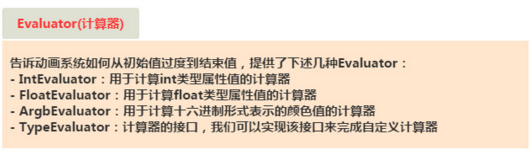
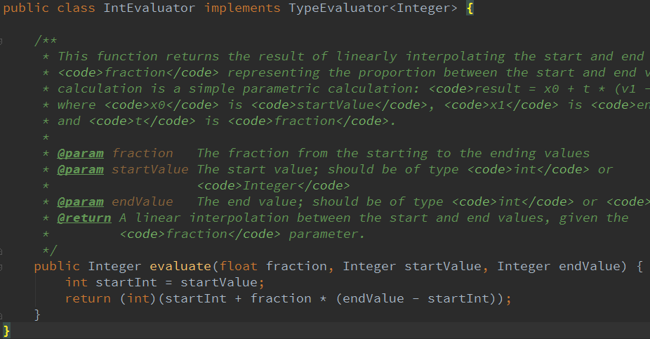
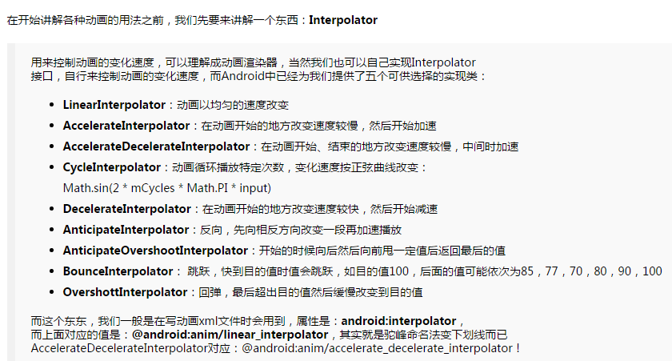
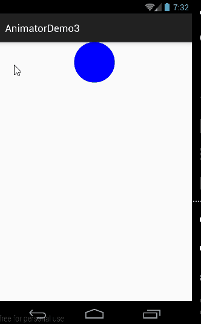
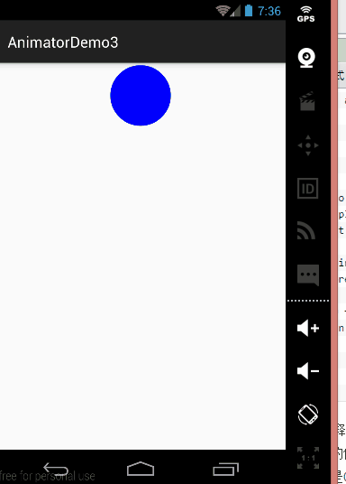
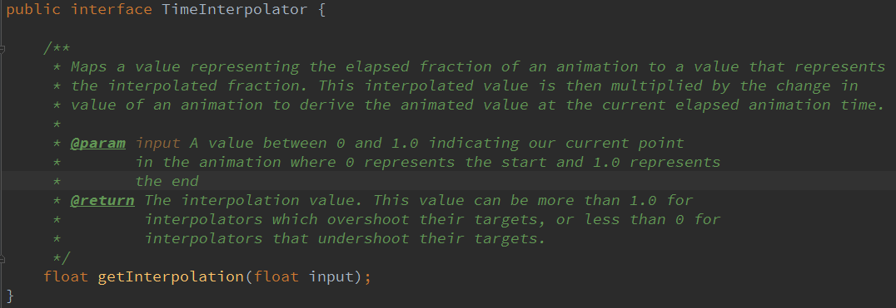
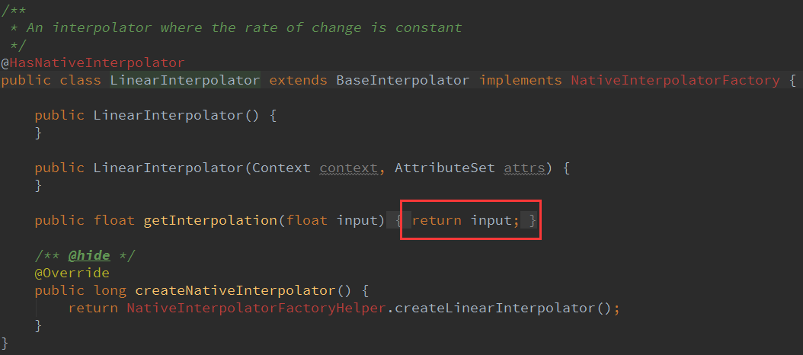
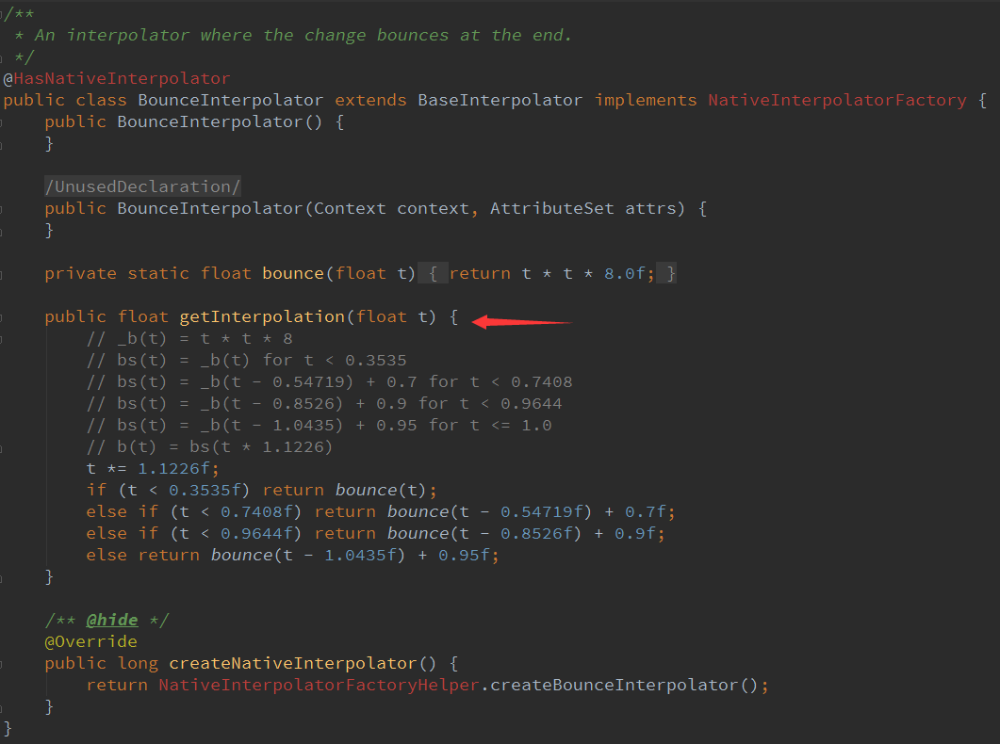
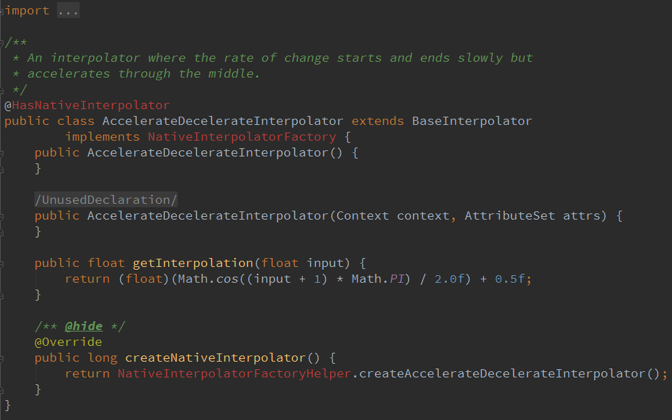

# 8.4.4 Android动画合集之属性动画-又见

> 来源: https://www.runoob.com/w3cnote/android-tutorial-valueanimator2.html

## 本节引言：

上节我们对Android的属性动画进行了初步的学习，相信大家对于属性动画已经不再是
一知半解的状态了，本节我们继续来探究Android属性动画的一些更高级的用法！
依旧贴下郭神的三篇文章~

[Android属性动画完全解析(上)，初识属性动画的基本用法 ](http://blog.csdn.net/guolin_blog/article/details/43536355)

[Android属性动画完全解析(中)，ValueAnimator和ObjectAnimator的高级用法 ](http://blog.csdn.net/guolin_blog/article/details/43816093)

[Android属性动画完全解析(下)，Interpolator和ViewPropertyAnimator的用法](http://blog.csdn.net/guolin_blog/article/details/44171115)

内容依旧是参考的上述三篇文章，好的，开始本节内容~

## 1.Evaluator自定义

### **1）Evaluator介绍**

上一节中的[8.4.3 Android动画合集之属性动画-初见](https://www.runoob.com/w3cnote/android-tutorial-valueanimator.html)，使用动画的第一步都是：

调用ValueAnimator的**ofInt**()，**ofFloat**()或**ofObject**()静态方法创建ValueAnimator实例！

在例子中，ofInt和ofFloat我们都用到了，分别用于对浮点型和整型的数据进行动画操作！

那么**ofObject**()？初始对象和结束对象？如何过渡法？或者说这玩意怎么用？

好的，带着疑问，我们先来了解一个东西：Evaluator，在属性动画概念叨叨逼处其实我们就说到了这个东西：

**用来告诉动画系统如何从初始值过渡到结束值**！好的，我们的入手点没错！
我们进去IntEvaluator的源码，看下里面写了些什么？

嗯，实现了**TypeEvaluator**接口，然后重写了**evaluate()**方法，参数有三个，依次是：

- **fraction**：动画的完成度，我们根据他来计算动画的值应该是多少

- **startValue**：动画的起始值

- **endValue**：动画的结束值

**动画的值 = 初始值 + 完成度 * (结束值 - 初始值)**

同样的还有FloatEvaluator，我们想告诉系统如何从初始对象过度到结束对象，那么我们就要
自己来实现**TypeEvaluator**接口，即自定义Evaluator了，说多无益，写个例子来看看：

### **2）使用示例**

**运行效果图**：

**代码实现**：

定义一个对象**Point.java**，对象中只有x，y两个属性以及get，set方法~

接着自定义Evaluator类：**PointEvaluator.java**，实现接口重写evaluate方法~

然后自定义一个View类：**AnimView.java**，很简单~

最后**MainActivity.java**处实例化这个View即可~

### **3)示例增强版**

我们上面示例的基础上加上圆移动时的颜色变化~
这里我们另外用一个ObjectAnimator来加载颜色变化的动画，我们在View中加多个
int color来控制颜色，另外写上getColor()和setColor()的方法，我们先来自定义个Evaluator吧~

**运行效果图**：

**实现代码**：

**ColorEvaluator.java**：

然后自定义View那里加个color，get和set方法；创建一个ObjectAnimator，
和AnimatorSet，接着把动画组合到一起就到，这里就加点东西而已，怕读者有问题，
直接另外建个View吧~

**AnimView2.java**：

然后MainActivity，setContentView那里把AnimView改成AnimView2就好~

## 2.Interpolator(补间器)

嗯，在讲补间动画的时候我们就讲过这个东东了~不知道你还有印象没？

上面的补间器补间动画和属性动画都可用，而且补间动画还新增了一个**TimeInterpolator**接口
该接口是用于兼容之前的Interpolator的，这使得所有过去的Interpolator实现类都可以直接拿过来
放到属性动画当中使用！我们可以调用动画对象的setInterpolator()方法设置不同的Interpolator！
我们先该点东西，让小球从屏幕正中央的顶部掉落到底部~
然后我们会我们为我们的集合动画调用下述语句：
**animatorSet.setInterpolator(new AccelerateInterpolator(2f));**
括号里的值用于控制加速度~

**运行效果**：

好像有点不和常理，正常应该是会弹起来的吧，我们换成**BounceInterpolator**试试~

嘿嘿，效果蛮赞的，当然还有N多个系统提供好的Interpolator，大家可以自己一一尝试，这里就
不慢慢跟大家纠结了~

下面我们来看看：

### **1）Interpolator的内部实现机制**

我们先到TimeInterpolator接口的源码，发现这里只有一个**getInterpolation**()方法；

**简单的解释**：
getInterpolation()方法中接收一个input参数，这个参数的值会随着动画的运行而不断变化，
不过它的变化是非常有规律的，就是根据设定的动画时长匀速增加，变化范围是0到1。
也就是说当动画一开始的时候input的值是0，到动画结束的时候input的值是1，而中间的值则
是随着动画运行的时长在0到1之间变化的。

这里的**input**值决定了我们**TypeEvaluator**接口里的**fraction**的值。
input的值是由系统经过计算后传入到getInterpolation()方法中的，然后我们可以自己实现
**getInterpolation**()方法中的算法，根据input的值来计算出一个返回值，而这个返回值就是fraction了。

我们可以看看**LinearInterpolator**里的代码：

这里没有处理过直接返回input值，即fraction的值就是等于input的值，这就是匀速运动的
Interpolator的实现方式！其实无非就是算法不同，这就涉及到一些数学的东西了，又一次
体会到数学的重要性了，这里再贴个**BounceInterpolator**的源码吧：

别问我这里的算法，我也不知道哈，我们再找个容易理解点的：**AccelerateDecelerateInterpolator**

这个Interpolator是先加速后减速效果的：
**(float)(Math.cos((input + 1) * Math.PI) / 2.0f) + 0.5f** 的算法理解：

解：由input的取值范围为[0,1]，可以得出cos中的值的取值范围为[π,2π]，对应的值为-1和1；
再用这个值来除以2加上0.5之后，getInterpolation()方法最终返回的结果值范围还是[0,1]，
对应的曲线图如下：

所以是一个先加速后减速的过程！

嗯，学渣没法玩了...，上面全是郭大叔文章里搬过来的...我想静静...

### **2）自定义Interpolator**

好吧，还是等会儿再忧伤吧，写个自定义的Interpolator示例先：
非常简单，实现TimeInterpolator接口，重写getInterpolation方法

**示例代码如下**

调用setInterpolator(new DecelerateAccelerateInterpolator())设置下即可~
限于篇幅就不贴图了~

## 3.ViewPropertyAnimator

3.1后系统当中附增的一个新的功能，为View的动画操作提供一种更加便捷的用法！
假如是以前，让一个TextView从正常状态变成透明状态，会这样写：

而使用ViewPropertyAnimator来实现同样的效果则显得更加易懂：

还支持**连缀用法**，组合多个动画，设定时长，设置Interpolator等~

用法很简单，使用的时候查下文档就好~，另外下面有几个细节的地方要注意一下！

- 整个ViewPropertyAnimator的功能都是建立在View类新增的animate()方法之上的，
这个方法会创建并返回一个ViewPropertyAnimator的实例，之后的调用的所有方法，
设置的所有属性都是通过这个实例完成的。

- 使用ViewPropertyAnimator将**动画定义完成之后**，动画就会**自动启动**。
并且这个机制对于组合动画也同样有效，只要我们不断地连缀新的方法，
那么动画就不会立刻执行，等到所有在ViewPropertyAnimator上设置的方法都执行完毕后，
动画就会自动启动。当然如果不想使用这一默认机制的话，我们也可以显式地调用
**start**()方法来启动动画。

- ViewPropertyAnimator的所有接口都是使用连缀的语法来设计的，每个方法的返回值都是
它**自身的实例**，因此调用完一个方法之后可以直接连缀调用它的另一个方法，这样把所有的
功能都串接起来，我们甚至可以仅通过一行代码就完成任意复杂度的动画功能。

## 4.本节示例代码下载

[AnimatorDemo3.zip](http://static.runoob.com/download/AnimatorDemo3.zip)

在Github上找到一个动画合集的项目，很多动画效果都有，下面贴下地址：

[BaseAnimation 动画合集](https://github.com/z56402344/BaseAnimation)

想研究各种动画是如何实现的可自行查看源码~

## 本节小结

> 嗯，本节我们讲了一些稍微高深一点的东西Evaluator啊，Interpolator啊，还有
> ViewPropertyAnimator，是不是又拓展了大家的见识~本节也是Android基础入门绘图
> 与的最后一小节了，如果大家把这一章节的内容都掌握了，再去学自定义控件，
> 或者看别人写的自定义控件，应该不会再那么地不知道从何入手，遇到一堆新面孔了吧！

> 嗯，还是谢谢郭神的文章，属性动画部分的内容很都是直接在郭神那里搬过来的
> 嘿嘿~本节就到这里，谢谢~

> PS:后面的示意图换模拟器是因为的N5秀逗了...

### 图片清单

1. 图1 -> images/54469594.jpg （原图：https://www.runoob.com/wp-content/uploads/2015/11/54469594.jpg）
2. 图2 -> images/48403251.jpg （原图：https://www.runoob.com/wp-content/uploads/2015/11/48403251.jpg）
3. 图3 -> images/10209964.jpg （原图：https://www.runoob.com/wp-content/uploads/2015/11/10209964.jpg）
4. 图4 -> images/65529491.jpg （原图：https://www.runoob.com/wp-content/uploads/2015/11/65529491.jpg）
5. 图5 -> images/73854084.jpg （原图：https://www.runoob.com/wp-content/uploads/2015/11/73854084.jpg）
6. 图6 -> images/6420198.jpg （原图：https://www.runoob.com/wp-content/uploads/2015/11/6420198.jpg）
7. 图7 -> images/42165604.jpg （原图：https://www.runoob.com/wp-content/uploads/2015/11/42165604.jpg）
8. 图8 -> images/6378219.jpg （原图：https://www.runoob.com/wp-content/uploads/2015/11/6378219.jpg）
9. 图9 -> images/53510297.jpg （原图：https://www.runoob.com/wp-content/uploads/2015/11/53510297.jpg）
10. 图10 -> images/43642406.jpg （原图：https://www.runoob.com/wp-content/uploads/2015/11/43642406.jpg）
11. 图11 -> images/80592279.jpg （原图：https://www.runoob.com/wp-content/uploads/2015/11/80592279.jpg）
12. 图12 -> images/Center （原图：https://www.runoob.com/wp-content/uploads/2015/11/Center）
13. 图13 -> images/90823139.jpg （原图：https://www.runoob.com/wp-content/uploads/2015/11/90823139.jpg）
14. 图14 -> images/95631595.jpg （原图：https://www.runoob.com/wp-content/uploads/2015/11/95631595.jpg）
