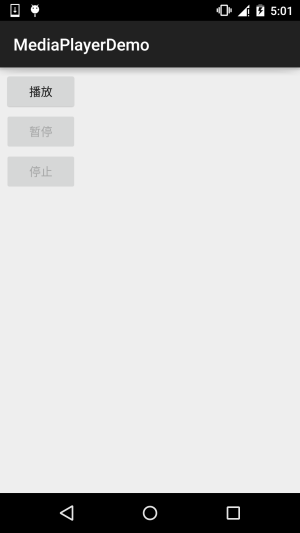
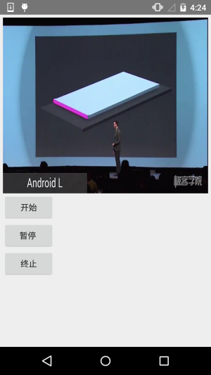

# 9.2 MediaPlayer播放音频与视频

> 来源: https://www.runoob.com/w3cnote/android-tutorial-mediaplayer.html

## 本节引言：

> 本节带来的是Android多媒体中的——MediaPlayer，我们可以通过这个API来播放音频和视频
> 该类是Androd多媒体框架中的一个重要组件，通过该类，我们可以以最小的步骤来获取，解码
> 和播放音视频。它支持三种不同的媒体来源：

> - 本地资源

> - 内部的URI，比如你可以通过ContentResolver来获取

> - 外部URL(流)
> 对于Android所支持的的媒体格式列表

> 对于Android支持的媒体格式列表，可见：[Supported Media Formats](http://androiddoc.qiniudn.com/guide/appendix/media-formats.html) 文档

> 本节我们就来用MediaPlayer来写个简单的播放音视频的例子！

> 官方API文档：[MediaPlayer](http://androiddoc.qiniudn.com/reference/android/media/MediaPlayer.html)

## 1.相关方法详解

### 1）获得MediaPlayer实例：

可以**直接new**或者调用**create**方法创建：

另外create还有这样的形式：
**create(Context context, Uri uri, SurfaceHolder holder)**
通过Uri和指定 SurfaceHolder 【抽象类】 创建一个多媒体播放器

### 2）设置播放文件：

> 另外setDataSource()方法有多个，里面有这样一个类型的参数：FileDescriptor，在使用这个
> API的时候，需要把文件放到res文件夹平级的assets文件夹里，然后使用下述代码设置DataSource：

### 3）其他方法

> - **getCurrentPosition**( )：得到当前的播放位置

> - **getDuration**() ：得到文件的时间

> - **getVideoHeight**() ：得到视频高度

> - **getVideoWidth**() ：得到视频宽度

> - **isLooping**()：是否循环播放

> - **isPlaying**()：是否正在播放

> - **pause**()：暂停

> - **prepare**()：准备(同步)

> - **prepareAsync**()：准备(异步)

> - **release()**：释放MediaPlayer对象

> - **reset**()：重置MediaPlayer对象

> - **seekTo(int msec)**：指定播放的位置（以毫秒为单位的时间）

> - **setAudioStreamType(int streamtype)**：指定流媒体的类型

> - **setDisplay(SurfaceHolder sh)**：设置用SurfaceHolder来显示多媒体

> - **setLooping(boolean looping)**：设置是否循环播放

> - **setOnBufferingUpdateListener(MediaPlayer.OnBufferingUpdateListener listener)**：
> 网络流媒体的缓冲监听

> - **setOnCompletionListener(MediaPlayer.OnCompletionListener listener)**：
> 网络流媒体播放结束监听

> - **setOnErrorListener(MediaPlayer.OnErrorListener listener)**：
> 设置错误信息监听

> - **setOnVideoSizeChangedListener(MediaPlayer.OnVideoSizeChangedListener listener)**：
> 视频尺寸监听

> - **setScreenOnWhilePlaying(boolean screenOn)**：设置是否使用SurfaceHolder显示

> - **setVolume(float leftVolume, float rightVolume)**：设置音量

> - **start**()：开始播放

> - **stop**()：停止播放

## 2.使用代码示例

### **示例一**：使用MediaPlayer播放音频：

**运行效果图**：

**关键代码**：

注意事项：

> 播放的是res/raw目录下的音频文件，创建MediaPlayer调用的是create方法，第一次启动播放前
> 不需要再调用prepare()，如果是使用构造方法构造的话，则需要调用一次prepare()方法！
> 另外贴下官方文档中，从其他两种途径播放音频的示例代码:

**本地Uri**：

**外部URL**：

> **Note**：假如你通过一个URL以流的形式播放在线音频文件，该文件必须可以进行
>  渐进式下载

### **示例二**：使用MediaPlayer播放视频

MediaPlayer主要用于播放音频，没有提供图像输出界面，所以我们需要借助其他的
组件来显示MediaPlayer播放的图像输出，我们可以使用用**SurfaceView**
来显示，下面我们使用SurfaceView来写个视频播放的例子：

**运行效果图**：

**实现代码**：

布局文件：**activity_main.xml**

**MainActivity.java**：

代码很简单，布局有个SurfaceView，然后调用getHolder获得一个SurfaceHolder对象，
在这里完成SurfaceView相关的设置，设置了显示的分辨率以及一个Callback接口，
重写了SurfaceView创建时，发生变化时，以及销毁时的三个方法！然后按钮控制播放
以及暂停而已~

### 示例三：使用VideoView播放视频

除了使用MediaPlayer + SurfaceView播放视频的方式，我们还可以使用VideoView来直接
播放视频，我们稍微改点东西就可以实现视频播放！运行效果和上面的一致，就不贴了，
直接上代码！

**MainActivity.java**：

代码非常简单，就不解释了~有疑问的自己下个Demo运行下即可~

## 3.本节示例代码下载：

[MediaPlayerDemo.zip](http://static.runoob.com/download/MediaPlayerDemo.zip)

[MediaPlayerDemo2.zip](http://static.runoob.com/download/MediaPlayerDemo2.zip)

[VideoViewDemo.zip](http://static.runoob.com/download/VideoViewDemo.zip)

## 本节小结：

> 好的，本节跟大家简单的介绍了下如何使用MediaPlayer播放音频以及结合SurfaceView
> 来播放视频，最后还写了一个用VideoView播放视频的例子，都是些非常简单的用法~
> 相信大家学习起来非常简单~嗯，谢谢~

### 图片清单

1. 图1 -> images/87460617.jpg （原图：https://www.runoob.com/wp-content/uploads/2015/11/87460617.jpg）
2. 图2 -> images/11791532.jpg （原图：https://www.runoob.com/wp-content/uploads/2015/11/11791532.jpg）
