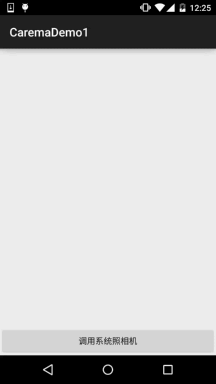
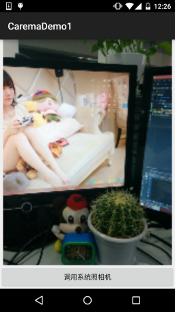
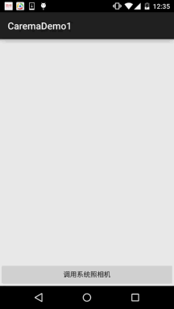
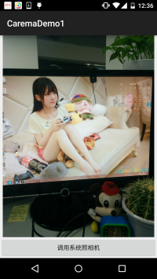
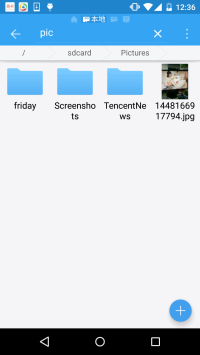
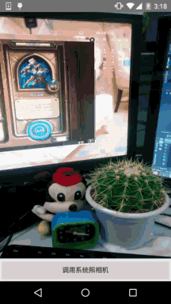

# 9.3 使用Camera拍照

> 来源: https://www.runoob.com/w3cnote/android-tutorial-camera.html

## 本节引言

本节给大家带来的是Android中Camera的使用，简单点说就是拍照咯，无非两种：

1.调用系统自带相机拍照，然后获取拍照后的图片

2.要么自己写个拍照页面

本节我们来写两个简单的例子体验下上面的这两种情况~

## 1.调用系统自带Carema

我们只需下面一席话语，即可调用系统相机，相机拍照后会返回一个intent给onActivityResult。
intent的extra部分包含一个编码过的Bitmap~

**运行效果图**：

 

这模糊的AV画质...毕竟是编码过后的Bitmap，对了，拍完的图片是不会保存到本地的，
我们可以自己写代码把图片保存到我们的SD卡里，然后再显示，这样的图片会清晰很多，
嗯，我们写代码来试下~

好的，非常简单，我们来看下运行结果：

  

相比起上面那个清晰多了~调用系统自带Carema就是这么简单~

## 2.自己写一个拍照页面

这里我们需要用一个SurfaceView作为我们的预览界面，使用起来同一非常简单！

**运行效果图**：

**代码实现**：

布局代码：**activity_main.xml**：一个简单的surfaceView + Button

**MainActivity.java**：

最后是另外一个PreviewActivity.java，这里将图片显示到界面上而已~

嗯，都非常简单哈，别忘了加上权限：

另外，有一点要说的就是假如carema没有释放掉的话，那么下次调用carema就会报错，
报错内容是：java.lang.RuntimeException:fail to connect to camera service
所以，需要对Carema进行release();假如一直报上面的错误，请重启手机~

## 3.本节示例代码下载

[CaremaDemo1.zip](http://static.runoob.com/download/CaremaDemo1.zip)

[CaremaDemo2.zip](http://static.runoob.com/download/CaremaDemo2.zip)

## 本节小结

> 好的，本节给大家讲解了如何去调用系统自带相机获取拍照后的图片，以及自己写Carema来
> 完成自定义相机，嘿嘿，在某些场合下我们不需要拍照预览界面，我们直接把弄一个悬浮框，
> 然后点击悬浮框，就触发拍照事件，这不就可以实现什么不知鬼不觉的拍摄了么？(偷拍)
> 嘿嘿，有点意思，要嗨自己动手写代码~

### 图片清单

1. 图1 -> images/74058012.jpg （原图：https://www.runoob.com/wp-content/uploads/2015/11/74058012.jpg）
2. 图2 -> images/20683940.jpg （原图：https://www.runoob.com/wp-content/uploads/2015/11/20683940.jpg）
3. 图3 -> images/54594474.jpg （原图：https://www.runoob.com/wp-content/uploads/2015/11/54594474.jpg）
4. 图4 -> images/21056381.jpg （原图：https://www.runoob.com/wp-content/uploads/2015/11/21056381.jpg）
5. 图5 -> images/12067558.jpg （原图：https://www.runoob.com/wp-content/uploads/2015/11/12067558.jpg）
6. 图6 -> images/71508156.jpg （原图：https://www.runoob.com/wp-content/uploads/2015/11/71508156.jpg）
7. 图7 -> images/6026176.jpg （原图：https://www.runoob.com/wp-content/uploads/2015/11/6026176.jpg）
