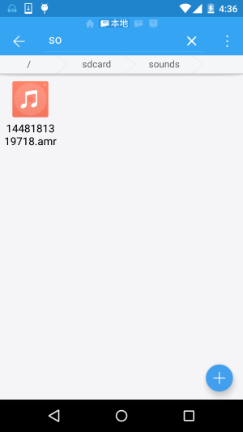

# 9.4 使用MediaRecord录音

> 来源: https://www.runoob.com/w3cnote/android-tutorial-mediarecord.html

## 本节引言

本节是Android多媒体基本API调用的最后一节，带来的是MediaRecord的简单使用，
用法非常简单，我们写个例子来熟悉熟悉~

## 1.使用MediaRecord录制音频

**运行结果**：

**实现代码**：

布局代码：**activity_main.xml**：

**MainActivity.java**：

最后别忘了在AndroidManifest.xml中添加下述权限：

好的，就是这么简单~

## 2.本节示例代码下载

[RecordDemo.zip](http://static.runoob.com/download/RecordDemo.zip)

## 本节小结：

> 好的，本节内容非常简单，就是MediaRecorder的使用而已，大概是整套教程中最精简的一节
> 了吧~嘿嘿~

### 图片清单

1. 图1 -> images/82410842.jpg （原图：https://www.runoob.com/wp-content/uploads/2015/11/82410842.jpg）
2. 图2 -> images/74946884.jpg （原图：https://www.runoob.com/wp-content/uploads/2015/11/74946884.jpg）
