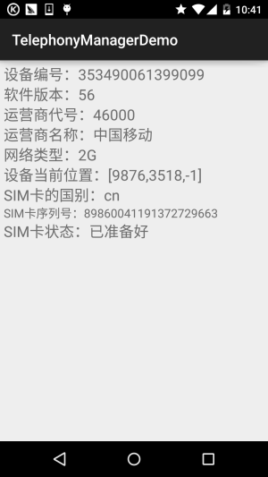
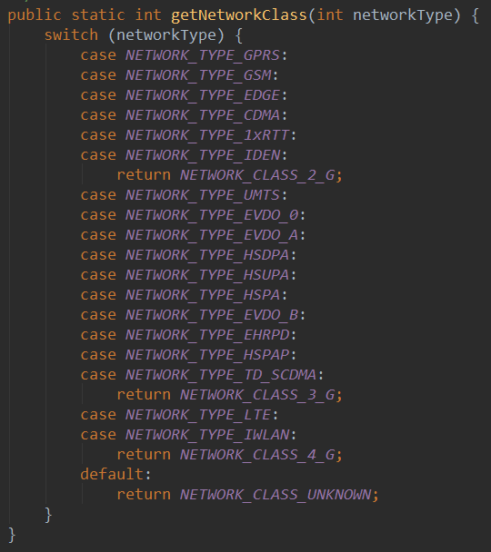
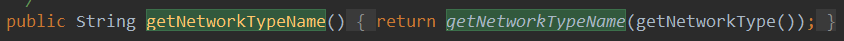
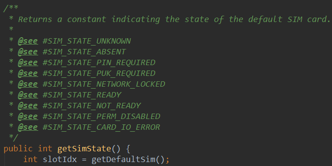
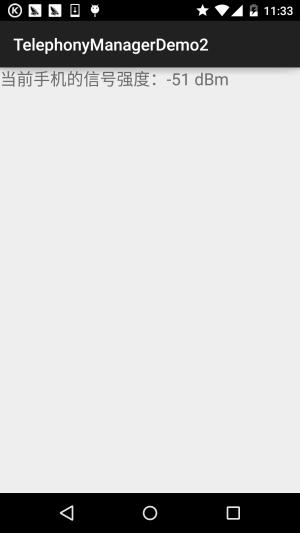

# 10.1 TelephonyManager(电话管理器)

> 来源: https://www.runoob.com/w3cnote/android-tutorial-telephonymanager.html

## 本节引言：

> 本章节是Android基础入门教程的最后一章，主要讲解是一些零零散散的一些知识点，以及一些遗漏
> 知识点的补充，这些零散的知识点包括，各种系统服务的使用，比如本节的电话管理器，短信管理器，
> 振动器，闹钟，壁纸等等，还有传感器之类的东西！乱七八糟什么都有哈！好的，本节我们要学习的
> 是TelephonyManager，见名知义：用于管理手机通话状态，获取电话信息(设备信息、sim卡信息以及
> 网络信息)，侦听电话状态(呼叫状态服务状态、信号强度状态等)以及可以调用电话拨号器拨打电话！
> 话不多开始本节内容~

> 官方API:[TelephonyManager](http://androiddoc.qiniudn.com/reference/android/telephony/TelephonyManager.html)

## 1.获得TelephonyManager的服务对象

**TelephonyManager tManager = (TelephonyManager)getSystemService(Context.TELEPHONY_SERVICE);**

## 2.用法示例

### 1)调用拨号器拨打电话号码

### 2)获取Sim卡信息与网络信息

**运行效果图**：

**实现代码**：

布局文件：**activity_main.xml**：

**MainActivity.java：**

对了，别忘了在AndroidManifest.xml中加上权限哦！

对了可能你想获取网络制式，而非普通的2G,3G,4G这样，其实我们可以到TelephonyManager类的源码里：

我们可以根据这个networkType的值，判断不同的网络制式，比如，如果networkType == 1
那个是GPRS这种制式的~而这个networkType的值可以通过

即这个getNetworkType()方法获得！好了，就这么简单，可以像上面列好一个数组然后根据
不同的下标显示不同的值！
对了，还有Sim卡状态的，字符串数组中的值，都可以到源码中看：

其他的可自行探索~

### 3)获取手机的信号强度

> 网络信号强度的单位是dBm(毫瓦分贝)，一般用负数表示，正常手机信号变化范围是从-110dBm
> (差)到-50dBm(好)之间，如果你比-50dBm还小的话，说明你就站在基站的附近，比如我的n5显示
> 的信号强度就是-51dBm，有时是-59dBm，因为隔壁就是南软大楼，上面就有基站...

> 另外2G，3G，4G获得信号强度的方式都是重写PhoneStateListener的onSignalStrengthsChanged()
> 方法，当信号强度发生改变的时候就会触发这个事件，我们可以在这个事件里获取信号强度！

**手机获取信号强度代码示例**：

**dBm =-113+2*asu**这是一个固定公式，asu(独立信号单元)

**运行效果图**：

**实现代码**：

**MainActivity.java**：

另外因为笔者的卡都是移动卡，联通和电信的不知道，但是从源码里看到这样几个API：

- **getEvdoDbm()**：电信3G

- 
**getCdmaDbm()**：联通3G

- 
**getLteDbm()**：4G

这些应该是可以直接获得dBm信号强度的，有条件的可以试试~

还有，别忘记加上权限了哦！

### 4)监听手机的所有来电

> 对于监听到的通话记录结果,你可以采取不同的方式获取到,这里用到的是把通话记录写入到文件中,
> 而你也可以以短信的形式发送给你,或者是上传到某个平台,当然如果通信记录不多的话还可以用短信
> 多了的话就很容易给人发现的了！另外,这里用的是Activity而非Service,就是说要打开这个Activity,
> 才可以进行监听,通常我们的需求都是要偷偷滴在后台跑的,因为时间关系就不写Service的了,如果需要
> 可自行修改,让Service随开机一起启动即可!

**代码解析**:

> 很简单,其实就是重写TelephonyManager的一个通话状态监听器**PhoneStateListener**
> 然后调用TelephonyManager.listen()的方法进行监听,当来电的时候,
> 程序就会将来电号码记录到文件中！

**实现代码**：

**MainActivity.java**：

**运行结果**：

注意!要让这个程序位于前台哦!用另一个电话拨打该电话,接着就可以在DDMS的file Explorer的应用
对应包名的files目录下看到phoneList的文件了,我们可以将他导出到电脑中打开,文件的大概内容如下:

THR Oct 30 12:05:48 GMT 2014 来电: 137xxxxxxx

对了，别忘了权限！

### 5)黑名单来电自动挂断

> 所谓的黑名单就是将一些电话号码添加到一个集合中,当手机接收到这些电话的时候就直接挂断！
> 但是Android并没有给我们提供挂断电话的API,于是乎我们需要通过AIDL来调用服务中的API来
> 实现挂断电话!

> 于是乎第一步要做的就是把android源码中的下面两个文件复制到src下的相应位置,他们分别是:
> com.android.internal.telephony包下的**ITelephony.aidl**;

> android.telephony包下的**NeighboringCellInfo.aidl**;

> 要创建对应的包哦!就是要把aidl文件放到上面的包下!!!
> 接着只需要调用ITelephony的endCall即可挂断电话!

这里给出的是简单的单个号码的拦截,输入号码,点击屏蔽按钮后,如果此时屏蔽的电话呼入的话;
直接会挂断,代码还是比较简单的,下面粘一下,因为用的模拟器是Genymotion,所以就不演示
程序运行后的截图了!

**MainActivity.java**：

**权限，权限，权限**：

另外，关于相关属性与方法中文版可见：[Android电话信息相关API](http://www.linuxidc.com/Linux/2011-10/45049.htm)

## 3.本节示例代码下载

[TelephonyManagerDemo.zip](http://static.runoob.com/download/TelephonyManagerDemo.zip)

[TelephonyManagerDemo2.zip](http://static.runoob.com/download/TelephonyManagerDemo2.zip)

[黑名单拦截Demo.zip](http://static.runoob.com/download/黑名单拦截Demo.zip)

## 本节小结：

> 好的，本节关于TelephonyManager(电话管理器)的学习就到这里，应该已经涵盖了
> 大部分的开发需求的了，如果有什么遗漏的，欢迎提出~

> 谢谢~

### 图片清单

1. 图1 -> images/16093505.jpg （原图：https://www.runoob.com/wp-content/uploads/2015/10/16093505.jpg）
2. 图2 -> images/75815866.jpg （原图：https://www.runoob.com/wp-content/uploads/2015/10/75815866.jpg）
3. 图3 -> images/12803880.jpg （原图：https://www.runoob.com/wp-content/uploads/2015/10/12803880.jpg）
4. 图4 -> images/2905149.jpg （原图：https://www.runoob.com/wp-content/uploads/2015/10/2905149.jpg）
5. 图5 -> images/89548597.jpg （原图：https://www.runoob.com/wp-content/uploads/2015/10/89548597.jpg）
6. 图6 -> images/45674207.jpg （原图：https://www.runoob.com/wp-content/uploads/2015/10/45674207.jpg）
