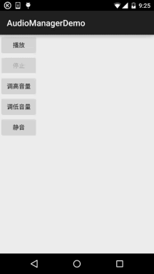

# 10.3 AudioManager(音频管理器)

> 来源: https://www.runoob.com/w3cnote/android-tutorial-audiomanager.html

## 本节引言：

> 在多媒体的第一节，我们用SoundPool写了个Duang的示例，小猪点击一个按钮后，突然发出"Duang"的
> 一声，而且当时的声音很大，吓死宝宝了，好在不是上班时间，上班时间偷偷写博客给经理知道
> 会作死的~嗯，好的，说到这个声音大小就得介绍下Android为我们提供的(音量大小控制)的API：

> **AudioManager(音频管理器)**了，该类位于Android.Media包下，提供了音量控制与铃声模式相关操作！
> 本节我们就来学下这个东东的用法，你可以写一个Demo，一个简单的静音，每次看小电影之前，先
> 进Demo点下静音，然后，说说而已哈~嗯，话不多说，开始本节内容！

> 官方API文档：[AudioManager](http://androiddoc.qiniudn.com/reference/android/media/AudioManager.html)

## 1.获得AudioManager对象实例

> **AudioManager audiomanage = (AudioManager)context.getSystemService(Context.AUDIO_SERVICE);**

## 2.相关方法详解

**常用方法**：

> - **adjustVolume**(int direction, int flags)：
> 控制手机音量,调大或者调小一个单位,根据第一个参数进行判断
> **AudioManager.ADJUST_LOWER**,可调小一个单位;
> **AudioManager.ADJUST_RAISE**,可调大一个单位

> - **adjustStreamVolume**(int streamType, int direction, int flags)：
> 同上,不过可以选择调节的声音类型
> 1）streamType参数,指定声音类型,有下述几种声音类型:
> **STREAM_ALARM**：手机闹铃 **STREAM_MUSIC**：手机音乐 
> **STREAM_RING**：电话铃声 **STREAM_SYSTEAM**：手机系统 
> **STREAM_DTMF**：音调 **STREAM_NOTIFICATION**：系统提示
> **STREAM_VOICE_CALL**:语音电话
> 2）第二个参数和上面那个一样,调大或调小音量的
> 3）可选的标志位,比如AudioManager.**FLAG_SHOW_UI**,显示进度条,AudioManager.**PLAY_SOUND**:播放声音

> - **setStreamVolume**(int streamType, int index, intflags)：直接设置音量大小

> - **getMode**( )：返回当前的音频模式

> - **setMode**( )：设置声音模式
> 有下述几种模式:
> **MODE_NORMAL**(普通), **MODE_RINGTONE**(铃声),
> **MODE_IN_CALL**(打电话)，**MODE_IN_COMMUNICATION**(通话)

> - **getRingerMode**( )：返回当前的铃声模式

> - **setRingerMode**(int streamType):设置铃声模式
> 有下述几种模式:
> 如**RINGER_MODE_NORMAL**（普通）、**RINGER_MODE_SILENT**（静音）、**RINGER_MODE_VIBRATE**（震动）

> - **getStreamVolume**(int streamType)：
> 获得手机的当前音量,最大值为7,最小值为0,当设置为0的时候,会自动调整为震动模式

> - **getStreamMaxVolume**(int streamType)：获得手机某个声音类型的最大音量值

> - **setStreamMute**(int streamType,boolean state)：将手机某个声音类型设置为静音

> - **setSpeakerphoneOn**(boolean on)：设置是否打开扩音器

> - **setMicrophoneMute**(boolean on)：设置是否让麦克风静音

> - **isMicrophoneMute**()：判断麦克风是否静音或是否打开

> - **isMusicActive**()：判断是否有音乐处于活跃状态

> - **isWiredHeadsetOn**()：判断是否插入了耳机

**其他方法**：

> - **abandonAudioFocus**(AudioManager.OnAudioFocusChangeListenerl)：放弃音频的焦点

> - **adjustSuggestedStreamVolume**(int,int suggestedStreamType intflags)：
> 调整最相关的流的音量，或者给定的回退流

> - **getParameters**(String keys)：给音频硬件设置一个varaible数量的参数值

> - **getVibrateSetting**(int vibrateType)：返回是否该用户的振动设置为振动类型

> - **isBluetoothA2dpOn**()：检查是否A2DP蓝牙耳机音频路由是打开或关闭

> - **isBluetoothScoAvailableOffCall**()：显示当前平台是否支持使用SCO的关闭调用用例

> - **isBluetoothScoOn**()：检查通信是否使用蓝牙SCO

> - **loadSoundEffects**()：加载声音效果

> - **playSoundEffect**((int effectType, float volume)：播放声音效果

> - **egisterMediaButtonEventReceiver**(ComponentName eventReceiver)：
> 注册一个组件MEDIA_BUTTON意图的唯一接收机

> - **requestAudioFocus**(AudioManager.OnAudioFocusChangeListener l,int streamType,int durationHint)
> 请求音频的焦点

> - **setBluetoothScoOn**(boolean on)：要求使用蓝牙SCO耳机进行通讯

> - **startBluetoothSco/stopBluetoothSco()**()：启动/停止蓝牙SCO音频连接

> - **unloadSoundEffects**()：卸载音效

## 3.使用示例

> 嘿嘿，属性蛮多的，有些还涉及到蓝牙这些东东，这里我们只讲解最常见的一些方法！

> 遇到一些特殊的没见过的，我们再来查文档！

> 简单的示例：使用Mediaplayer播放音乐,通过AudioManager调节音量大小与静音！

> 对了，先在res下创建一个raw的文件夹，往里面丢一个MP3资源文件！

**运行效果图**：

**代码实现**：

布局代码**activity_main.xml**：

**MainActivity.java**：

代码还是非常简单的，另外设置静音的方法**setStreamMute**()在API 23版本过期，
可以使用另一个方法adjustStreamVolume(int, int, int)，然后第三个属性设置：

**ADJUST_MUTE** 或 **ADJUST_UNMUTE**！

对了，还有：

如果**adjustStreamVolume**()的第三个参数你设置了振动(Vibrator),
需要在AndroidManifest.xml中添加这个权限哦!

## 本节小结：

> 好的，本节给大家演示了AudioManager用于调节音量的一个简单用法，这个类笔者也不常用
> 到，以后如果有什么新get的技能再加上吧~嘿嘿，静音Demo写好没？要结合实际需求哈~

> 另外，本周博客可能不会更新得太频繁，本周要把公司的WebSocket库替换掉，有得头痛了~
> 好的，就说这么多，谢谢~

### 图片清单

1. 图1 -> images/75690406.jpg （原图：https://www.runoob.com/wp-content/uploads/2015/10/75690406.jpg）
2. 图2 -> images/59360078.jpg （原图：https://www.runoob.com/wp-content/uploads/2015/10/59360078.jpg）
3. 图3 -> images/22065922.jpg （原图：https://www.runoob.com/wp-content/uploads/2015/10/22065922.jpg）
4. 图4 -> images/68214403.jpg （原图：https://www.runoob.com/wp-content/uploads/2015/10/68214403.jpg）
