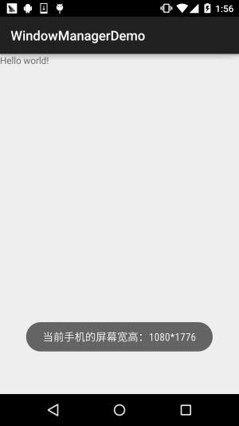
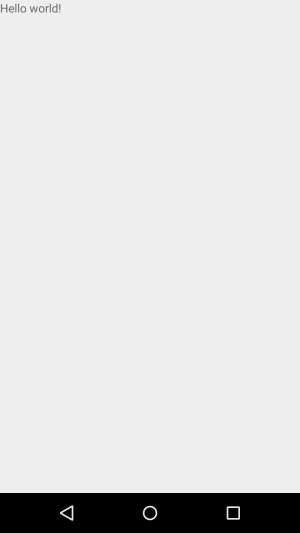
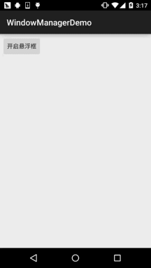

# 10.7 WindowManager(窗口管理服务)

> 来源: https://www.runoob.com/w3cnote/android-tutorial-windowmanager.html

## 本节引言：

> 本节给大家带来的Android给我们提供的系统服务中的——WindowManager(窗口管理服务)，
> 它是显示View的最底层，Toast，Activity，Dialog的底层都用到了这个WindowManager，
> 他是全局的！该类的核心无非：调用addView，removeView，updateViewLayout这几个方法
> 来显示View以及通过WindowManager.LayoutParams这个API来设置相关的属性！

> 本节我们就来探讨下这个WindowManager在实际开发中的一些应用实例吧~

> 官方API文档：[WindowManager](http://androiddoc.qiniudn.com/reference/android/view/WindowManager.html)

## 1.WindowManager的一些概念：

### 1）WindowManager介绍

> Android为我们提供的用于与窗口管理器进行交互的一个API！我们都知道App的界面都是
> 由一个个的Acitivty组成，而Activity又由View组成，当我们想显示一个界面的时候，
> 第一时间想起的是:Activity，对吧？又或者是Dialog和Toast。

> 但是有些情况下，前面这三者可能满足不了我们的需求，比如我们仅仅是一个简单的显示
> 用Activity显得有点多余了，而Dialog又需要Context对象，Toast又不可以点击...
> 对于以上的情况我们可以利用WindowManager这个东东添加View到屏幕上，
> 或者从屏幕上移除View！他就是管理Android窗口机制的一个接口，显示View的最底层！

### 2）如何获得WindowManager实例

①**获得WindowManager对象**:

②**获得WindowManager.LayoutParams对象，为后续操作做准备**

## 2.WindowManager使用实例：

### **实例1：获取屏幕宽高**

在Android 4.2前我们可以用下述方法获得屏幕宽高：

而上述的方法在Android 4.2以后就过时了，我们可以用另一种方法获得屏幕宽高：

然后我们可以再另外写两个获取宽以及高的方法，这里以第二种获得屏幕宽高为例：

当然，假如你不另外写一个工具类的话，你可以直接直接获取，比如：

**运行结果**：

### **实例2：设置窗口全屏显示**

**运行结果**：

### **实例3：保持屏幕常亮**

### **实例4：简单悬浮框的实现**

**运行效果图**：

**实现代码**：

首先我们需要一个后台的Service在后台等待我们的操作，比如完成悬浮框的绘制移除等，
于是乎我们定义一个Service：**MyService.java**：
我们需要一个创建悬浮框View的一个方法：

然后我们只需在OnCreate( )方法中调用上述的createWindowView( )方法即可启动加载悬浮框，
但是我们发现了一点：这玩意貌似关不掉啊，卧槽，好吧，接下来我们就要分析下需求了!

当处于手机的普通界面，即桌面的时候，这玩意才显示，而当我们启动其他App时，这个悬浮框应该
消失不见,当我们推出app又回到桌面,这个悬浮框又要重新出现!

那么我们首先需要判断App是否位于桌面，于是乎我们再加上下述代码：

好了,接下来我们需要每隔一段时间来进行一系列的判断，比如：是否在桌面，是否已加载悬浮框，
否则加载；否则，如果加载了,就将这个悬浮框移除!这里我们使用handler~,因为不能在子线程直接
更新UI，所以，你懂的，所以我们自己写一个handler来完成上述的操作:

最后要做的一件事,就是重写Service的onStartCommand( )方法了,就是做判断,取出Intent中的
数据,判断是需要添加悬浮框,还是要移除悬浮框!

好的，至此，主要的工作就完成了，接下来就是一些零碎的东西了，用一个Activity
来启动这个Service：**MainActivity.java**：

接着AndroidManifest.xml加上权限，以及为MainService进行注册：

好了，逻辑还是比较容易理解的~大家自己再看看吧~

## 3.文献扩展：

> 从第四个实例中，你可能留意到了：WindowManager.LayoutParams这个东东，这是一个标记，
> 比如全屏~时间关系就不一一列举出来了，可以到官网或者下述链接中查看：

> [官方文档：WindowManager.LayoutParams](http://androiddoc.qiniudn.com/reference/android/view/WindowManager.LayoutParams.html)

> [Android系统服务-WindowManager](http://blog.csdn.net/chenyafei617/article/details/6577940)

> 另外，假如你对上述的悬浮框有兴趣，想更深入的研究，可见郭大叔(郭霖)的博客：

> [Android桌面悬浮窗效果实现，仿360手机卫士悬浮窗效果](http://blog.csdn.net/guolin_blog/article/details/8689140)

> [Android桌面悬浮窗进阶，QQ手机管家小火箭效果实现](http://blog.csdn.net/guolin_blog/article/details/16919859)

## 4.本节代码示例下载：

[WindowManagerDemo2.zip](http://static.runoob.com/download/WindowManagerDemo2.zip)

## 本节小结：

> 本节我们对Android系统服务中的WindowManager进行了学习，前面三个实例可能
> 实际开发中会用得多一点，建议将第一个示例写成一个工具类，毕竟屏幕宽高用得
> 蛮多的~至于悬浮框那个能看懂就看懂，没看懂耶没什么~实际开发很少叫你弄个
> 悬浮框吧...嗯，好的，本节就到这里，谢谢~

> 

### 图片清单

1. 图1 -> images/59542517.jpg （原图：https://www.runoob.com/wp-content/uploads/2015/11/59542517.jpg）
2. 图2 -> images/59172917.jpg （原图：https://www.runoob.com/wp-content/uploads/2015/11/59172917.jpg）
3. 图3 -> images/51340411.jpg （原图：https://www.runoob.com/wp-content/uploads/2015/11/51340411.jpg）
4. 图4 -> images/64749423.jpg （原图：https://www.runoob.com/wp-content/uploads/2015/11/64749423.jpg）
