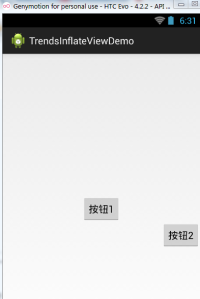
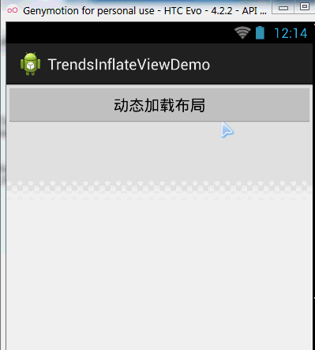

# 10.8 LayoutInflater(布局服务)

> 来源: https://www.runoob.com/w3cnote/android-tutorial-layoutinflater.html

## 本节引言：

> 本节继续带来的是Android系统服务中的LayoutInflater(布局服务)，说到布局，大家第一时间
> 可能想起的是写完一个布局的xml，然后调用Activity的setContentView()加载布局，然后把他显示
> 到屏幕上是吧~其实这个底层走的还是这个LayoutInflater，用的Android内置的Pull解析器来解析
> 布局。一般在Android动态加载布局或者添加控件用得较多，本节我们就来学习下他在实际开发中
> 的一些用法~

> **官方API文档**：[LayoutInflater](http://androiddoc.qiniudn.com/reference/android/view/LayoutInflater.html)

## 1.LayoutInflater的相关介绍

### 1）Layout是什么鬼？

> 答：一个用于加载布局的系统服务，就是实例化与Layout XML文件对应的View对象，不能直接使用，
> 需要通过**getLayoutInflater**( )方法或**getSystemService**( )方法来获得与当前Context绑定的
> LayoutInflater实例!

### 2）LayoutInflater的用法

**①获取LayoutInflater实例的三种方法**：

PS:后面两个其实底层走的都是第一种方法~

**②加载布局的方法**：

> public View **inflate** (int resource, ViewGroup root, boolean attachToRoot)
> 该方法的三个参数依次为:

> ①要加载的布局对应的资源id

> ②为该布局的外部再嵌套一层父布局，如果不需要的话，写null就可以了!

> ③是否为加载的布局文件的最外层套一层root布局，不设置该参数的话，
> 如果root不为null的话，则默认为true
> 如果root为null的话，attachToRoot就没有作用了!
> root不为null，attachToRoot为true的话，会在加载的布局文件最外层嵌套一层root布局;
> 为false的话，则root失去作用!
> 简单理解就是：**是否为加载的布局添加一个root的外层容器~!**

**③通过LayoutInflater.LayoutParams来设置相关的属性**:

> 比如RelativeLayout还可以通过addRule方法添加规则，就是设置位置：是参考父容器呢？
> 还是参考子控件？又或者设置margin等等，这个由你决定~

## 2.纯Java代码加载布局

> 我们早已习惯了使用XML生成我们需要的布局，但是在一些特定的情况下，我们
> 需要使用Java代码往我们的布局中动态的添加组件或者布局！

> 但是不建议大家完全地使用Java代码来编写Android页面布局，首先一点就是代码会多，
> 一多久容易乱，而且不利于业务的分离，我们还是建议使用xml来完成布局，然后通过
> Java代码对里面的组件进行修改，当然有些时候可能需要使用Java动态的来添加组件！

### **纯Java代码加载布局的流程**：

**——Step 1**：

①**创建容器**:LinearLayout ly = new LinearLayout(this);

②**创建组件**:Button btnOne = new Button(this);

**——Step 2:**

可以为容器或者组件设置相关属性：
比如：**LinearLayout**，我们可以设置组件的排列方向：**ly.setOrientation(LinearLayout.VERTICAL);**
而组件也可以：比如Button：**btnOne.setText("按钮1");**
关于设置属性的方法可参见Android 的API,通常xml设置的属性只需在前面添加：set即可,比如
**setPadding**(左,上,右,下);

**——Step 3：**

将组件或容器添加到容器中，这个时候我们可能需要设置下组件的添加位置，或者设置他的大小：
我们需要用到一个类：LayoutParams，我们可以把它看成布局容器的一个信息包!封装位置与大小
等信息的一个类!先演示下设置大小的方法：(前面的LinearLayout可以根据不同容器进行更改)

很简单，接着就到这个设置位置了，设置位置的话，通常我们考虑的只是RelativeLayout!
这个时候用到LayoutParams的addRule( )方法!可以添加多个addRule( )哦！
设置组件在父容器中的位置，

比如**设置组件的对其方式**:

**参照其他组件的对其方式**：
(有个缺点,就是要为参考组件手动设置一个id，是**手动**!!!!)
比如:设置btnOne居中后,让BtnTwo位于btnOne的下方以及父容器的右边!

**——step 4：**

调用setContentView( )方法加载布局对象即可!
另外，如果你想移除某个容器中的View，可以调用容器.**removeView**(要移除的组件);

**运行截图**：

## 3.Java代码动态添加控件或xml布局

> 第二点我们讲解了使用纯Java代码来加载布局，实际当中用得并不多，更多的时候是动态
> 的添加View控件以及动态的加载XML布局！

### **1）Java代码动态增加View**

动态添加组件的写法有两种，区别在于是否需要先**setContentView(R.layout.activity_main)**;
下面演示下两种不同写法添加一个Button的例子：

先写个布局文件先：**activity_main.xml**：

**第一种不需要setContentView()加载布局文件先：**

**第二种不需要setContentView()加载布局文件先：**

**分析总结**：

> 代码很简单,创建按钮后，我们又创建了一个LayoutParams对象，用来设置Button的大小，
> 又通过addRule()方法设置了Button的位置!

> **第一种方法**：通过LayoutInflate的inflate()方法加载了activity_main布局，获得了外层容器，
> 接着addView添加按钮进容器,最后setContentView();

> **第二种方法**：因为我们已经通过setContetView()方法加载了布局，此时我们就可以通过
> findViewById找到这个外层容器,接着addView,最后setContentView()即可!

> 另外,关于这个setContentView( )他设置的视图节点是整个XML的根节点!

### 2）Java代码动态加载xml布局

接下来的话，我们换一个，这次加载的是xml文件!**动态地添加xml文件**!
先写下主布局文件和动态加载的布局文件：

**activity_main.xml**：

**inflate.xml**：

接着到我们的**MainActivity.java**在这里动态加载xml布局：

**运行截图**：

**代码分析**：

> **①获取容器对象**:

> **②获得Inflater对象,同时加载被添加的布局的xml,通过findViewById找到最外层的根节点**

> **③为这个容器设置大小与位置信息:**

> **④添加到外层容器中:**

## 4.LayoutInflater的inflate()方法源码

> 最后提供下LayoutInflater的inflate()方法的源码吧，有兴趣的可以看看~，其实就是Pull解析而已~

## 本节小结：

> 本节给大家讲解了一下Android中的LayoutInflater(布局服务)，以及动态加载View和控件
> 相关的东西，相信对初学控件的朋友带来帮助~好的，就说这么多，谢谢~
> 

### 图片清单

1. 图1 -> images/89350855.jpg （原图：https://www.runoob.com/wp-content/uploads/2015/11/89350855.jpg）
2. 图2 -> images/42530721.jpg （原图：https://www.runoob.com/wp-content/uploads/2015/11/42530721.jpg）
3. 图3 -> images/74974983.jpg （原图：https://www.runoob.com/wp-content/uploads/2015/11/74974983.jpg）
