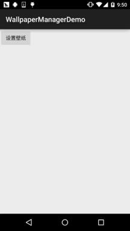
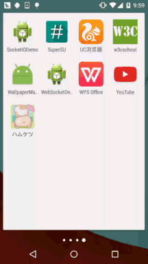
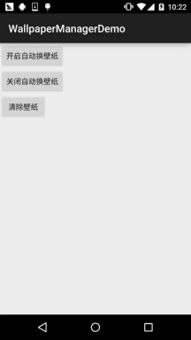

# 10.9 WallpaperManager(壁纸管理器)

> 来源: https://www.runoob.com/w3cnote/android-tutorial-wallpapermanager.html

## 本节引言：

本节给大家带来的是WallpaperManager(壁纸管理器)，如其名，就是手机壁纸相关的
一个API，在本节中我们会描述下WallpaperManager的基本用法，调用系统自带的
壁纸选择功能，将Activity的背景设置为壁纸背景，以及写一个定时换壁纸的例子~
好了，不BB，开始本节内容~

**官方API文档**：[WallpaperManager](http://androiddoc.qiniudn.com/reference/android/app/WallpaperManager.html)

## 1.WallpaperManager的基本用法

### 相关方法

设置壁纸的相关方法：

- **setBitmap**(Bitmap bitmap)：将壁纸设置为bitmap所代表的位图

- **setResource**(int resid)：将壁纸设置为resid资源所代表的图片

- **setStream**(InputStream data)：将壁纸设置为data数据所代表的图片

其他方法：

- **clear**()：清除壁纸，设置回系统默认的壁纸

- **getDesiredMinimumHeight**()：最小壁纸高度

- **getDesiredMinimumWidth**()：最小壁纸宽度

- **getDrawable**()：获得当前系统壁纸，如果没有设置壁纸，则返回系统默认壁纸

- **getWallpaperInfo**()：加入当前壁纸是动态壁纸，返回动态壁纸信息

- **peekDrawable**()：获得当前系统壁纸，如果没设置壁纸的话返回null

### 获得WallpaperManager对象

### 设置壁纸需要的权限

## 2.调用系统自带的壁纸选择功能

**运行效果图**：

## 3.将Activity的背景设置为壁纸背景

方法有两种，一种是在Activity中用代码进行设置，另一种是在AndroidManifest.xml中修改
Activity的主题~！

**方法一：Activity中设置**：

**方法二：AndroidManifest.xml修改theme**：

## 4.定时换壁纸的Demo

这里用到前面学的AlarmManager(闹钟服务)，假如你对它不了解的话可以到：
[10.5 AlarmManager(闹钟服务)](https://www.runoob.com/w3cnote/android-tutorial-alarmmanager.html)进行学习~
下面我们来写个Demo~

**运行效果图**：

**代码实现**：

首先我们来写一个定时换壁纸的Service：**WallPaperService.java**

接着撸个简单的布局，三个Button：**activity_main.xml**：

接着是我们的Activity，在这里实例化aManager并设置定时事件~：**MainActivity.java**：

最后别忘了加上设置壁纸的权限以及为我们的Service进行注册：**AndroidManifest.xml**：

好的，非常简单~

## 5.本节示例代码下载

[WallpaperManagerDemo.zip](http://static.runoob.com/download/WallpaperManagerDemo.zip)

## 本节小结：

> 好的，本节给大家介绍了下WallpaperManager的一些基本用法~更多的东西还需你们自己
> 进行探究~谢谢~!

### 图片清单

1. 图1 -> images/58269365.jpg （原图：https://www.runoob.com/wp-content/uploads/2015/11/58269365.jpg）
2. 图2 -> images/59308385.jpg （原图：https://www.runoob.com/wp-content/uploads/2015/11/59308385.jpg）
3. 图3 -> images/88842017.jpg （原图：https://www.runoob.com/wp-content/uploads/2015/11/88842017.jpg）
4. 图4 -> images/14124431.jpg （原图：https://www.runoob.com/wp-content/uploads/2015/11/14124431.jpg）
5. 图5 -> images/61146918.jpg （原图：https://www.runoob.com/wp-content/uploads/2015/11/61146918.jpg）
