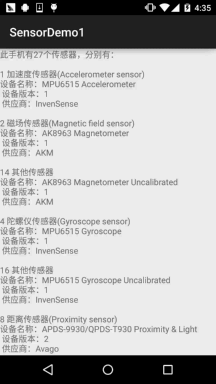

# 10.10 传感器专题(1)——相关介绍

> 来源: https://www.runoob.com/w3cnote/android-tutorial-sensor1.html

## 1.传感器相关介绍：

说到传感器，相信大家都不会陌生吧，比如微信的摇一摇就用到了加速度传感器；

**传感器的定义**：一种物理设备或者生物器官，能够探测、感受外界的信号，物理条件(如光，热，
适度)或化学组成（如烟雾），并将探知的信息传递给其他的设备或者器官！

**传感器的种类**：可以从不同的角度对传感器进行划分，转换原理(传感器工作的基本物理或化学
效应)；用途；输出信号以及制作材料和工艺等。一般是按工作原来来分：物理传感器与化学传感器
两类！手机上搭载的基本都是物理传感器，手机上搭载的传感器有下面这些：

- **方向传感器(Orientation sensor)**

- **加速感应器（Accelerometer sensor）**

- **陀螺仪传感器(Gyroscope sensor)**

- **磁场传感器(Magnetic field sensor)**

- **距离传感器(Proximity sensor)**

- **光线传感器(Light sensor)**

- **气压传感器(Pressure sensor)**

- **温度传感器（Temperature sensor）**

- **重力感应器（Gravity sensor，Android 2.3引入）**

- **线性加速感应器（Linear acceleration sensor ，Android 2.3引入）**

- **旋转矢量传感器（Rotation vector sensor，Android 2.3）**

- **相对湿度传感器（Relative humidity sensor，Android 4.0）**

- **近场通信（NFC）传感器（Android 2.3引入），NFC和其他不一样，具有读写功能。**

当然除了这些以外还有其他比如心率传感器，记步传感器，指纹传感器等，
关于Android设备所支持的传感器类型可见官方文档：[Sensor](http://androiddoc.qiniudn.com/reference/android/hardware/Sensor.html) Summary部分的内容~

## 2.如何查看自己手机所支持的传感器有哪些？

上面说的这么多种肯定不是所有手机都具备的，每台手机上搭载的传感器类型
以及数目都可能是不一样的，比如我手头上的Nexus 5支持的传感器类型有：
重力，光线，距离，气压和陀螺仪！而令意外moto x 二代则有重力，光线，
距离和红外传感器！关于自己手机支持的传感器类型，你可以到相关的评测
网站比如：中关村手机在线，太平洋等，搜索到自己的机型查看相关参数！
当然，我们也可以自己写代码来看看自己手机支持的传感器类型~

**代码示例**：

**运行效果图**：

**代码实现**：

**activity_main.xml**：

**MainActivity.java**：

## 3.Sensor传感器相关的方法以及使用套路

从2中的例子我们可以大概地总结下获取Sensor传感器以及获取传感器相关的一些信息
流程如下：

### 1)Sensor传感器的相关方法

**Step 1：获得传感器管理器**：

- **Step 2：获得设备的传感器对象的列表**：

- **Step 3**：迭代获取Sensor对象，然后调用对应方法获得传感器的相关信息：

### 2)传感器的使用套路

一般我们是很少说直接去获取Sensor，然后获取上面这些信息的！因为这没什么
大的作用，我们更多的时候是去获取传感器采集到的数据，比如获取当前的大气压，
或者方向传感器三个角的值，或者陀螺仪的值这样~而大部分的传感器数据采集都是
下面的一个套路：

**~Step 1：获得传感器管理器：**

**~Step 2：调用特定方法获得需要的传感器：**

比如这里获取的是方向传感器，想获得什么传感器自己查API~：

**~Step 3：实现SensorEventListener接口，重写onSensorChanged和onAccuracyChanged的方法！**

**onSensorChanged**：当传感器的值变化时会回调

**onAccuracyChanged**：当传感器的进度发生改变时会回调

我们一般获取传感器数据的来源就是这个SensorEvent，这个类中有一个**values的变量**，
类型是**Float[]**，该变量**最多有只有三个元素**，而且传感器不同，对应元素代表的含义也不同，
比如方向传感器中第一个元素是方位角的值，而气压传感器中第一个值则是气压值！

**~Step 4：SensorManager对象调用registerListener注册监听器：**

方法也很简单，对应的参数：**上下文对象**，**Sensor传感器对象**，
以及**传感器的延时时间的精度密度**，有四个可选值：

- **SENSOR_DELAY_FASTEST**——延时：**0ms**

- **SENSOR_DELAY_GAME**——延时：**20ms**

- **SENSOR_DELAY_UI**——延时：**60ms**

- **SENSOR_DELAY_NORMAL**——延时：**200ms**

当然低延时意味着更频繁的检车，更意味着更多的电量消耗，如果不是要求精度非常高的建议
别使用太高精度的，一般用第三个较多~自己衡量衡量吧~

**~Step 5：监听器的取消注册：**

用完就放，一个很好的习惯，一般我们可以把他写到Activity或者Service的销毁方法中：

好的，套路非常简单~

## 4.本节示例代码下载：

[SensorDemo1.zip](http://static.runoob.com/download/SensorDemo1.zip)

## 本节小结：

> 好的，本节给大家讲解了下Android中的传感器的介绍以及如何了解自己手机所支持的传感器，
> 除了网上查，也可以自己写代码测，然后还讲解了Sensor传感器相关信息获取的方法流程，最后
> 还讲解了采集传感器数据的套路，后面我们会针对一些常用的传感器的用法进行剖析，敬请期待~
> 

### 图片清单

1. 图1 -> images/29480532.jpg （原图：https://www.runoob.com/wp-content/uploads/2015/11/29480532.jpg）
2. 图2 -> images/15214453.jpg （原图：https://www.runoob.com/wp-content/uploads/2015/11/15214453.jpg）
