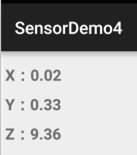
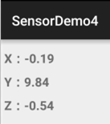
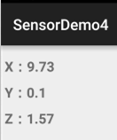
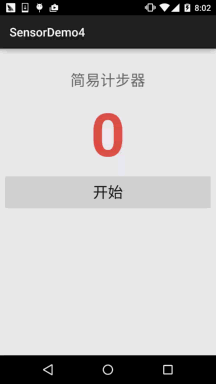

# 10.12 传感器专题(3)——加速度/陀螺仪传感器

> 来源: https://www.runoob.com/w3cnote/android-tutorial-sensor3.html

## 本节引言：

本节继续来扣Android中的传感器，本节带来的是加速度传感器(Accelerometer sensor)以及
陀螺仪传感器(Gyroscope sensor)，和上一节的方向传感器一样有着x，y，z 三个轴，
还是要说一点：x，y轴的坐标要和绘图那里的x，y轴区分开来！传感器的是以左下角
为原点的！x向右，y向上！好的，带着我们的套路来学本节的传感器吧！

另外，想说一点的就是我们不是专门搞这个的，就写东西啊玩玩，见识下而已哈，很多东西
别太较真！

**PS**:方向传感器其实就是利用加速度传感器和磁场传感器来获取方位的，在2.2开始就被弃用了~

## 1.加速度传感器(Accelerometer sensor)

### **1）名词概念：**

> - 加速度传感器的**单位**：**加速度(m/s^2)**

> - 方向传感器获取到的加速度是：**手机运动的加速度与重力加速度(9.81m/s^2)的合加速度**

> - 另外重力加速度是**垂直向下**的！

关于这个不同方向合加速度的计算好像蛮复杂的，这里我们就不去纠结这个了！
先来看看加速度的value数组中的三个数的值吧~依旧是上节的代码，改下传感器而已~

**水平放置**： **竖直平放**： **竖直横放**：

从上面我们知道value数组的三个值分别对应X，Y，Z轴上的加速度！
好的，知道个大概，我们来写个简易计步器来熟悉下用法！

### **2）.简易计步器的实现**

**运行效果图**：

**代码实现**：

布局代码：**activity_main.xml**：

**MainActivity.java**：

好的，真的是非常简易的计步器...上面的步数是我坐着拿手撸出来的...
，毕竟写来玩玩而已~

## 2.陀螺仪传感器(Gyroscope sensor)

### **1）名词概念：**

陀螺仪又叫角速度传感器，一般用来检测手机姿态的，好像手机中的陀螺仪传感器一般都是三轴的！
体感游戏用得最多，手机拍照防抖，GPS惯性导航，还有为APP添加一些动作感应(比如轻轻晃动手机
关闭来电铃声)等等，具体的可以自己去百度下~

- 陀螺仪传感器的**单位**：**角速度(弧度/秒)radians/second**

- 获得传感器用的是：**Sensor.TYPE_GYROSCOPE**

他的三个值依次是沿着X轴，Y轴，Z轴旋转的角速度，手机逆时针旋转，角速度值为正，顺时针则为负值！
经常用于计算手机已经转动的角度！这是网上的一段代码~

通过陀螺仪传感器相邻两次获得数据的时间差（dT）来分别计算在这段时间内手机延X、 Y、Z轴旋转的角度，并将值分别累加到angle数组的不同元素上

## 3.本节示例代码下载：

[SensorDemo4.zip](http://static.runoob.com/download/SensorDemo4.zip)

## 本节小结：

> 好的，本节给大家简单的跟大家介绍了下加速度传感器和陀螺仪，写了个简易计步器，
> 感觉传感器没怎么玩过，没什么好写，算了，下节就简单的把剩下的传感器介绍下
> 算了，就当科普科普，以后要用到再深入研究吧~
> 

### 图片清单

1. 图1 -> images/76996732.jpg （原图：https://www.runoob.com/wp-content/uploads/2015/11/76996732.jpg）
2. 图2 -> images/31738093.jpg （原图：https://www.runoob.com/wp-content/uploads/2015/11/31738093.jpg）
3. 图3 -> images/30102506.jpg （原图：https://www.runoob.com/wp-content/uploads/2015/11/30102506.jpg）
4. 图4 -> images/4196699.jpg （原图：https://www.runoob.com/wp-content/uploads/2015/11/4196699.jpg）
5. 图5 -> images/2723188.jpg （原图：https://www.runoob.com/wp-content/uploads/2015/11/2723188.jpg）
6. 图6 -> images/93465440.jpg （原图：https://www.runoob.com/wp-content/uploads/2015/11/93465440.jpg）
7. 图7 -> images/29828770.jpg （原图：https://www.runoob.com/wp-content/uploads/2015/11/29828770.jpg）
