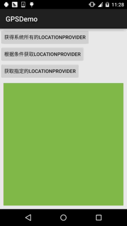
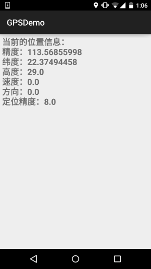
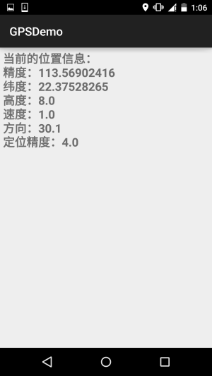
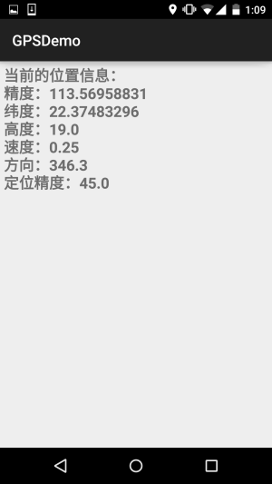
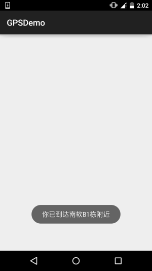
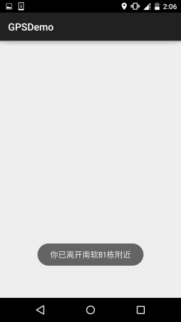

# 10.14 Android GPS初涉

> 来源: https://www.runoob.com/w3cnote/android-tutorial-gps.html

## 本节引言：

说到GPS这个名词，相信大家都不陌生，GPS全球定位技术嘛，嗯，Android中定位的方式
一般有这四种：GPS定位，WIFI定准，基站定位，AGPS定位(基站+GPS)；

本系列教程只讲解GPS定位的基本使用！GPS是通过与卫星交互来获取设备当前的经纬度，准确
度较高，但也有一些缺点，最大的缺点就是：**室内几乎无法使用**...需要收到4颗卫星或以上
信号才能保证GPS的准确定位！但是假如你是在室外，无网络的情况，GPS还是可以用的！

本节我们就来探讨下Android中的GPS的基本用法~

## 1.定位相关的一些API

### **1）LocationManager**

官方API文档：[LocationManager](http://androiddoc.qiniudn.com/reference/android/location/LocationManager.html)

这玩意是系统服务来的，不能直接new，需要：

另外用GPS定位别忘了加权限：

好的，获得了LocationManager对象后，我们可以调用下面这些常用的方法：

- **addGpsStatusListener**(GpsStatus.Listener listener)：添加一个GPS状态监听器

- **addProximityAlert**(double latitude, double longitude, float radius, long expiration, PendingIntent intent)：
添加一个临界警告

- **getAllProviders**()：获取所有的LocationProvider列表

- **getBestProvider**(Criteria criteria, boolean enabledOnly)：根据指定条件返回最优LocationProvider

- **getGpsStatus**(GpsStatus status)：获取GPS状态

- **getLastKnownLocation**(String provider)：根据LocationProvider获得最近一次已知的Location

- **getProvider**(String name)：根据名称来获得LocationProvider

- **getProviders**(boolean enabledOnly)：获取所有可用的LocationProvider

- **getProviders**(Criteria criteria, boolean enabledOnly)：根据指定条件获取满足条件的所有LocationProvider

- **isProviderEnabled**(String provider)：判断指定名称的LocationProvider是否可用

- **removeGpsStatusListener**(GpsStatus.Listener listener)：删除GPS状态监听器

- **removeProximityAlert**(PendingIntent intent)：删除一个临近警告

- **requestLocationUpdates**(long minTime, float minDistance, Criteria criteria, PendingIntent intent)：
通过制定的LocationProvider周期性地获取定位信息，并通过Intent启动相应的组件

- **requestLocationUpdates**(String provider, long minTime, float minDistance, LocationListener listener)：
通过制定的LocationProvider周期性地获取定位信息，并触发listener所对应的触发器

### **2）LocationProvider(定位提供者)**

官方API文档：[LocationProvider](http://androiddoc.qiniudn.com/reference/android/location/LocationProvider.html)

这比是GPS定位组件的抽象表示，调用下述方法可以获取该定位组件的相关信息！

常用的方法如下：

- **getAccuracy**()：返回LocationProvider精度

- **getName**()：返回LocationProvider名称

- **getPowerRequirement**()：获取LocationProvider的电源需求

- **hasMonetaryCost**()：返回该LocationProvider是收费还是免费的

- **meetsCriteria**(Criteria criteria)：判断LocationProvider是否满足Criteria条件

- **requiresCell**()：判断LocationProvider是否需要访问网络基站

- **requiresNetwork**()：判断LocationProvider是否需要访问网络数据

- **requiresSatellite**()：判断LocationProvider是否需要访问基于卫星的定位系统

- **supportsAltitude**()：判断LocationProvider是否支持高度信息

- **supportsBearing**()：判断LocationProvider是否支持方向信息

- **supportsSpeed**()：判断是LocationProvider否支持速度信息

### **3）Location(位置信息)**

官方API文档：[Location](http://androiddoc.qiniudn.com/reference/android/location/Location.html)

位置信息的抽象类，我们可以调用下述方法获取相关的定位信息！

常用方法如下：

- float **getAccuracy**()：获得定位信息的精度

- double **getAltitude**()：获得定位信息的高度

- float **getBearing**()：获得定位信息的方向

- double **getLatitude**()：获得定位信息的纬度

- double **getLongitude**()：获得定位信息的精度

- String **getProvider**()：获得提供该定位信息的LocationProvider

- float **getSpeed**()：获得定位信息的速度

- boolean **hasAccuracy**()：判断该定位信息是否含有精度信息

### **4）Criteria(过滤条件)**

官方API文档：[Criteria](http://androiddoc.qiniudn.com/reference/android/location/Criteria.html)

获取LocationProvider时，可以设置过滤条件，就是通过这个类来设置相关条件的~

常用方法如下：

- **setAccuracy**(int accuracy)：设置对的精度要求

- **setAltitudeRequired**(boolean altitudeRequired)：设置是否要求LocationProvider能提供高度的信息

- **setBearingRequired**(boolean bearingRequired)：设置是否要LocationProvider求能提供方向信息

- **setCostAllowed**(boolean costAllowed)：设置是否要求LocationProvider能提供方向信息

- **setPowerRequirement**(int level)：设置要求LocationProvider的耗电量

- **setSpeedRequired**(boolean speedRequired)：设置是否要求LocationProvider能提供速度信息

## 2.获取LocationProvider的例子

**运行效果图**：

由图可以看到，当前可用的LocationProvider有三个，分别是：

- **passive**：被动提供，由其他程序提供

- **gps**：通过GPS获取定位信息

- **network**：通过网络获取定位信息

**实现代码**：

布局文件：**activity_main.xml**：

MainActivity.java：

## 3.判断GPS是否打开以及打开GPS的两种方式

在我们使用GPS定位前的第一件事应该是去判断GPS是否已经打开或可用，没打开的话我们需要去
打开GPS才能完成定位！这里不考虑AGPS的情况~

### **1）判断GPS是否可用**

### **2）检测到GPS未打开，打开GPS**

**方法一**：强制打开GPS，Android 5.0后无用....

**方法二**：打开GPS位置信息设置页面，让用户自行打开

## 4.动态获取位置信息

这个非常简单，调用requestLocationUpdates方法设置一个LocationListener定时检测位置而已！

示例代码如下：

布局:**activity_location.xml**：

LocationActivity.java：

好的，非常简单，因为gps需要在室外才能用，于是趁着这个机会小跑出去便利店买了杯奶茶，
顺道截下图~

  

**requestLocationUpdates** (String provider, long minTime, float minDistance, LocationListener listener)

当时间超过minTime（单位：毫秒），或者位置移动超过minDistance（单位：米），就会调用listener中的方法更新GPS信息，建议这个minTime不小于60000，即1分钟，这样会更加高效而且省电，加入你需要尽可能
实时地更新GPS，可以将minTime和minDistance设置为0

对了，别忘了，你还需要一枚权限：

## 5.临近警告(地理围栏)

嗯，就是固定一个点，当手机与该点的距离少于指定范围时，可以触发对应的处理！
有点像地理围栏...我们可以调用LocationManager的addProximityAlert方法添加临近警告！
完整方法如下：

**addProximityAlert**(double latitude,double longitude,float radius,long expiration,PendingIntent intent)

属性说明：

- **latitude**：指定固定点的经度

- **longitude**：指定固定点的纬度

- **radius**：指定半径长度

- **expiration**：指定经过多少毫秒后该临近警告就会过期失效，-1表示永不过期

- **intent**：该参数指定临近该固定点时触发该intent对应的组件

**示例代码如下**：

**ProximityActivity.java**：

还需要注册一个广播接收者：**ProximityReceiver.java**：

别忘了注册：

**运行效果图**：

PS：好吧，设置了10m，结果我从B1走到D1那边，不止10m了吧...还刚好下雨

 

## 6.本节示例代码下载

[GPSDemo.zip](http://static.runoob.com/download/GPSDemo.zip)

## 本节小结：

> 好的，本节给大家介绍了Android中GPS定位的一些基本用法，非常简单，内容部分参考的
> 李刚老师的《Android疯狂讲义》，只是对例子进行了一些修改以及进行了可用性的测试！
> 本节就到这里，谢谢~

### 图片清单

1. 图1 -> images/41158979.jpg （原图：https://www.runoob.com/wp-content/uploads/2015/11/41158979.jpg）
2. 图2 -> images/32680588.jpg （原图：https://www.runoob.com/wp-content/uploads/2015/11/32680588.jpg）
3. 图3 -> images/91720524.jpg （原图：https://www.runoob.com/wp-content/uploads/2015/11/91720524.jpg）
4. 图4 -> images/47096984.jpg （原图：https://www.runoob.com/wp-content/uploads/2015/11/47096984.jpg）
5. 图5 -> images/91712746.jpg （原图：https://www.runoob.com/wp-content/uploads/2015/11/91712746.jpg）
6. 图6 -> images/17095451.jpg （原图：https://www.runoob.com/wp-content/uploads/2015/11/17095451.jpg）
7. 图7 -> images/94935175.jpg （原图：https://www.runoob.com/wp-content/uploads/2015/11/94935175.jpg）
8. 图8 -> images/10200190.jpg （原图：https://www.runoob.com/wp-content/uploads/2015/11/10200190.jpg）
