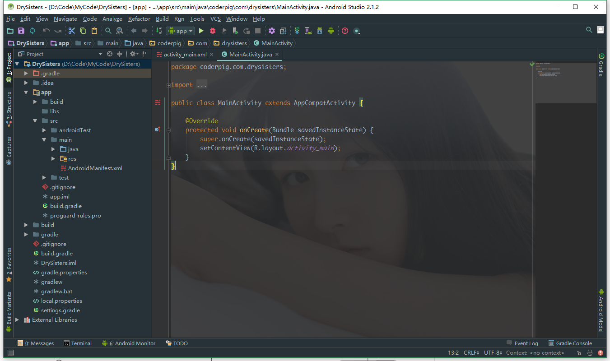
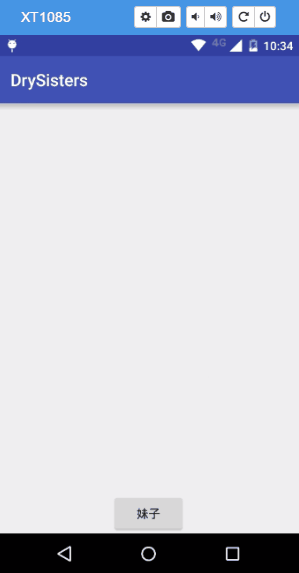

# 12.1Android 实战 ：DrySister看妹子应用(第一版) &#8212; 项目搭建与简单实现

> 来源: https://www.runoob.com/w3cnote/android-tutorial-exercise-1.html

(本节过于简单，只是为了包吃连贯性，非小小白建议跳过！)

## 1.一些BB：

入门教程在上一年的11月份就写完了，到现在也有差不多9个多月了，
当时由于自己工作上的一些原因，没有写一个实战的项目，很是遗憾。
最近项目终于也差不多快收尾了，可能会稍微有一些时间，所以还是
决定把这个遗憾给填补上。毕竟入门教程学了那么多东西，肯定要写
个实战项目整合下，鉴于看入门系列的都是初学者和自己时间的关系，
这个项目就设定为一个简单的看妹子的应用：**DrySister**(干妹子)
之所以叫这个名字，请听我娓娓道来：
妹子图片来源于[Gank.io](http://gank.io/)，Gank发音有"干客"，简称干，本来想直接
叫GanMeizi的，后来看到Github上已经有人用了，后来手多谷歌翻译了下：
干妹子，然后翻译的结果是：**DrySister**，索性就用这个名字吧！
没什么不对，是吧！

另外选这个作为实战项目的原因是看妹子养眼，比如我的AS：

背景插件是：**Sexy Editor**

右面和Subline Text预览相似的插件是：**CodeGlance**

AS的MD主题插件是：**Material Theme UI**

别问我怎么装插件这种问题。

好的，说回来这个实战项目我想怎么搞法，关于用Gank.io接口做接口的
小项目，在Github上面可以找到很多个，然后都是用很酷炫的框架Rx，Retrofit
，Glide，Butterknife等等。我也可以直接写一个：
**MVP模式**，**BufferKnife** + **Dagger2** + **Retrofit** + **Rx** + **retrolambda** + **Glide** +
**Relam**的项目，但是没太大意义，我想从最简单的Handler开始，然后慢慢加东西，
一点点优化，就好像一个项目迭代一样，而不是写完就把这个项目丢到一边，这样就
完了，其实优化和重构项目的时候会学到更多，真的。好吧，那我们就从Hello world！开始吧！

 就问你嗨不嗨？

好吧，说笑，不过本节还是比较简单的，就写一个简单的显示网络图片的雏形，
后面再一点点迭代优化，什么乱七八糟的都会加上去的！
另外，项目所有的代码都会托管到Github上，引入分支管理，master分支作为正式的
大版本，develop作为日常的开发分支，加新东西在develop分支上开辟功能分支，编写
完毕后合并回develop分支。大概就这样吧，具体的自己慢慢看！

---

## 1.创建github仓库

在AS上创建一个新的项目，命名为：**DrySister**，包名：**com.coderpig.drysister**
来到项目根目录下打开git bash，键入下述命令创建Git仓库：
**
git init
**
Github上创建一个新的仓库，命名为：DrySister，接着配置下远程仓库，
键入命令：
**
git remote add origin [[email protected]](/cdn-cgi/l/email-protection):coder-pig/DrySister.git
**
pull下master分支，然后add，commit，push到github仓库，在接着，我对
.gitignore文件进行了修改，我创建了一个新的develop分支，然后在该分支
上提交，然后合并到master分支，好的，关于Git的准备工作就差不多了。

---

## 2.开始编写程序

我们在本地开辟一个develop分支，然后开始编写代码，布局很简单，一个
显示妹子图的ImageView和Button，[activity_main.xml](https://github.com/coder-pig/DrySister/blob/develop/app/src/main/res/layout/activity_main.xml)
接着编写一个简单的下载加载图片的类，[PictureLoader.java](https://github.com/coder-pig/DrySister/blob/master/app/src/main/java/com/coderpig/drysisters/PictureLoader.java)
逻辑很简单，线程将输入流转成字节数组，转换完毕 handler 里 decodeByteArray
将字节数组解码成bitmap，然后显示~

然后是[MainActivity.java](https://github.com/coder-pig/DrySister/blob/master/app/src/main/java/com/coderpig/drysisters/MainActivity.java)，也很简单，就不解释了

---

## 3.运行效果图

(看手机屏幕用的是Chrome的插件：**Vysor**，录Gif用得ScreenToGif)

---

## 4.小结

**先说说本节我们做了些什么**：

- 1.创建了DrySister项目，并把项目托管到Github上

- 2.写了很简单的显示网络图片的功能

**待优化与想加的东西**：

- 1.代码中的图片来源是我们写死的，每天能看到的图片都是那么几张，
Gank提供的接口没用到

- 2.图片加载类只有加载网络的，应该加上加载本地图片的

**下一节要做的事**：

- 1.用Android自带抠脚解析器解析接口数据，获取图片显示的数据源

- 2.优化图片加载类

---

本节代码下载：[Github：DrySister](https://github.com/coder-pig/DrySister/tree/develop)

### 图片清单

1. 图1 -> images/1513918808-9232-alxixxi957965jlrjtkwtv10.jpg （原图：https://www.runoob.com/wp-content/uploads/2017/12/1513918808-9232-alxixxi957965jlrjtkwtv10.jpg）
2. 图2 -> images/1513918841-8637-hox8azhv4cgbaa7bsayydyr2.png （原图：https://www.runoob.com/wp-content/uploads/2017/12/1513918841-8637-hox8azhv4cgbaa7bsayydyr2.png）
3. 图3 -> images/1513918884-8980-DY29MY_4CBR0L5BRH7E7E2928F3I.jpg （原图：https://www.runoob.com/wp-content/uploads/2017/12/1513918884-8980-DY29MY@4CBR0L5BRH7E7E2928F3I.jpg）
4. 图4 -> images/1513919027-8800-4z0klwr9lvn0r7d0oyzdfhvo.gif （原图：https://www.runoob.com/wp-content/uploads/2017/12/1513919027-8800-4z0klwr9lvn0r7d0oyzdfhvo.gif）
