# 12.2 DrySister看妹子应用(第一版)——2.解析后台数据

> 来源: https://www.runoob.com/w3cnote/android-tutorial-exercise-2.html

## 1.一些BB

上节我们把简单的项目搭起来了，然后把仓库托管到Github上了，经过分析，
我们觉得有必要把下面两点优化下：

> 1.URL写死 -> 解析接口返回的Json，处理获取图片URL
> 2.优化图片加载，添加本地加载

本节就来完成上述的第一点！

## 2.开始写代码

1）在Develop上开辟功能分支：**parse_json**

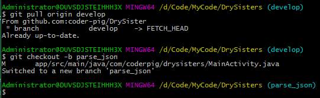

2）抠脚Json解析接口数据

数据来源接口：[Gank.io API](http://gank.io/api)

数据来源接口：[Gank.io API](http://gank.io/api)

这里我们用的是接口是：**http://gank.io/api/data/福利/{请求个数}/{第几页}**
例如：每页显示10个，第一页：[http://gank.io/api/data/福利/10/1](http://gank.io/api/data/%E7%A6%8F%E5%88%A9/10/1)

先看下服务器返回的Json格式：

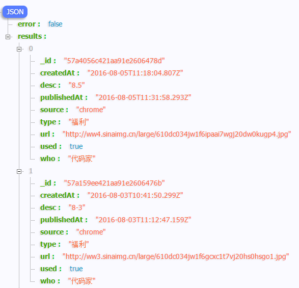

PS：格式化Json的是Chrome的插件：**JSON_handle**

根据这个我们先来编写我们的Bean类：**Sister.java**：

接下来我们编写一个用来解析网络数据的类，这个类里要做的事依次是：

> - **Step 1**：通过HttpUrlConnection发起Get请求，然后获得后台返回的数据，此时是流形式的

> - **Step 2**：我们需要写一个流转成字节数组的方法

> - **Step 3**：将字节数组转成字符串后，得到的就是后台的给我们返回的数据了，接着要做的就
> 是写一个解析这一大串Json的方法了，我们需要获取Json里我们需要的数据，丢到Bean里

> - **Step 4**：返回处理后的集合数据

于是乎我们编写一个网络请求的处理类：**SisterApi.java**：

好的，接着我们就去调用这个网络请求类了，我们把调用写在**MainActivity.java**里
而Android是不允许在主线程做网络操作的这里我们就不直接new Runnable，
直接写一个AsyncTask，在里面进网络操作，还有一些简单的逻辑。

核心是这些，还有一些小改动，加了个Application的类，调整了一下结构，变成这样的：

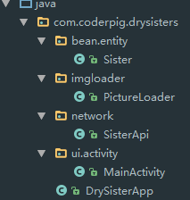

## 3.运行效果图

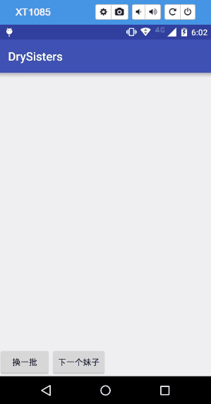

## 4.提交代码，合并分支，删除分支

依次键入命令提交代码：

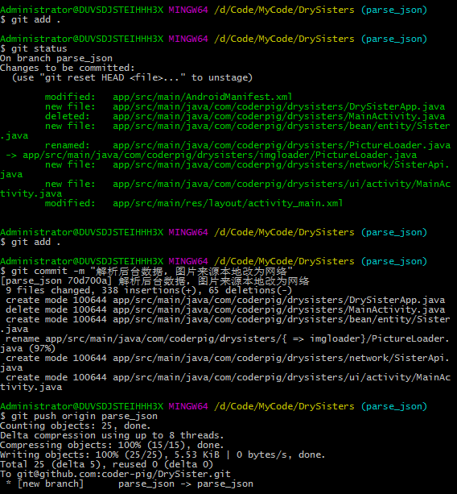

提交完到Github上可以看到：

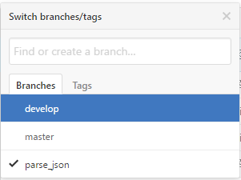

因为没下载Github客户端，所以分支合并就用命令行走一发了：
切到develop分支上，走一波merge parse_json

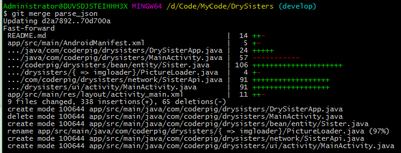

然后把合并后的develop提交到Github，（因为一个人开发，所以基本不用处理冲突

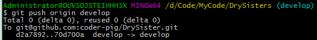

好的，推完看到github上的develop内容已经发生了变化

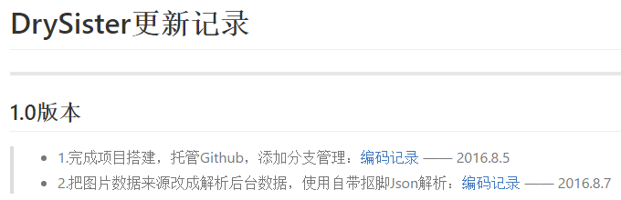

那么开辟的这个parse_json分支，现在已经没什么作用了，我们可以用命令删掉这个分支：

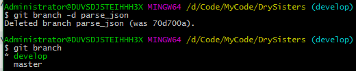

当然，这里我们删除的只是本地仓库，Github上还是有这个分支的，再键入命令：

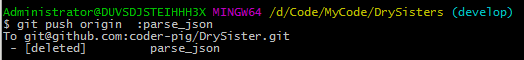

然后到GitHub上面看看：

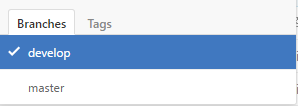

好的，分支已经被删除了！develop分支上的代码也是最新的代码了！

## Bug修复——(2016.8.9)：

今天群里的B神和我反馈了下new AsyncTask可能会导致内存溢出的问题，
仔细一想确实有这个可能，时间关系写的时候并没有注意这个，特意开
了个 **asyncTask_bug** 的分支来修复这个问题，对MainActivity的代码
进行了修改，修改后的代码如下：

源码下载：[DrySister](https://github.com/coder-pig/DrySister/tree/develop)

### 图片清单

1. 图1 -> images/1513925495-4660-1apfegv182j9dgh1p1a1mqo1l829.png （原图：https://www.runoob.com/wp-content/uploads/2017/12/1513925495-4660-1apfegv182j9dgh1p1a1mqo1l829.png）
2. 图2 -> images/1513925495-5059--1apfhnqnnq1q1nrlpb035qrug13.png （原图：https://www.runoob.com/wp-content/uploads/2017/12/1513925495-5059--1apfhnqnnq1q1nrlpb035qrug13.png）
3. 图3 -> images/1513925495-6047-e-1api66neisou80j6el19m76kt9.png （原图：https://www.runoob.com/wp-content/uploads/2017/12/1513925495-6047-e-1api66neisou80j6el19m76kt9.png）
4. 图4 -> images/1513925499-2775-pz7a53l4aslvwi3lvub0n9gm.gif （原图：https://www.runoob.com/wp-content/uploads/2017/12/1513925499-2775-pz7a53l4aslvwi3lvub0n9gm.gif）
5. 图5 -> images/1513925496-9498-1api69iha11l01it2doj51g1mu6m.png （原图：https://www.runoob.com/wp-content/uploads/2017/12/1513925496-9498-1api69iha11l01it2doj51g1mu6m.png）
6. 图6 -> images/1513925495-4816-api6cmq81qnsj3n1r1mm1t1m9h1a.png （原图：https://www.runoob.com/wp-content/uploads/2017/12/1513925495-4816-api6cmq81qnsj3n1r1mm1t1m9h1a.png）
7. 图7 -> images/1513925496-5694-api6onr41h03fod1ms2dd215001n.png （原图：https://www.runoob.com/wp-content/uploads/2017/12/1513925496-5694-api6onr41h03fod1ms2dd215001n.png）
8. 图8 -> images/1513925496-9893--1api6rv8c3lm7pr14b5pjbqvp24.png （原图：https://www.runoob.com/wp-content/uploads/2017/12/1513925496-9893--1api6rv8c3lm7pr14b5pjbqvp24.png）
9. 图9 -> images/1513925496-9962-api6tqri1nov189lhkl116dtve2h.png （原图：https://www.runoob.com/wp-content/uploads/2017/12/1513925496-9962-api6tqri1nov189lhkl116dtve2h.png）
10. 图10 -> images/1513925497-9975-api717ni1nqp18785sg1b147313b.png （原图：https://www.runoob.com/wp-content/uploads/2017/12/1513925497-9975-api717ni1nqp18785sg1b147313b.png）
11. 图11 -> images/1513925497-5366-api75fev14j21h7p1oa2knqgb53o.png （原图：https://www.runoob.com/wp-content/uploads/2017/12/1513925497-5366-api75fev14j21h7p1oa2knqgb53o.png）
12. 图12 -> images/1513925497-8742-pi7687v17bq9ho1pr2128c1c9t45.png （原图：https://www.runoob.com/wp-content/uploads/2017/12/1513925497-8742-pi7687v17bq9ho1pr2128c1c9t45.png）
