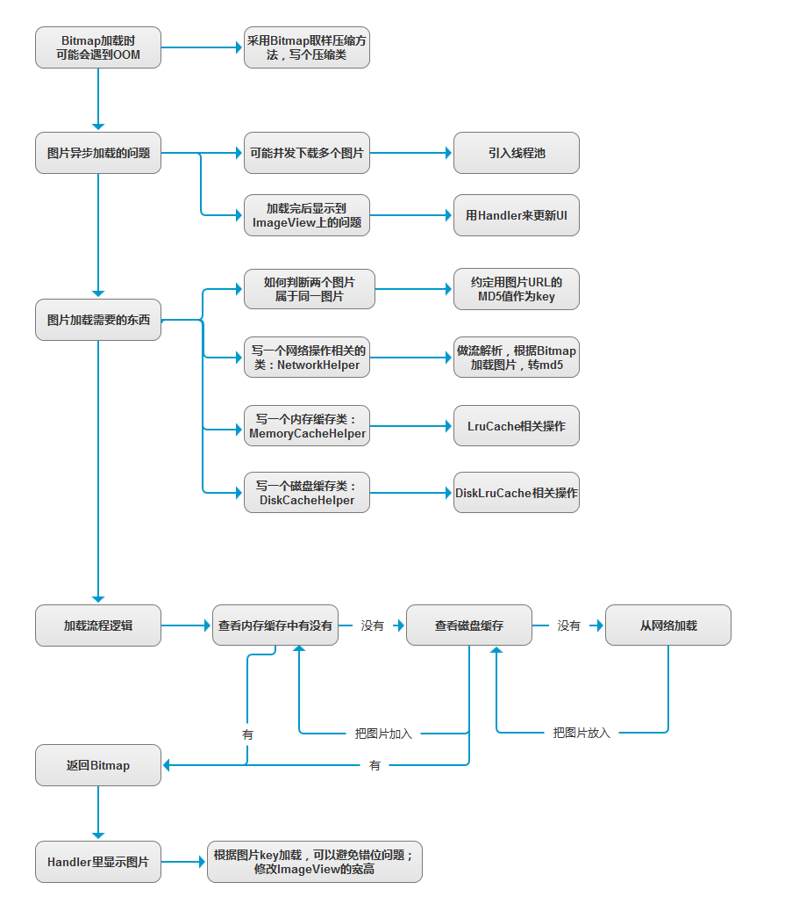
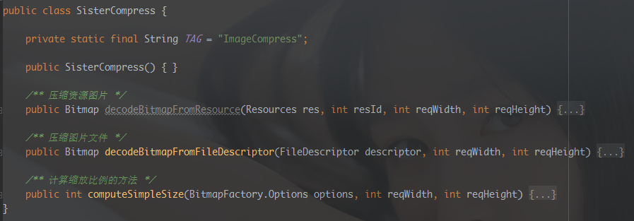
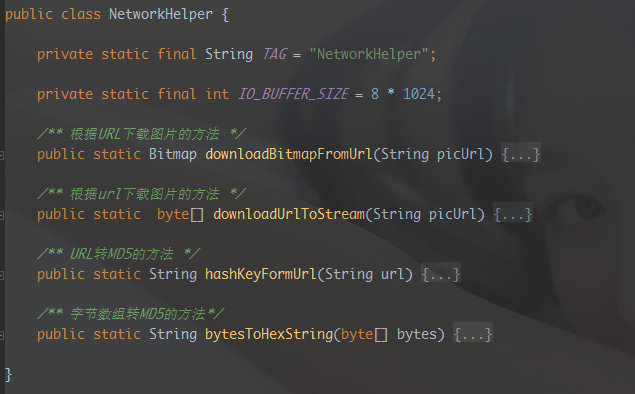
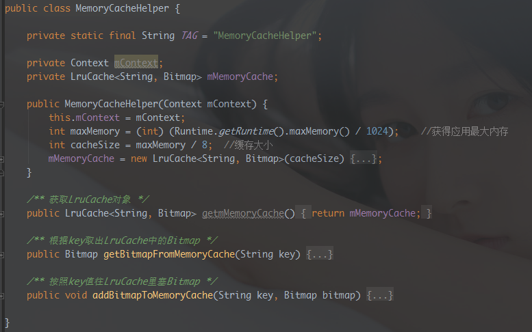
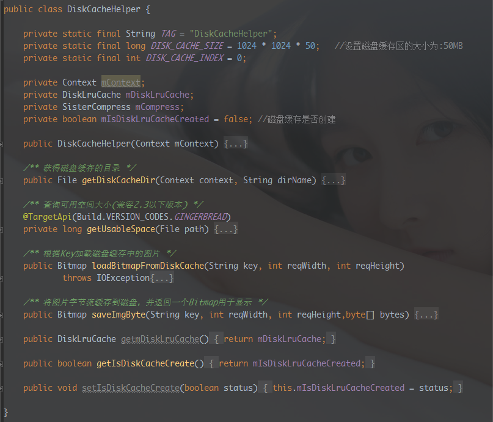
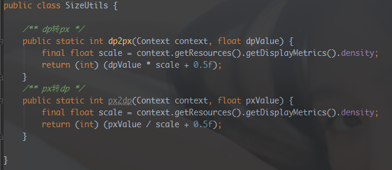
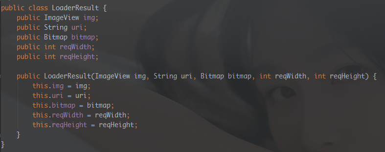
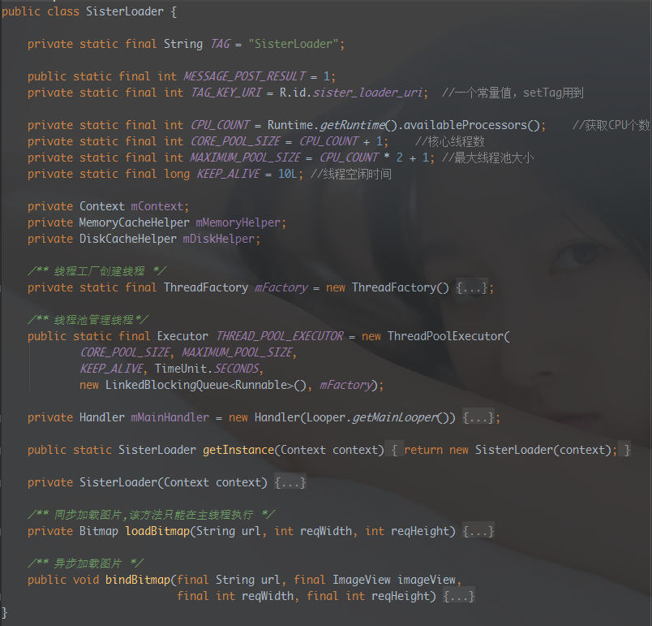
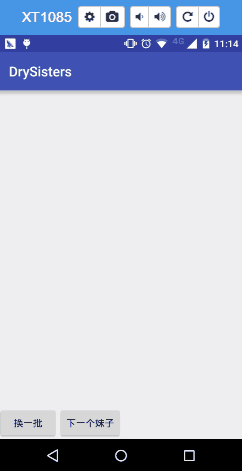
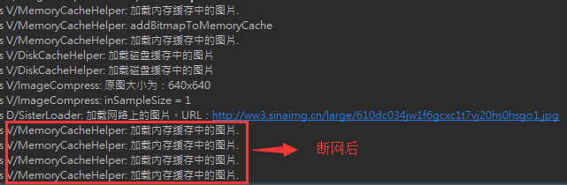

# 12.3 DrySister看妹子应用(第一版)——3.图片加载优化(写个图片缓存小框架)

> 来源: https://www.runoob.com/w3cnote/android-tutorial-exercise-3.html

## 1.一些BB

上节我们把妹子图片的数据来源从**本地**改成了解析**Gank提供的接口**数据，
我们本节想对这个图片加载类进行优化，比如加上显示本地图片的，另外还有一点
就是缓存，我们现在用得图片加载没有任何缓存可言，每次都是请求后，解析流，
即使是同样的图片每次都要去请求一次，这显得有点累赘，把图片缓存到内存，
或者磁盘里，当访问相同的图片资源我们从这里拿？嗯，好像很有搞头，那么本节
我们就来写一个简单的带缓存的图片加载框架吧！嗯，就叫**SisterLoader**吧！

(PS：拖着好久没更的原因是因为自己最近在看下载相关的东西，还有改BUG
写图片加载的时候因为一些问题卡住了，抽不出时间解决...)

## 2.简单常识科普

开始写代码之前我们先来撸清楚一些概念先：

### 1）缓存

**①引入图片缓存的目的**：

答：从网络加载图片费时费电费流量，我们希望把一些加载过的图片可以存起来，
当再次加载时可以复用这个图片。

**②什么是二级缓存**：

答：说下需要显示一张图片所经历的逻辑，你就一清二楚了：
**需要显示图片** ——> **查内存**(有的话显示) —**没有**—>**查磁盘**(有的话显示) —**没有**—>
**从网络加载**(显示出来) ——> **往内存中存一份** ——> **往磁盘存一份**

从上我们知道，缓存有两种，**内存缓**存和**磁盘缓存**(SD卡/机身存储)：

**内存缓存**：一级缓存，优先从这里拿，缓存文件存储在**data/data/包名/cache**目录下，
以前写内存缓存的老旧套路是用**Map弱引用的Bitmap对象**，我翻了翻上上上家公司的祖传代码：

而Google老东家并不建议这样做，官方最佳实践中给我们推荐了关于缓存的两个API：
**LruCache**(内存缓存) 和 **DiskLruCache**(磁盘缓存)
LruCache是以**强引用**(直接引用)的方式引用外界的缓存对象的，不会被GC回收，
而**SoftReference**引用，当系统内存不足的时候回随GC回收
还有个**WeakRefreence**，随时都可能会被系统回收...
如果你对这个很有兴趣，可移步到官方的最佳实践：[Caching Bitmaps](https://developer.android.com/training/displaying-bitmaps/cache-bitmap.html?hl=zh-cn)

**磁盘缓存**：

每个应用的内存都是有限的，如果是大批量的图片，不可能全部塞到内存中，
我们可以考虑把图片保存到磁盘中，老旧的做法是在SD上创建一个文件夹，
然后把图片保存到里面，网上很容易就能找到代码，这里不讨论这个，本节
我们用上面Google推荐的DiskLruCache来做磁盘缓存

### 2）同步加载与异步加载

同步和异步的概念，相信很多人都了然于心了，简单点说：
**同步**：发出加载图片的调用后，要直到完成加载才能够做其他操作
**异步**：发出加载图片的调用后，想干嘛就干嘛，不用等他加载完才能去做其他事。

### 3）图片加载流程图

### 4）图片OOM，压缩之类关于Bitmap的概念

以前在入门教程那里写过就不再重复了：

[Android基础入门教程——8.2.1 Bitmap(位图)详解](//www.runoob.com/w3cnote/android-tutorial-bitmap1.html)

[Android基础入门教程——8.2.2 Bitmap引起的OOM问题](//www.runoob.com/w3cnote/android-tutorial-bitmap2.html)

也可以移步到我的好基友——**基神**的个人博客查看，解释得更加详细：

[Android Bitmap 优化(1) - 图片压缩](http://anany.me/2015/10/15/bitmap1/)

[Android Bitmap 优化(2) - 图片缓存](http://anany.me/2015/10/19/bitmap2/)

## 3.简单的图片加载框架流程图

尽管代码不算复杂，觉得还是有必要画个流程图帮助大家理解一下~

## 4.手撕代码时间

PS：思前想后，还是把贴代码还是放最后吧，只做下代码折叠截图简单
解释一波，具体自己看代码，

### ①DiskLruCache.java

这个是Google提供的，直接下这个类

[https://android.googlesource.com/platform/libcore/+/jb-mr2-release/luni/src/main/java/libcore/io/DiskLruCache.java](https://android.googlesource.com/platform/libcore/+/jb-mr2-release/luni/src/main/java/libcore/io/DiskLruCache.java)

然后加到你的工程里，自己改下包名就能用了~

### ②图片压缩类：SisterCompress.java

### ③网络加载协助类：NetworkHelper.java

### ④内存缓存协助类：MemoryCacheHelper.java

### ⑤磁盘缓存协助类：DiskCacheHelper.java

### ⑥尺寸转换类：SizeUtils.java

PS: 设置ImageView大小用到

### ⑦加载结果类：LoaderResult.java

PS：就是异步加载图片后传给Handler的数据集合

### ⑧图片加载逻辑控制类：SisterLoader.java

### ⑨调用图片加载框架：MainActivity.java

## 5.运行效果图

先有网络加载一次，让应用做好内存和硬盘缓存
然后断开网络，点下一个妹子会加载内存缓存中的图片

## 6.代码下载

本节代码是切换到新的分支下编写的：**sisterloader**
代码编写完后，本地直接merge到develop分支，最后推送到Github的！
命令和上节的一样！

[https://github.com/coder-pig/DrySister/tree/develop](https://github.com/coder-pig/DrySister/tree/develop)

欢迎follow，star，觉得有什么想加进来的可以提下issues！

### 图片清单

1. 图1 -> images/1513926417-1135-h9gk1ydjnt2n5cjaxjwe3jhb.jpg （原图：https://www.runoob.com/wp-content/uploads/2017/12/1513926417-1135-h9gk1ydjnt2n5cjaxjwe3jhb.jpg）
2. 图2 -> images/1513926417-8308-1app669df1jv5r0k8ea1nk71ltq9.png （原图：https://www.runoob.com/wp-content/uploads/2017/12/1513926417-8308-1app669df1jv5r0k8ea1nk71ltq9.png）
3. 图3 -> images/1513926417-3585-2016-08-17-210735.png （原图：https://www.runoob.com/wp-content/uploads/2017/12/1513926417-3585-2016-08-17-210735.png）
4. 图4 -> images/1513926417-8087-QQE59BBEE7898720160817211346.gif （原图：https://www.runoob.com/wp-content/uploads/2017/12/1513926417-8087-QQE59BBEE7898720160817211346.gif）
5. 图5 -> images/1513926418-7471-aqca3rd518ps1lptlou1ngq1qcgl.png （原图：https://www.runoob.com/wp-content/uploads/2017/12/1513926418-7471-aqca3rd518ps1lptlou1ngq1qcgl.png）
6. 图6 -> images/1513926418-1488-aqcaeknsb281ov11gq9p3s14bg1e.png （原图：https://www.runoob.com/wp-content/uploads/2017/12/1513926418-1488-aqcaeknsb281ov11gq9p3s14bg1e.png）
7. 图7 -> images/1513926419-9621-aqcah4hik7c1dae161l5l713t21r.png （原图：https://www.runoob.com/wp-content/uploads/2017/12/1513926419-9621-aqcah4hik7c1dae161l5l713t21r.png）
8. 图8 -> images/1513926419-4021-1aqcajgj7p4d1lo71c8oaf65cd28.png （原图：https://www.runoob.com/wp-content/uploads/2017/12/1513926419-4021-1aqcajgj7p4d1lo71c8oaf65cd28.png）
9. 图9 -> images/1513926420-5525-qcam6o213d89971htq1vkh11dd2l.png （原图：https://www.runoob.com/wp-content/uploads/2017/12/1513926420-5525-qcam6o213d89971htq1vkh11dd2l.png）
10. 图10 -> images/1513926421-6479--1aqcao3il1o3g7oak0brq3v9s32.png （原图：https://www.runoob.com/wp-content/uploads/2017/12/1513926421-6479--1aqcao3il1o3g7oak0brq3v9s32.png）
11. 图11 -> images/1513926423-2652-qcb378g1m0v1n281m6i6a41bmu3f.png （原图：https://www.runoob.com/wp-content/uploads/2017/12/1513926423-2652-qcb378g1m0v1n281m6i6a41bmu3f.png）
12. 图12 -> images/1513926425-7322-6h1czj0mtkfbxrglg8zweue4.gif （原图：https://www.runoob.com/wp-content/uploads/2017/12/1513926425-7322-6h1czj0mtkfbxrglg8zweue4.gif）
13. 图13 -> images/1513926424-5663-8kdrffdlxjb4sszaki11dg6k.png （原图：https://www.runoob.com/wp-content/uploads/2017/12/1513926424-5663-8kdrffdlxjb4sszaki11dg6k.png）
