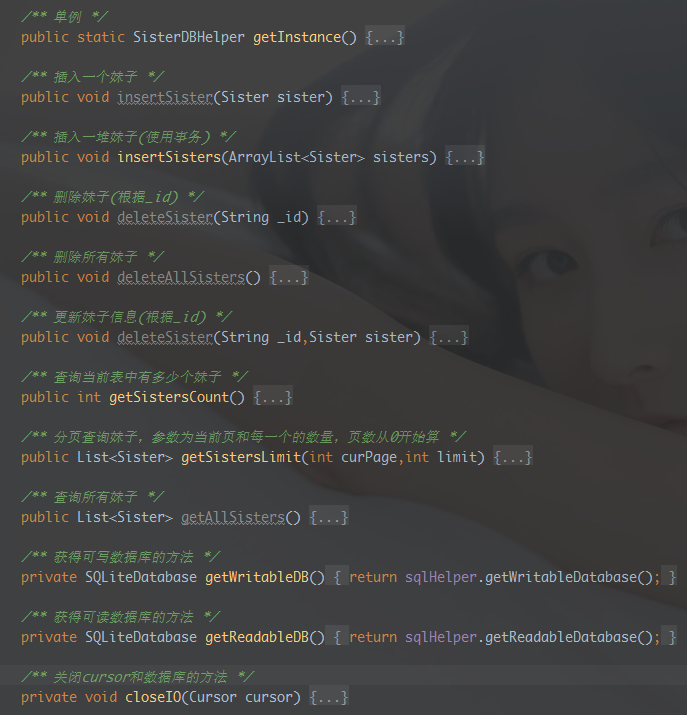

# 12.4 DrySister看妹子应用(第一版)——4.添加数据缓存(加入SQLite)

> 来源: https://www.runoob.com/w3cnote/android-tutorial-exercise-4.html

## 1.一些BB

上节我们为DrySister编写了一个异步图片加载缓存框架——**SisterLoader(妹子加载器)**
成功的从网络加载的图片缓存到了磁盘和内存中，当我们断开网络后，仍然能够查看这些图片，
但是，细心的你可能发现了一个很尴尬的地方，我们在有网的情况下进入APP，获取到图片相关
的信息，比如URL，如果退出了，断网，然后进来，图片就加载不出来了，图片已经缓存了，但是
我们没有图片对应的URL，就显得有些鸡肋了。所以我们需要对后台接口返回的数据进行存储，
当每次加载的时候，把返回的数据信息存储到本地，然后当无网的时候，可以让他加载本地
数据！所以本节我们为DrySister添加SQLite用于存储相关数据。任务都说清楚了，搞起~

## 2.开始编写程序

在develop上开辟一个新的**db**分支，来完成本节相关代码的编写。

首先，我们添加一个用来判断网络状态的工具类：**NetworkUtils.java**，
就一个简单的判断网络是否可用的方法~这里我们还需要在AndroidManifest.xml
里加一个权限：**android.permission.ACCESS*NETWORK*STATE"**的权限！

接着定义一个数据库字段常量的类：**TableDefine.java**，
在里面把数据库名，字段写上：

再接着编写数据库的创建类：**SisterOpenHelper.java**，在里面完成数据库的创建

再接着，我们需要编写一个数据库的操作类，就是做增删改查，分页查询等操作的类，
这里我们把这个类写成单例的：**SisterDBHelper.java**，里面的编写的方法有这些：

具体代码：

嗯，还是蛮简单的，都是一些SQLite的方法调用而已，接着我们对布局做一下更改，
把**activity_main.xml**改成下面的代码，就是换成上一个和下一个这样：

最后就是对MainActivity.java的一些逻辑更改了，核心的要点如下：

- 
1.curPos和page的控制以及处理逻辑

- 
2.根据网络是否可用加载网络还是数据库数据

- 
3.加载网络数据时存储到数据库需要避免重复插入 等等。

代码实现：

## 3.运行效果图

操作步骤：

> 把项目跑起来后，一直按下一页下一页缓存一堆图片，接着断开网络，进入DrySister，
> Duang~，神奇的发现，有妹子出现了，按下一页或者上一页也可以切换图片，妈妈再也
> 不用担心我在没网的时候不可以看DrySister了！

> 

运行截图：

## 4.小结

好的，本节在上节的基础上行添加了SQlite保存后台数据，当无网的时候也可以查看
妹子图片，代码的大的改动如上述，还有一些小改，具体看代码。
最后把db分支的代码合并到develop分支上，然后删除db分支，把更新后的
develop分支推送到Github！

代码下载：

[https://github.com/coder-pig/DrySister/tree/develop](https://github.com/coder-pig/DrySister/tree/develop)
欢迎follow，star，觉得有什么想加进来的可以提下issues！

### 图片清单

1. 图1 -> images/1513927590-6917-QQE59BBEE7898720160822162927.jpg （原图：https://www.runoob.com/wp-content/uploads/2017/12/1513927590-6917-QQE59BBEE7898720160822162927.jpg）
2. 图2 -> images/1513927591-1787-e-1aqomkcvnt3pds4m9h1i2k951s.png （原图：https://www.runoob.com/wp-content/uploads/2017/12/1513927591-1787-e-1aqomkcvnt3pds4m9h1i2k951s.png）
3. 图3 -> images/1513927590-7091-QQE59BBEE7898720160822170140.jpg （原图：https://www.runoob.com/wp-content/uploads/2017/12/1513927590-7091-QQE59BBEE7898720160822170140.jpg）
4. 图4 -> images/1513927591-6880-95mywzay3jo1zeyzymq2qhbj.gif （原图：https://www.runoob.com/wp-content/uploads/2017/12/1513927591-6880-95mywzay3jo1zeyzymq2qhbj.gif）
