# 12.5 DrySister看妹子应用(第一版)——5.代码回顾，调整与日志类编写

> 来源: https://www.runoob.com/w3cnote/android-tutorial-exercise-5.html

## 1.一些BB

说来惭愧，DrySister的上一篇距今已经有一年多了，期间有不少小伙伴
都曾私信过我说写得很好，稳什么时候更，我基本都回复说太监了...
具体原因各种各样吧，最近一段时间比较闲，就想把第一版的完结了吧。
之前刚开始写的时候是**AS 2.1.2**，现在都**AS 3.0.1**了，本节的内容
依次是：

- **Step 1：温习一波之前几节涉及到的东西**

- **Step 2：代码在AS 3.0.1上跑要做一些调整**

- **Step 3：编写一个日志类**

下节我们来说说签名，混淆，以及发布到应用市场~
废话不多说，开始本节内容！

## 2.代码回顾

- **第一节：项目搭建与简单实现**

- 1.Git相关的操作

- 2.简单的图片加载类(获取网络流->转换成图片->Handler更新UI)

- **第二节：解析后台数据**

- 1.使用Android自带抠脚Json解析器解析后台返回的Json数据(Json字符串 -> List<**Bean**>)

- 2.使用AsyncTask来做异步网络请求

- **第三节：图片加载优化(写个图片缓存小框架)**

- 1.图片缓存的基本套路
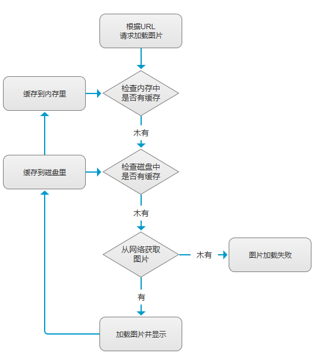

- 2.使用**采样压缩法**压缩Bitmap，避免OOM

- 3.线程池管理多个图片加载线程

- 4.Handler更新UI

- 5.String字符串(这里是URL)转MD5

- 6.内存缓存类**LruCache**的使用

- 7.磁盘缓存类**DiskLruCache**的使用

- 8.整个图片异步加载缓存的逻辑设计

- **第四节：添加数据缓存(加入SQLite)**

- 1.网络状态的判断

- 2.自定义SQLiteOpenHelper创建数据库

- 3.数据库相关操作：增删改查，事务，分页等

以上就是前面四节的内容，对于Android基础入门中重要的
知识点都进行了运用，如果都掌握了的话，算是勉强Android入门了，
后面的路还长着呢！

## 3.代码调整

AS切换到3.0以后，下述文件的代码需要进行改动，老规矩，切换分支命令走一波：
**git checkout -b fix*code*as3.0.1**，然后开始代码修改：

项目层级的**build.gradle**：

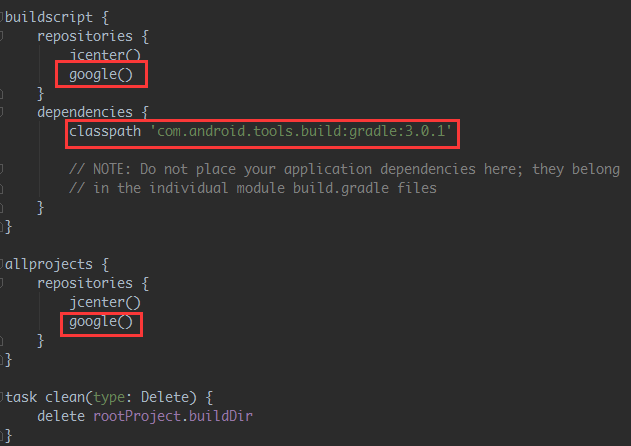

APP层级的**build.gradle**：

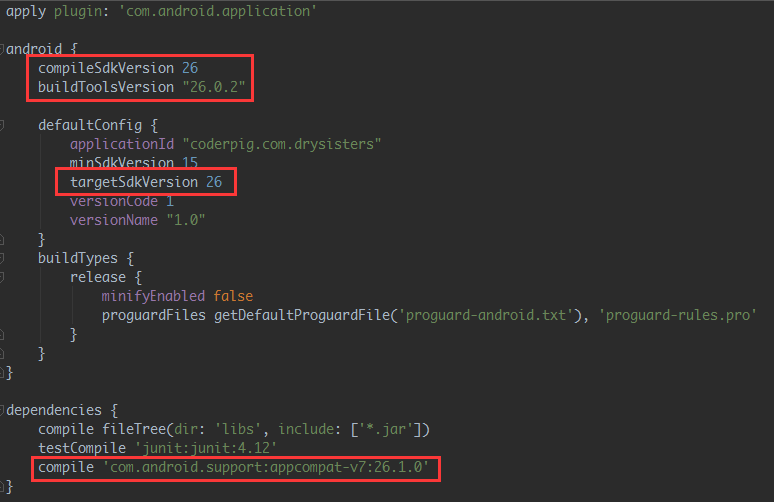

**gradle-wrapper.properties**：

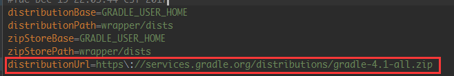

还有个地方要小改：**SisterApi.java**，把**福利**改成：**%e7%a6%8f%e5%88%a9**
这涉及到了中文转码问题，而HttpUrlConnection无法打开含有中文的链接，需要
对中文部分调用**URLEncoder.encode(中文部分,"utf-8");**进行转码，记得**只是**
**中文部分，不是整个url**！！！转码还需要捕获异常，这里因为只有一个地方要
转码，我就直接用网页版的转码工具来转码了：[https://c.runoob.com/front-end/695](https://c.runoob.com/front-end/695)

转换后的结果：

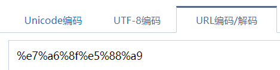

另外还有一些小改，**buildToolsVersion 26以上**，**findViewById是不用强转的**，
点进去方法看就知道了，用了泛型，所以把findViewById都去掉：

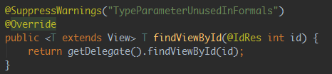

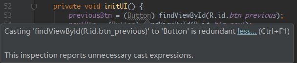

最后觉得运行再我的魅蓝E2上效果有点偏差，小调了一下页面布局，让图片宽度满屏
然后高度自适应，这里用到的属性 **android:adjustViewBounds = "true"**，就是
宽高按比例缩放；还有把上一步下一步的文字放到**strings.xml**文件中，小调边距：

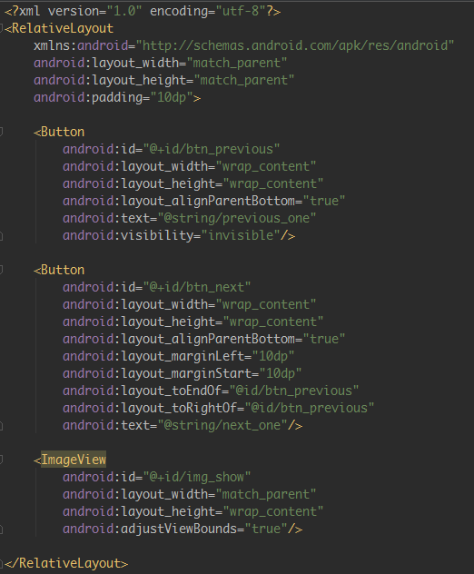

最后再来看我们的项目运行结果：(啧啧，好看的妹子就是养眼)：

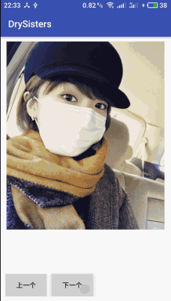

然后把这个分支合并到develop分支上，这里我们不用之前merge那种合并套路
而是用rebase来合并，具体过程如下：

关于Git还不懂的可以去另一篇文章学习，这里就不多解释了：[小猪的Git使用总结](http://blog.csdn.net/coder_pig/article/details/54346867)

## 4.编写日志工具类与崩溃日志采集类

Log打印日志相信每一位开发者都不会陌生吧，平时调试必不可少，
当应用打包给测试测试时。测试反馈应用crash的时候，我们第一件
想到的事就是让对方提供日志。说到这个打Log，很多童鞋喜欢随手
一个Log.e(xxx,xxx)，什么日志都是Error级别，原因基本是：
**红色比较醒目**，哈哈！然后直接把变量的值打印处理啊，或在某个
方法里加上，验证方法是否执行了等，正式发布的收记得删还好，
不记得删的话简直是作死。反正之前给上家公司的大佬喷了一顿，
至今记忆犹新！Log的管理非常重要，我们要写的两个工具类如下：

> - 1.debug的时候日志正常打印，release的时候不打印

> - 2.**奔溃日志采集**，自己测试或者测试测试倒没什么，崩溃了直接把
> 手机接你电脑上看看logcat就一清二楚了，但是如果应用装到了用户
> 手机里，应用崩溃停止运行了，用户可不会把日志发给你，多次崩溃
> 还可能导致用户卸载你的APP，所以我们需要在APP崩溃的时候把
> 日志保存起来，当用户连接wifi或再次打开应用时，把这个日志上传
> 到我们的服务器，我们这里只是写来玩玩的，所以只做**本地崩溃日志采集**，
> 一般都是通过集成第三方的统计工具来进行日志采集的，比如友盟，Bugly等。

好的，需求就上面的两点，接着准备开始编写代码，不过在写代码之前
科普关于Log的两点，可能大部分的童鞋都已经知道了，知道的可以直接跳过：

### 1) 快速打印Log

打开设置，依次点击：**Live Templates** -> **AndroidLog**把日志打印的都勾上
你还可以自己在下面的Template text里编写模板~

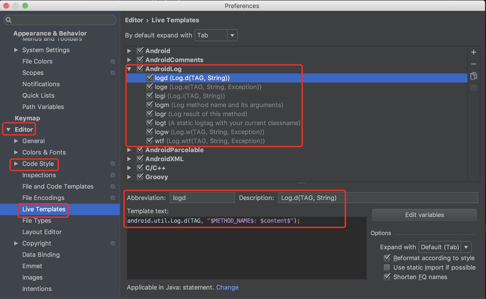

接着随便代码里键入上面的log...一个enter，Log语句就出来了，
TAG直接就是你当前的方法名~

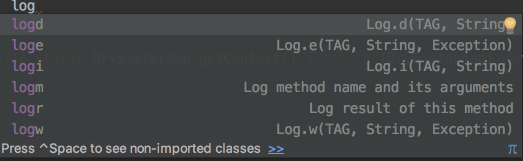

### 2.关于Log的使用科普

**1) 快速打印Log打印命令**

打开Settings，依次点击：**Live Templates** -> **AndroidLog**把日志打印的都勾上
你也可以自己在下面的Template text里编写模板~

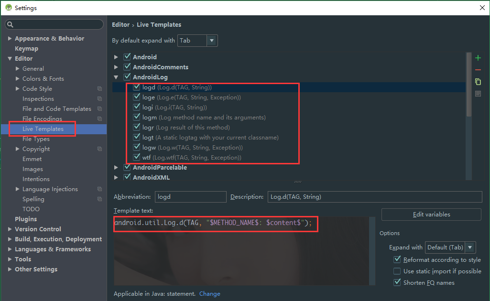

接着随便代码里键入上面的log...一个enter，Log语句就出来了~

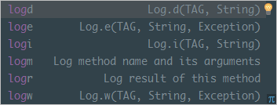

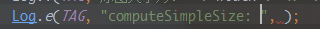

如果你在方法外，键入logt，可以直接生成一个对应类名的TAG：

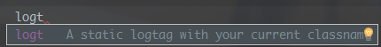

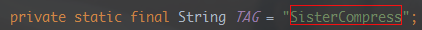

**2) Log等级的科普**

以前组长开小会的时候曾说过我们调试时直接Log.e的坏习惯，
不同的Log级别应该打印不同的信息：

> - **Log.v**：**Verbose(冗长)**
> 开发调试过程中一些详细信息，不该编译进产品，只在开发阶段使用

> - **Log.d：Debug(调试)**
> 用于调试的信息，编译进产品，运行时关闭。

> 下面这三种等级进制作为普通调试信息使用，这些等级的Log是应用
> 出现问题时候的重要分析线索，如果随意使用，会给开发人员分析Bug
> 带来不必要的困扰。

> - **Log.i：Info(信息)**
> 例如一些运行时的状态信息，这些状态信息在出现问题的时候能提供帮助。

> - **Log.w：Warning(警告)**
> 警告应用出现了异常，但不一定会马上出现错误，需要留意

> - **Log.e：Error(错误)**
> 应用出现了错误，最需要关注解决的！

### 3) 编写日志工具类

老规矩，先开辟分支：**bug*log*catch**
这个就非常简单了，调试时输出，正式版时不输出，利用**BuildConfig.Debug**
进行判断即可，代码如下：

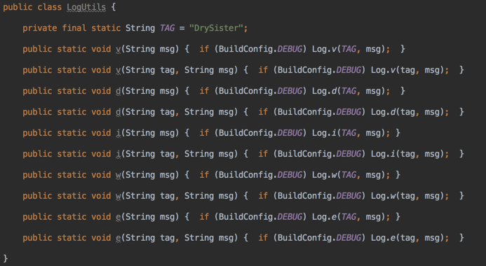

### 4) 编写崩溃日志采集类

崩溃日志采集类依赖于**Application**与**Thread.UncaughtExceptionHandler**实现~
当因为程序因为**未捕获的异常**即将终止退出时，会使用Thread.UncaughtExceptionHandler
查询UncaughtExceptionHandler的线程，调用**uncaughtException方法**，将线程
与异常作为参数传递。如果线程**没有明确设置UncaughtExceptionHandler**，则将
其**ThreadGroup**作为其UncaughtExceptionHandler，然后丢给默认的未捕获异常
处理程序处理。所以我们只需要**实现UncaughtExceptionHandler接口**，重写
**uncaughtException方法**，来实现我们的自定义处理。我们先来捋一捋逻辑清单：

- 1.**建一个文件夹专门放日志文件**：需要判断是存储卡是否可用，然后判断文件
夹是否存在，不存在则新建文件夹；

- 2.需要一个把字符串写入文件的方法

- 3.**崩溃日志的内容组成**：当前的时间，应用版本，设备信息，奔溃日志

- 4.获取系统默认的UncaughtException处理器，然后判断是否为null，不为空
设置为自定义的UncaughtException，这里我们用单例

- 5.最后是应用的重启，设置1s后重新启动应用；

大概逻辑就是上面这些，我们一步步讲，首先是1，2步：

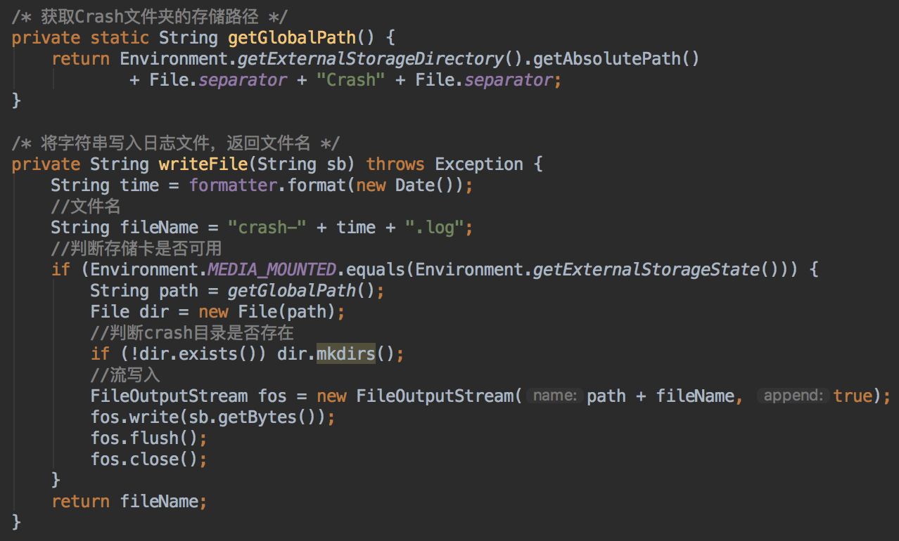

接着是奔溃日志，由几部分组成：先是当前时间

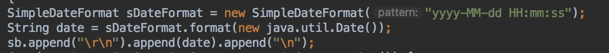

接着是应用版本以及设备信息，这里用一个HashMap来存：

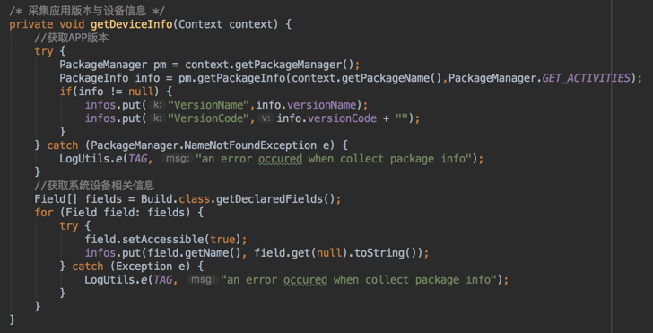

在接着是异常信息，这个就简单啦，直接传异常对象，调printStackTrace即可
最后合到一起就是：

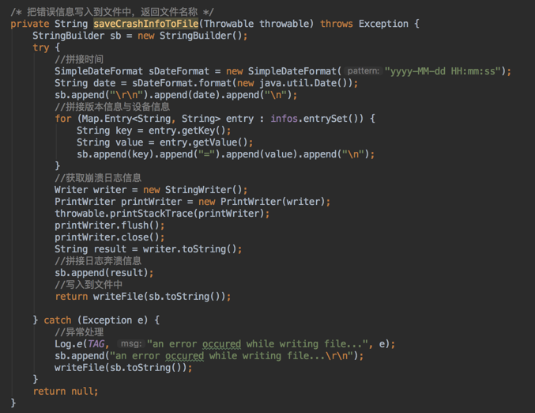

写入文件的也解决了，然后是自定义UncaughtExceptionHandler单例以及默认
UncaughtExceptionHandler处理器的获取，设置为自定义UncaughtExceptionHandler，
还需重写UncaughtException方法

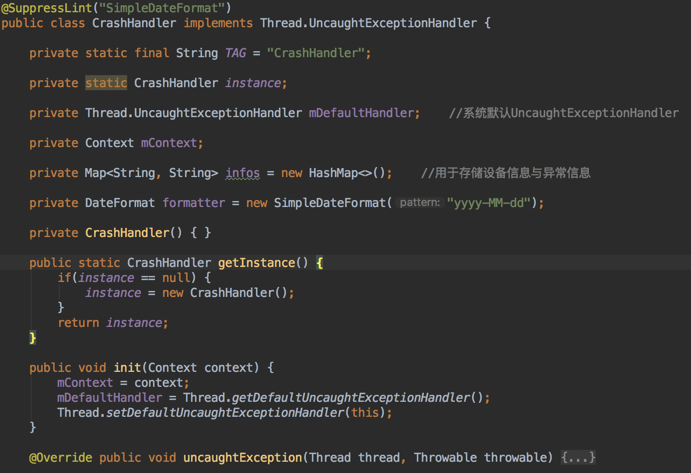

接着我们把自己处理异常的一整套都写到一个方法里，当异常发生了，弹出
一个Toast提示用户应用要重启，还有调用写入日志的方法：

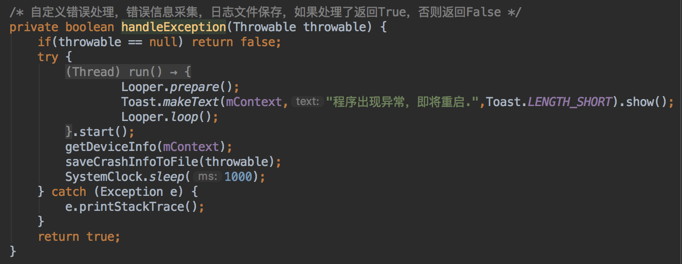

然后重写的UncaughtException方法做下判断，是否通过自定义处理了异常，
以及默认的UncaughtExceptionHandler的是否为空，即:**异常处理了没**？
没处理，丢给自定义的UncaughtExceptionHandler，如果处理了，重启应用。

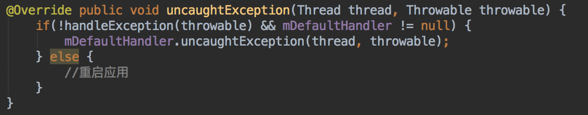

最后加上重启应用的相关代码，大功告成：

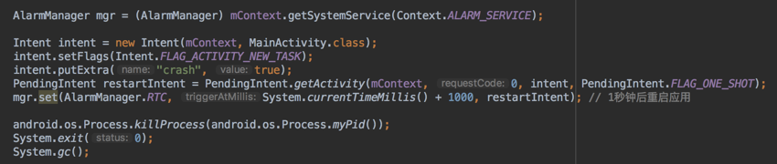

到此我们的崩溃日志采集工具类就编写完毕了，要启用他的
话需要在DrySisterApp.java中的onCreate()方法中加上：

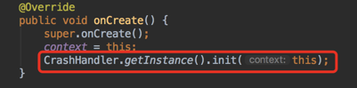

弄完想测试下是否生效的话很简单，手动引发崩溃就好了
比如我在下一步的按钮里做除数为0的操作：

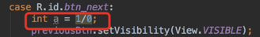

应用运行后点击下一步，直接崩溃，打开内置存储根目录看下
有没有Crash的文件夹，打开看到我们日志文件的话，说明成功：

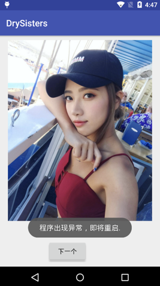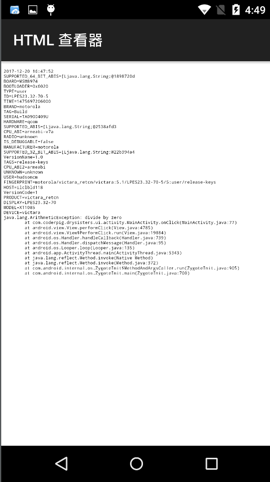

到此完成，把分支合并到develop上，然后推送到远程仓库上：

## 5.小结

本节先回顾了下之前写的代码，然后因为切换到AS 3.0上的原因
小调整了一下代码，最后还编写了日志工具类以及崩溃日志采集
工具类，麻雀虽小五脏俱全，尽管就是一个小小的图片显示程序，
但是也算囊括了大部分的入门知识，下一节就是第一版的完结篇
了，**签名打包**，**混淆**，以及发布到**酷安市场**了！敬请期待~

**代码下载**：

[https://github.com/coder-pig/DrySister/tree/develop](https://github.com/coder-pig/DrySister/tree/develop)
欢迎follow，star，觉得有什么想加进来的可以提下issues！

### 图片清单

1. 图1 -> images/1513928014-2804-1app669df1jv5r0k8ea1nk71ltq9.png （原图：https://www.runoob.com/wp-content/uploads/2017/12/1513928014-2804-1app669df1jv5r0k8ea1nk71ltq9.png）
2. 图2 -> images/1513928014-5885-if3ebfc794w2xw6gm2k4lx2l.png （原图：https://www.runoob.com/wp-content/uploads/2017/12/1513928014-5885-if3ebfc794w2xw6gm2k4lx2l.png）
3. 图3 -> images/1513928015-5254-aajqntkjl20mg1yzfzj69l1c.png （原图：https://www.runoob.com/wp-content/uploads/2017/12/1513928015-5254-aajqntkjl20mg1yzfzj69l1c.png）
4. 图4 -> images/1513928015-5735-hijnbclbwrmwrq67htffny67.png （原图：https://www.runoob.com/wp-content/uploads/2017/12/1513928015-5735-hijnbclbwrmwrq67htffny67.png）
5. 图5 -> images/1513928015-6829-iuq65j5rh64ganeyeqz5hs1o.png （原图：https://www.runoob.com/wp-content/uploads/2017/12/1513928015-6829-iuq65j5rh64ganeyeqz5hs1o.png）
6. 图6 -> images/1513928015-9168-46828sb373zsxtfj01kvg9ql.png （原图：https://www.runoob.com/wp-content/uploads/2017/12/1513928015-9168-46828sb373zsxtfj01kvg9ql.png）
7. 图7 -> images/1513928015-7749-p6j1w8my03o75b0vikauotg9.png （原图：https://www.runoob.com/wp-content/uploads/2017/12/1513928015-7749-p6j1w8my03o75b0vikauotg9.png）
8. 图8 -> images/1513928015-2216-rvay1y8if1c01xh6revn49zv.png （原图：https://www.runoob.com/wp-content/uploads/2017/12/1513928015-2216-rvay1y8if1c01xh6revn49zv.png）
9. 图9 -> images/1513928016-1421-5e6f63u5hwhtt13ir1omvp2k.gif （原图：https://www.runoob.com/wp-content/uploads/2017/12/1513928016-1421-5e6f63u5hwhtt13ir1omvp2k.gif）
10. 图10 -> images/1513928016-2202-s733cjuawgz3fripy2tn5kpl.gif （原图：https://www.runoob.com/wp-content/uploads/2017/12/1513928016-2202-s733cjuawgz3fripy2tn5kpl.gif）
11. 图11 -> images/1513928016-7093-f9tq60nafa3vy493pckxylfq.png （原图：https://www.runoob.com/wp-content/uploads/2017/12/1513928016-7093-f9tq60nafa3vy493pckxylfq.png）
12. 图12 -> images/1513928016-9802-srdif5h6klmy7voqu1o158wu.png （原图：https://www.runoob.com/wp-content/uploads/2017/12/1513928016-9802-srdif5h6klmy7voqu1o158wu.png）
13. 图13 -> images/1513928016-5655-argb5mlg120rduj1l0r1mr21473n.png （原图：https://www.runoob.com/wp-content/uploads/2017/12/1513928016-5655-argb5mlg120rduj1l0r1mr21473n.png）
14. 图14 -> images/1513928019-2273--1argb9tak86apko1bikglv60814.png （原图：https://www.runoob.com/wp-content/uploads/2017/12/1513928019-2273--1argb9tak86apko1bikglv60814.png）
15. 图15 -> images/1513928020-9516-argbanqcuh91pcqb1k1evg1ctm1h.png （原图：https://www.runoob.com/wp-content/uploads/2017/12/1513928020-9516-argbanqcuh91pcqb1k1evg1ctm1h.png）
16. 图16 -> images/1513928020-1556-rgbd7ja1inq1rrd1plc1bhjked1u.png （原图：https://www.runoob.com/wp-content/uploads/2017/12/1513928020-1556-rgbd7ja1inq1rrd1plc1bhjked1u.png）
17. 图17 -> images/1513928020-5462--1argbdju61j2hru0p4k1n10jv2b.png （原图：https://www.runoob.com/wp-content/uploads/2017/12/1513928020-5462--1argbdju61j2hru0p4k1n10jv2b.png）
18. 图18 -> images/1513928021-3638-1c1p0op3op171go0avr1fbvu8o1t.png （原图：https://www.runoob.com/wp-content/uploads/2017/12/1513928021-3638-1c1p0op3op171go0avr1fbvu8o1t.png）
19. 图19 -> images/1513928021-8209-auoo6b3768ewaexch8wru07n.png （原图：https://www.runoob.com/wp-content/uploads/2017/12/1513928021-8209-auoo6b3768ewaexch8wru07n.png）
20. 图20 -> images/1513928021-8270-1c1pevhabe4j1fe618ijfi1ar02m.png （原图：https://www.runoob.com/wp-content/uploads/2017/12/1513928021-8270-1c1pevhabe4j1fe618ijfi1ar02m.png）
21. 图21 -> images/1513928022-1456--1c1pfvm4roassp61u8s613dci33.png （原图：https://www.runoob.com/wp-content/uploads/2017/12/1513928022-1456--1c1pfvm4roassp61u8s613dci33.png）
22. 图22 -> images/1513928022-9667-1c1pgn9vp1q01kegjubir01vt13g.png （原图：https://www.runoob.com/wp-content/uploads/2017/12/1513928022-9667-1c1pgn9vp1q01kegjubir01vt13g.png）
23. 图23 -> images/1513928022-7838--1c1pgst8nqraum2bqngp81m1l3t.png （原图：https://www.runoob.com/wp-content/uploads/2017/12/1513928022-7838--1c1pgst8nqraum2bqngp81m1l3t.png）
24. 图24 -> images/1513928023-2375-1ph5f281ua612r716q4tch16ri4n.png （原图：https://www.runoob.com/wp-content/uploads/2017/12/1513928023-2375-1ph5f281ua612r716q4tch16ri4n.png）
25. 图25 -> images/1513928023-5639-0dqouhkhhna3y5fnloefgc9c.png （原图：https://www.runoob.com/wp-content/uploads/2017/12/1513928023-5639-0dqouhkhhna3y5fnloefgc9c.png）
26. 图26 -> images/1513928023-1959--1c1phd7kbcf1c59b2n1p64dmo5g.png （原图：https://www.runoob.com/wp-content/uploads/2017/12/1513928023-1959--1c1phd7kbcf1c59b2n1p64dmo5g.png）
27. 图27 -> images/1513928023-6308-1c1phgpbd1k0rh9hmifunq14li5t.png （原图：https://www.runoob.com/wp-content/uploads/2017/12/1513928023-6308-1c1phgpbd1k0rh9hmifunq14li5t.png）
28. 图28 -> images/1513928023-8923-1c1phjhrv15deccc1eql44l4cg6a.png （原图：https://www.runoob.com/wp-content/uploads/2017/12/1513928023-8923-1c1phjhrv15deccc1eql44l4cg6a.png）
29. 图29 -> images/1513928024-2285--1c1phn3or1nicvet1kcem8ehb77.png （原图：https://www.runoob.com/wp-content/uploads/2017/12/1513928024-2285--1c1phn3or1nicvet1kcem8ehb77.png）
30. 图30 -> images/1513928024-3082-e-1c1phqa9du7lk1ulle3m1a3l7k.png （原图：https://www.runoob.com/wp-content/uploads/2017/12/1513928024-3082-e-1c1phqa9du7lk1ulle3m1a3l7k.png）
